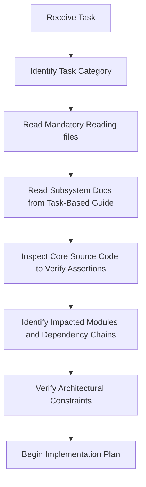
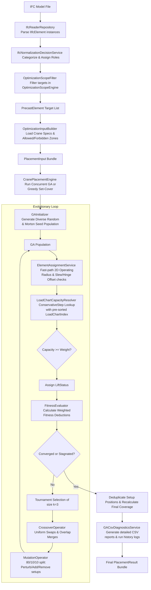
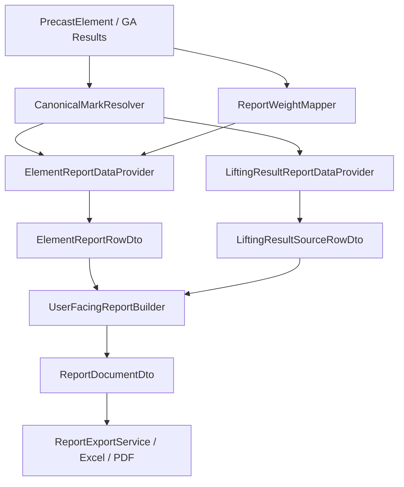

# Mobile Crane Path Optimizer — Developer & AI Agent Onboarding Guide

Welcome to the **Mobile Crane Path Optimizer** codebase. This document serves as the entry-point index and navigation guide for all AI agents and developers. 

Use this guide to determine which documentation files you must read, which architectural constraints apply to your task, and what procedures must be followed before making any modifications to the system.

---

## 1. Project Overview

*   **Project Name:** Mobile Crane Path Optimizer (CraneOptimizer)
*   **Project Goal:** Optimize the 3D placement, configuration, and structural lifting schedules of mobile cranes on construction sites to maximize element coverage while adhering to safety limits and load capacities.
*   **Main Technologies:** .NET 8, WPF (Windows Presentation Foundation), Helix Toolkit (3D Viewport Rendering), SQLite (EF Core), xBIM (IFC parsing and context processing).
*   **Architectural Style:** Clean Architecture (Domain-driven core) combined with the MVVM (Model-View-ViewModel) presentation pattern.

> [!NOTE]
> For a detailed breakdown of the business vision, target outcomes, and optimization constraints, refer to [vision.md](file:///F:/06-ITI/00-Project/Main%20Project/CraneOptimizer/docs/project/vision.md).

---

## 2. Mandatory Reading for All Tasks

Before performing **any** task, reading the following core documents is mandatory to establish proper context and align with the current implementation state:

1.  **System and Context Safeguards:** Read [agent-context.md](file:///F:/06-ITI/00-Project/Main%20Project/CraneOptimizer/docs/agent/agent-context.md) to understand critical naming invariants, engineering limits, and coordinate safeguards.
2.  **Limitations & Assumptions:** Read [limitations.md](file:///F:/06-ITI/00-Project/Main%20Project/CraneOptimizer/docs/project/limitations.md) to understand reach calculations, rigging, and coordinate limitations.
3.  **GA & Optimization Reference:** Read [ga-settings-guide.md](file:///F:/06-ITI/00-Project/Main%20Project/CraneOptimizer/docs/ga/ga-settings-guide.md) for a complete analysis of GASettings and hardcoded constants.

---

## 3. Task-Based Reading Guide

Use this index to route your research based on the specific subsystem or domain you are working on:

### If Working On the Genetic Algorithm
*   For chromosome encoding, selection, crossover operators, and fitness formulas, read [ga-engine-design.md](file:///F:/06-ITI/00-Project/Main%20Project/CraneOptimizer/docs/ga/ga-engine-design.md).
*   For fitness weights definitions and sensitivity impacts, read [fitness-weights.md](file:///F:/06-ITI/00-Project/Main%20Project/CraneOptimizer/docs/ga/fitness-weights.md).
*   For GA settings properties and cloning details, read [ga-settings.md](file:///F:/06-ITI/00-Project/Main%20Project/CraneOptimizer/docs/architecture/ga-settings.md).
*   For a comprehensive guide to GA parameters and calibration, read [ga-settings-guide.md](file:///F:/06-ITI/00-Project/Main%20Project/CraneOptimizer/docs/ga/ga-settings-guide.md).
*   For the adaptive relocation weight formula and fitness calculations, read [fitness-function.md](file:///F:/06-ITI/00-Project/Main%20Project/CraneOptimizer/docs/architecture/fitness-function.md).
*   For GA selection alternatives and operators design rationale, read [ga-design-decisions.md](file:///F:/06-ITI/00-Project/Main%20Project/CraneOptimizer/docs/architecture/ga-design-decisions.md).
*   For boom configurations, lifting calibrations, and `ConservativeStep` load chart lookups, read [crane-engine.md](file:///F:/06-ITI/00-Project/Main%20Project/CraneOptimizer/docs/domain/crane-engine.md) and [lifting-calibration.md](file:///F:/06-ITI/00-Project/Main%20Project/CraneOptimizer/docs/domain/lifting-calibration.md).
*   For performance optimizations and profiling parameters, read [refactoring-opportunities.md](file:///F:/06-ITI/00-Project/Main%20Project/CraneOptimizer/docs/project/refactoring-opportunities.md).

### If Working On IFC Processing
*   For parsing normalization pipelines, categories, and role classifications, read [ifc.md](file:///F:/06-ITI/00-Project/Main%20Project/CraneOptimizer/docs/domain/ifc.md).
*   For length scaling, mass extraction, fallback density estimations, and display unit preferences, read [units.md](file:///F:/06-ITI/00-Project/Main%20Project/CraneOptimizer/docs/domain/units.md).
*   For EF Core entity mapping and DB schema layouts, read [database.md](file:///F:/06-ITI/00-Project/Main%20Project/CraneOptimizer/docs/architecture/database.md).
*   For GIS & survey coordinate integrations (persistence and IFC georeferencing extraction), read [gis-survey-coordinate-integration.md](file:///F:/06-ITI/00-Project/Main%20Project/CraneOptimizer/docs/project/gis-survey-coordinate-integration.md).

### If Working On Database & Persistence Features
*   For context configurations (`CraneDbContext` & `CreatedProjectDbContext`), read [database.md](file:///F:/06-ITI/00-Project/Main%20Project/CraneOptimizer/docs/architecture/database.md).
*   For database schema migrations and EF Core commands, read [database-migrations.md](file:///F:/06-ITI/00-Project/Main%20Project/CraneOptimizer/docs/architecture/database-migrations.md).
*   For entity mappings and project file serialization guidelines, read [dto-rules.md](file:///F:/06-ITI/00-Project/Main%20Project/CraneOptimizer/docs/coding-standards/dto-rules.md).

### If Working On Coding Standards
*   For Clean Code principles, naming standards, and formatting, read [clean-code.md](file:///F:/06-ITI/00-Project/Main%20Project/CraneOptimizer/docs/coding-standards/clean-code.md).
*   For WPF command binding and MVVM standards, read [mvvm.md](file:///F:/06-ITI/00-Project/Main%20Project/CraneOptimizer/docs/coding-standards/mvvm.md).
*   For dependency injection lifetime mappings, read [dependency-injection.md](file:///F:/06-ITI/00-Project/Main%20Project/CraneOptimizer/docs/coding-standards/dependency-injection.md).
*   For naming conventions rules, read [naming-conventions.md](file:///F:/06-ITI/00-Project/Main%20Project/CraneOptimizer/docs/coding-standards/naming-conventions.md).
*   For DTO decoupling guidelines, read [dto-rules.md](file:///F:/06-ITI/00-Project/Main%20Project/CraneOptimizer/docs/coding-standards/dto-rules.md).

### If Working On System Architecture
*   For overall layer structures and compile dependencies, read [system-overview.md](file:///F:/06-ITI/00-Project/Main%20Project/CraneOptimizer/docs/architecture/system-overview.md).
*   For the orchestration of spatial engines and calculations, read [engines.md](file:///F:/06-ITI/00-Project/Main%20Project/CraneOptimizer/docs/architecture/engines.md).
*   For the dynamic position discovery and GA stage orchestration, read [optimization-engine.md](file:///F:/06-ITI/00-Project/Main%20Project/CraneOptimizer/docs/architecture/optimization-engine.md).
*   For the Hungarian global assignment solver and min-cost flow architecture, read [assignment-engine.md](file:///F:/06-ITI/00-Project/Main%20Project/CraneOptimizer/docs/architecture/assignment-engine.md).
*   For crane travel pathfinding, Dubins curves, and A* grid mapping, read [pathfinding-relocation.md](file:///F:/06-ITI/00-Project/Main%20Project/CraneOptimizer/docs/domain/pathfinding-relocation.md).
*   For identified architectural vulnerabilities and refactoring opportunities, read [refactoring-opportunities.md](file:///F:/06-ITI/00-Project/Main%20Project/CraneOptimizer/docs/project/refactoring-opportunities.md).

### If Working On Refactoring & Technical Debt Cleanup
*   For the priority index of identified architectural flaws and rendering bottlenecks, read [refactoring-opportunities.md](file:///F:/06-ITI/00-Project/Main%20Project/CraneOptimizer/docs/project/refactoring-opportunities.md).
*   For current tasks and build/test status, inspect the current source tree, `git status`, and available audit reports; `docs/project/current-state.md` is not present in the current repository.
*   Always read the relevant domain documentation ([ga-engine-design.md](file:///F:/06-ITI/00-Project/Main%20Project/CraneOptimizer/docs/ga/ga-engine-design.md), [ifc.md](file:///F:/06-ITI/00-Project/Main%20Project/CraneOptimizer/docs/domain/ifc.md), etc.) to understand standard mathematical logic before refactoring.

---

## 4. Architectural Rules

You must respect the following core design constraints at all times. Do not deviate from these rules unless explicitly directed by the user:

*   **Clean Architecture:** Core layers (`Domain`, `Application`) must remain completely decoupled from Outer layers (`Infrastructure`, `UI`). The Domain layer must have zero dependencies. Refer to [system-overview.md](file:///F:/06-ITI/00-Project/Main%20Project/CraneOptimizer/docs/architecture/system-overview.md) for details.
*   **MVVM Pattern:** The UI views are layout definitions only. No business logic or visual state mutations should be hardcoded in the code-behind (`.xaml.cs`). Use databinding and standard WPF commands. Refer to [mvvm.md](file:///F:/06-ITI/00-Project/Main%20Project/CraneOptimizer/docs/coding-standards/mvvm.md) for details.
*   **Dependency Injection:** Services and repositories must be registered with the central ServiceProvider inside `App.xaml.cs`. Do not use manual service location or transitional global holders. Refer to [dependency-injection.md](file:///F:/06-ITI/00-Project/Main%20Project/CraneOptimizer/docs/coding-standards/dependency-injection.md) for details.
*   **DTO Decoupling:** Model parameters, serialized databases, and transient settings must be kept separate from the internal representation of domain entities. Refer to [dto-rules.md](file:///F:/06-ITI/00-Project/Main%20Project/CraneOptimizer/docs/coding-standards/dto-rules.md) for details.

---

## 5. Documentation Policy

Our documentation has a strict "evidence-based alignment" policy. As an agent or developer, you must respect the following guidelines:

*   **Documentation Follows Code:** The source code is the single source of truth. The documentation is a mirror of the actual implementation.
*   **No Invented Features:** Do not document planned features, algorithms, schemas, or visual behaviors as implemented until they are fully written in C# and XAML.
*   **Roadmap Features:** All planned features or future architecture models must be explicitly marked as such (e.g. `[Planned Feature]`) to prevent developer confusion.

---

## 6. Startup Procedure

Whenever you receive a task, follow this systematic startup procedure **before** writing any code:

1.  **Identify Category:** Classify the task (UI, Genetic Algorithm, IFC, DB, Architecture, or Refactoring).
2.  **Read Documentation:** Open and read all listed files from Section 2 & Section 3.
3.  **Inspect Source Code:** Find the C# classes that implement this feature and inspect them to confirm they match the documentation.
4.  **Identify Impact:** Map out the dependent classes that will be impacted by your changes.
5.  **Verify Constraints:** Ensure your plan complies with Clean Architecture, MVVM, and DI lifetimes.
6.  **Formulate Plan:** Begin implementing the task following the system workflow.

---

## 7. Onboarding Agent Checklist

Before proposing or editing any codebase files, copy and verify this checklist:

*   [ ] Checked ** agent-context.md ** for safeguards, coordinate ranges, and naming rules.
*   [ ] Read the task-relevant documentation files completely (no skimming).
*   [ ] Inspected the actual C# source code to verify existing behavior.
*   [ ] Checked that no hypothetical or planned features are treated as existing.
*   [ ] Verified that the planned changes do not violate Clean Architecture layer isolation.
*   [ ] Verified that the planned changes do not violate MVVM databinding rules.

---

## 8. End-to-End Optimization Pipeline Flow

The flowchart below illustrates the execution path and data flow from the initial IFC model parsing to the final genetic optimization outputs:

---

## 9. Phase 4 Readiness Diagnostics Navigation

This section details the organization of the Phase 4 diagnostics and model import readiness system to help future agents navigate the codebase:

### Architectural Components
1. **Domain Models**:
   - Validation message data contract: [ValidationMessage.cs](file:///f:/06-ITI/00-Project/Main%20Project/CraneOptimizer/CraneOptimizer.Domain/Diagnostics/ValidationMessage.cs)
   - Aggregated diagnostics summary: [ImportReadinessSummary.cs](file:///f:/06-ITI/00-Project/Main%20Project/CraneOptimizer/CraneOptimizer.Domain/Diagnostics/ImportReadinessSummary.cs)
2. **Central Readiness Service**:
   - Interface: [IImportReadinessService.cs](file:///f:/06-ITI/00-Project/Main%20Project/CraneOptimizer/CraneOptimizer.Application/Services/IImportReadinessService.cs)
   - Implementation: [ImportReadinessService.cs](file:///f:/06-ITI/00-Project/Main%20Project/CraneOptimizer/CraneOptimizer.Application/Services/ImportReadinessService.cs)
3. **UI Elements**:
   - GA Optimizer View: [CraneOptimizerDialog.xaml](file:///f:/06-ITI/00-Project/Main%20Project/CraneOptimizer/CraneOptimizer.UI/Features/F8_GAOptimizer/Views/CraneOptimizerDialog.xaml)
   - Code-behind bindings/refreshes: [CraneOptimizerDialog.xaml.cs](file:///f:/06-ITI/00-Project/Main%20Project/CraneOptimizer/CraneOptimizer.UI/Features/F8_GAOptimizer/Views/CraneOptimizerDialog.xaml.cs)
   - ViewModel bindings: [CraneOptimizerDialogViewModel.cs](file:///f:/06-ITI/00-Project/Main%20Project/CraneOptimizer/CraneOptimizer.UI/Features/F8_GAOptimizer/ViewModels/CraneOptimizerDialogViewModel.cs)

### Critical Scope Rules & Files
* **GA Scoped Element List**: Do not fetch all elements independently. The readiness service evaluates the exact list of scoped elements retrieved via `GetScopedElements()` in the dialog, matching the actual inputs processed in the GA run.
* **Diagnostics Toggle**: Controlled by the `Element Checker` toggle (bound to `IsElementCheckerEnabled` on `CraneOptimizerDialogViewModel`). When disabled, the service skips checks and returns `ValidationStatus.Valid` with an info code `ElementCheckerDisabled`.
* **Blocking Restrictions**: The optimization run is blocked **only** if the number of valid GA candidate elements is 0 (handled in `BtnRun_Click` in `CraneOptimizerDialog.xaml.cs`).
* **Non-Modification Rule**: Do not modify GA candidate selection, fitness computation, or placement logic when modifying diagnostics logic. Keep optimization logic separated.

### Phase Sequence Summary
* **Phase 1: IFC Stabilization & Safety Gates**: Fixed geometry memory leaks, established transitional mark prioritizing, and blocked unapproved estimated weight elements from GA.
* **Phase 2: Canonical Assembly Identity**: Introduced standard schema properties (`AssemblyMark`, `ValidationStatus`, etc.) and mapped their confidences.
* **Phase 3: Central Alias Resolver**: Factored out hardcoded property aliases into exporter profiles (`Revit`, `Tekla`, `Generic`) and resolved them via `CentralIfcPropertyAliasResolver`.
* **Phase 4: Import Readiness Diagnostics**: Created the `ImportReadinessService` and added a minimal card UI to display warnings/errors.
* **Phase 5: Canonical Display Identity**: Consistently consume and display canonical assembly identity and validation metadata across GA outputs, reports, and UI-facing data paths.

---

## 10. Phase 5 & Reports Structured Closure Navigation

This section details the navigation and data paths for the canonical display identity, validation, and reports systems:

### A. F5 Element Management Data Display
*   **ViewModel:** [ElementManagementViewModel.cs](file:///f:/06-ITI/00-Project/Main%20Project/CraneOptimizer/CraneOptimizer.UI/Features/F5_ElementManagement/ViewModels/ElementManagementViewModel.cs)
*   **XAML View:** [ElementManagementPanel.xaml](file:///f:/06-ITI/00-Project/Main%20Project/CraneOptimizer/CraneOptimizer.UI/Features/F5_ElementManagement/Views/ElementManagementPanel.xaml)
*   **Behavior:** F5 displays canonical identity and validation properties in a dynamic property sheet under the categories `"Canonical Identity"` and `"Validation"`. It resolves these properties via [CanonicalMarkResolver.cs](file:///f:/06-ITI/00-Project/Main%20Project/CraneOptimizer/CraneOptimizer.Application/Services/Identity/CanonicalMarkResolver.cs) when an element is selected.

### B. F8 GA Readiness & Results Display
*   **Pre-run Readiness View:** [CraneOptimizerDialog.xaml](file:///f:/06-ITI/00-Project/Main%20Project/CraneOptimizer/CraneOptimizer.UI/Features/F8_GAOptimizer/Views/CraneOptimizerDialog.xaml) displays overall status, candidate counts, and warning codes (missing marks, low confidence mapping, blocked weights) driven by `ImportReadinessSummary` from [ImportReadinessService.cs](file:///f:/06-ITI/00-Project/Main%20Project/CraneOptimizer/CraneOptimizer.Application/Services/ImportReadinessService.cs).
*   **Post-run Results View:** [GAResultsWindow.xaml](file:///f:/06-ITI/00-Project/Main%20Project/CraneOptimizer/CraneOptimizer.UI/Features/F8_GAOptimizer/Views/GAResultsWindow.xaml) displays the optimized setups. The assigned elements grid binds to [ElementLiftResultRowDto](file:///f:/06-ITI/00-Project/Main%20Project/CraneOptimizer/CraneOptimizer.UI/Features/F8_GAOptimizer/ViewModels/GAResultsWindowViewModel.cs#L84), which displays:
    *   **Mark:** Canonical display mark resolved by the resolver.
    *   **Confidence, Validation, and Weight Trust:** Displayed in dedicated columns and rich tooltips on hover.

### C. Reports Data Flow & Navigation Map
The Reports module consumes resolved display and weight data across standard boundary DTOs:

*   **Identity Single Source of Truth:** [CanonicalMarkResolver.cs](file:///f:/06-ITI/00-Project/Main%20Project/CraneOptimizer/CraneOptimizer.Application/Services/Identity/CanonicalMarkResolver.cs) resolves display mark strings using the priority chain: Explicit `AssemblyMark` > Any `AssemblyMark` > `ResolvedDisplayMark` > `ElementMark` > `ElementName` > `ParentAssemblyName` > `ElementID` (excluding placeholders).
*   **Weight Single Source of Truth:** [ReportWeightMapper.cs](file:///f:/06-ITI/00-Project/Main%20Project/CraneOptimizer/CraneOptimizer.Application/Reports/Services/ReportWeightMapper.cs) formats weights and handles estimated weight warnings.
*   **Report Builders:** [UserFacingReportBuilder.cs](file:///f:/06-ITI/00-Project/Main%20Project/CraneOptimizer/CraneOptimizer.Application/Reports/Services/UserFacingReportBuilder.cs) constructs the output documents by consuming DTO collections, maintaining clean separation from raw DB entities.
*   **Built-in Templates:** [ReportTemplateCatalog.cs](file:///f:/06-ITI/00-Project/Main%20Project/CraneOptimizer/CraneOptimizer.Application/Reports/Services/ReportTemplateCatalog.cs) defines the columns and metadata mapping schemas.

### D. CSV Diagnostics & Backward Compatibility
*   **Service:** [GACsvDiagnosticsService.cs](file:///f:/06-ITI/00-Project/Main%20Project/CraneOptimizer/CraneOptimizer.Application/Optimization/GeneticAlgorithms/Services/GACsvDiagnosticsService.cs)
*   **Compatibility:** Flat canonical fields (`CanonicalMark`, `MarkSource`, `MarkConfidence`, `IsExplicitMark`) are appended to the right of `ga_audit_detailed_*.csv` sheets. [GADiagnosticsReaderService.cs](file:///f:/06-ITI/00-Project/Main%20Project/CraneOptimizer/CraneOptimizer.Application/Optimization/GeneticAlgorithms/Services/GADiagnosticsReaderService.cs) reads these fields safely, ensuring full backward compatibility with older session logs.

### E. DTO Boundaries
*   **Domain:** [PrecastElement.cs](file:///f:/06-ITI/00-Project/Main%20Project/CraneOptimizer/CraneOptimizer.Domain/Schemas/PrecastElement.cs)
*   **Application Services:** [ElementDisplayIdentityDto.cs](file:///f:/06-ITI/00-Project/Main%20Project/CraneOptimizer/CraneOptimizer.Application/Services/Identity/ElementDisplayIdentityDto.cs)
*   **Report Layer:** [ElementReportRowDto.cs](file:///f:/06-ITI/00-Project/Main%20Project/CraneOptimizer/CraneOptimizer.Application/Reports/DTOs/ElementReportRowDto.cs) and [LiftingResultSourceRowDto.cs](file:///f:/06-ITI/00-Project/Main%20Project/CraneOptimizer/CraneOptimizer.Application/Reports/DTOs/LiftingResultSourceRowDto.cs)
*   **GA Outputs:** [ElementLiftResult.cs](file:///f:/06-ITI/00-Project/Main%20Project/CraneOptimizer/CraneOptimizer.Application/Optimization/GeneticAlgorithms/DTOs/PlacementResult.cs) (backend) and [ElementLiftResult.cs (UI)](file:///f:/06-ITI/00-Project/Main%20Project/CraneOptimizer/CraneOptimizer.UI/Features/F8_GAOptimizer/DTOs/CranePlacementResult.cs) (frontend).

---

## 11. Onboarding Checklist for Future Tasks
When starting a new Phase or feature, ensure you verify that:
1. All display formatting queries prefer the `CanonicalMarkResolver` and `ReportWeightMapper` single sources of truth.
2. DTO boundaries are preserved (never pass domain `PrecastElement` directly across layer interfaces).
3. GA candidate safety gates are untouched (e.g. blocking unapproved estimated weights).
