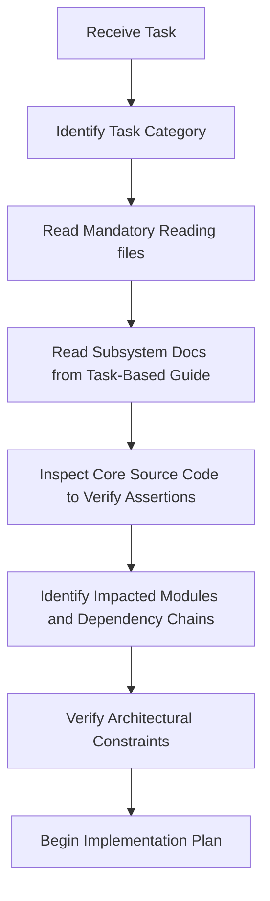

# Mobile Crane Path Optimizer — Developer & AI Agent Onboarding Guide

Welcome to the **Mobile Crane Path Optimizer** codebase. This document serves as the entry-point index and navigation guide for all AI agents and developers. 

Use this guide to determine which documentation files you must read, which architectural constraints apply to your task, and what procedures must be followed before making any modifications to the system.

---

## 1. Project Overview

*   **Project Name:** Mobile Crane Path Optimizer (CraneOptimizer)
*   **Project Goal:** Optimize the 3D placement, configuration, and structural lifting schedules of mobile cranes on construction sites to maximize element coverage while adhering to safety limits and load capacities.
*   **Main Technologies:** .NET 8, WPF (Windows Presentation Foundation), Helix Toolkit (3D Viewport Rendering), SQLite (EF Core), xBIM (IFC parsing and context processing).
*   **Architectural Style:** Clean Architecture (Domain-driven core) combined with the MVVM (Model-View-ViewModel) presentation pattern.

> [!NOTE]
> For a detailed breakdown of the business vision, target outcomes, and optimization constraints, refer to [vision.md](file:///f:/06-ITI/00-Project/Main%20Project/CraneOptimizer/docs/project/vision.md).

---

## 2. Mandatory Reading for All Tasks

Before performing **any** task, reading the following core documents is mandatory to establish proper context and align with the current implementation state:

1.  **System and Context Safeguards:** Read [agent-context.md](file:///f:/06-ITI/00-Project/Main%20Project/CraneOptimizer/docs/agent/agent-context.md) to understand critical naming invariants, engineering limits, and coordinate safeguards.
2.  **Current Project State:** Read [current-state.md](file:///f:/06-ITI/00-Project/Main%20Project/CraneOptimizer/docs/project/current-state.md) to obtain the list of active tasks, completed modules, and immediate environment details.

---

## 3. Task-Based Reading Guide

Use this index to route your research based on the specific subsystem or domain you are working on:

### If Working On UI / Views / Layouts
*   For typography rules, button styling, and layout tokens, read [design-system.md](file:///f:/06-ITI/00-Project/Main%20Project/CraneOptimizer/docs/ui/design-system.md).
*   For the brand terracotta/sienna color matrix and hex codes, read [colors.md](file:///f:/06-ITI/00-Project/Main%20Project/CraneOptimizer/docs/ui/colors.md).
*   For resource dictionary structures and Merged Dictionaries, read [resource-dictionaries.md](file:///f:/06-ITI/00-Project/Main%20Project/CraneOptimizer/docs/ui/resource-dictionaries.md).
*   For WPF command binding and MVVM standards, read [mvvm.md](file:///f:/06-ITI/00-Project/Main%20Project/CraneOptimizer/docs/coding-standards/mvvm.md).

### If Working On the Genetic Algorithm
*   For chromosome encoding, selection, crossover operators, and fitness formulas, read [ga-engine.md](file:///f:/06-ITI/00-Project/Main%20Project/CraneOptimizer/docs/domain/ga-engine.md).
*   For boom configurations and `ConservativeStep` load chart lookups, read [crane-engine.md](file:///f:/06-ITI/00-Project/Main%20Project/CraneOptimizer/docs/domain/crane-engine.md).
*   For performance optimizations in fitness calculations, read [refactoring-opportunities.md](file:///f:/06-ITI/00-Project/Main%20Project/CraneOptimizer/docs/project/refactoring-opportunities.md).

### If Working On IFC Processing
*   For parsing normalization pipelines, categories, and role classifications, read [ifc.md](file:///f:/06-ITI/00-Project/Main%20Project/CraneOptimizer/docs/domain/ifc.md).
*   For EF Core entity mapping and DB schema layouts, read [database.md](file:///f:/06-ITI/00-Project/Main%20Project/CraneOptimizer/docs/architecture/database.md).

### If Working On Database & Persistence Features
*   For context configurations (`CraneDbContext` & `CreatedProjectDbContext`), read [database.md](file:///f:/06-ITI/00-Project/Main%20Project/CraneOptimizer/docs/architecture/database.md).
*   For entity mappings and project file serialization guidelines, read [dto-rules.md](file:///f:/06-ITI/00-Project/Main%20Project/CraneOptimizer/docs/coding-standards/dto-rules.md).

### If Working On System Architecture
*   For overall layer structures and compile dependencies, read [system-overview.md](file:///f:/06-ITI/00-Project/Main%20Project/CraneOptimizer/docs/architecture/system-overview.md).
*   For the orchestration of spatial engines and calculations, read [engines.md](file:///f:/06-ITI/00-Project/Main%20Project/CraneOptimizer/docs/architecture/engines.md).
*   For Clean Code principles, naming standards, and formatting, read [clean-code.md](file:///f:/06-ITI/00-Project/Main%20Project/CraneOptimizer/docs/coding-standards/clean-code.md).
*   For identified architectural vulnerabilities and refactoring opportunities, read [refactoring-opportunities.md](file:///f:/06-ITI/00-Project/Main%20Project/CraneOptimizer/docs/project/refactoring-opportunities.md).

### If Working On Refactoring & Technical Debt Cleanup
*   For the priority index of identified architectural flaws and rendering bottlenecks, read [refactoring-opportunities.md](file:///f:/06-ITI/00-Project/Main%20Project/CraneOptimizer/docs/project/refactoring-opportunities.md).
*   For current tasks and build/test status, read [current-state.md](file:///f:/06-ITI/00-Project/Main%20Project/CraneOptimizer/docs/project/current-state.md).
*   Always read the relevant domain documentation ([ga-engine.md](file:///f:/06-ITI/00-Project/Main%20Project/CraneOptimizer/docs/domain/ga-engine.md), [ifc.md](file:///f:/06-ITI/00-Project/Main%20Project/CraneOptimizer/docs/domain/ifc.md), etc.) to understand standard mathematical logic before refactoring.

---

## 4. Architectural Rules

You must respect the following core design constraints at all times. Do not deviate from these rules unless explicitly directed by the user:

*   **Clean Architecture:** Core layers (`Domain`, `Application`) must remain completely decoupled from Outer layers (`Infrastructure`, `UI`). The Domain layer must have zero dependencies. Refer to [system-overview.md](file:///f:/06-ITI/00-Project/Main%20Project/CraneOptimizer/docs/architecture/system-overview.md) for details.
*   **MVVM Pattern:** The UI views are layout definitions only. No business logic or visual state mutations should be hardcoded in the code-behind (`.xaml.cs`). Use databinding and standard WPF commands. Refer to [mvvm.md](file:///f:/06-ITI/00-Project/Main%20Project/CraneOptimizer/docs/coding-standards/mvvm.md) for details.
*   **Dependency Injection:** Services and repositories must be registered with the central ServiceProvider inside `App.xaml.cs`. Do not use manual service location or transitional global holders. Refer to [dependency-injection.md](file:///f:/06-ITI/00-Project/Main%20Project/CraneOptimizer/docs/coding-standards/dependency-injection.md) for details.
*   **DTO Decoupling:** Model parameters, serialized databases, and transient settings must be kept separate from the internal representation of domain entities. Refer to [dto-rules.md](file:///f:/06-ITI/00-Project/Main%20Project/CraneOptimizer/docs/coding-standards/dto-rules.md) for details.

---

## 5. Documentation Policy

Our documentation has a strict "evidence-based alignment" policy. As an agent or developer, you must respect the following guidelines:

*   **Documentation Follows Code:** The source code is the single source of truth. The documentation is a mirror of the actual implementation.
*   **No Invented Features:** Do not document planned features, algorithms, schemas, or visual behaviors as implemented until they are fully written in C# and XAML.
*   **Roadmap Features:** All planned features or future architecture models must be explicitly marked as such (e.g. `[Planned Feature]`) to prevent developer confusion.

---

## 6. Startup Procedure

Whenever you receive a task, follow this systematic startup procedure **before** writing any code:

1.  **Identify Category:** Classify the task (UI, Genetic Algorithm, IFC, DB, Architecture, or Refactoring).
2.  **Read Documentation:** Open and read all listed files from Section 2 & Section 3.
3.  **Inspect Source Code:** Find the C# classes that implement this feature and inspect them to confirm they match the documentation.
4.  **Identify Impact:** Map out the dependent classes that will be impacted by your changes.
5.  **Verify Constraints:** Ensure your plan complies with Clean Architecture, MVVM, and DI lifetimes.
6.  **Formulate Plan:** Begin implementing the task following the system workflow.

---

## 7. Onboarding Agent Checklist

Before proposing or editing any codebase files, copy and verify this checklist:

*   [ ] Checked ** agent-context.md ** for safeguards, coordinate ranges, and naming rules.
*   [ ] Read the task-relevant documentation files completely (no skimming).
*   [ ] Inspected the actual C# source code to verify existing behavior.
*   [ ] Checked that no hypothetical or planned features are treated as existing.
*   [ ] Verified that the planned changes do not violate Clean Architecture layer isolation.
*   [ ] Verified that the planned changes do not violate MVVM databinding rules.
