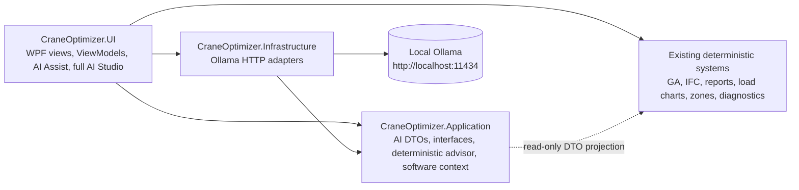
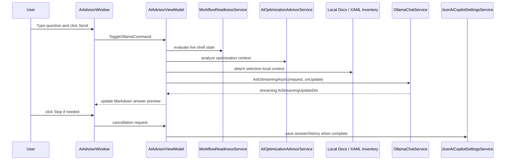
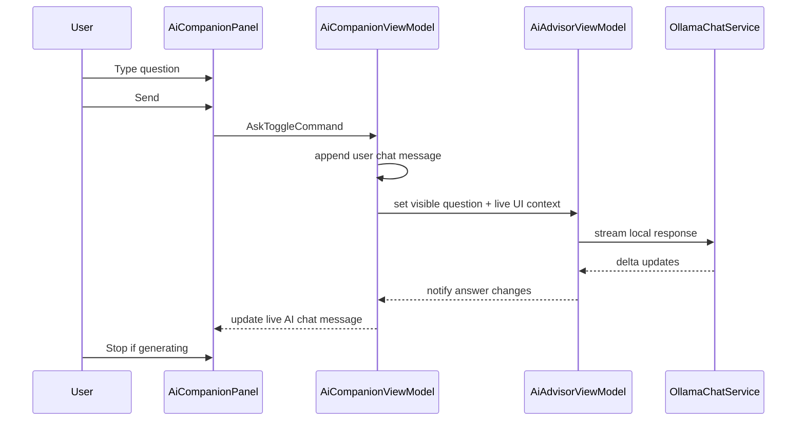

# AI Assist / AI Studio Branch Engineering Dossier

**Repository:** `ITI-intake46/CranePathOptimizer`  
**Product:** IFC Building Analyzer — Crane Planner Edition  
**Branch lineage:** AI platform enhancement branch
**Canonical AI documentation status:** Current, final-state engineering dossier for AI Assist and AI Studio
**Prepared for:** senior maintainers, reviewers, research collaborators, safety reviewers, future contributors  
**Prepared on:** 2026-06-27  
**Primary implementation area:** `CraneOptimizer.AI` plus thin host adapters in `CraneOptimizer.UI/AIIntegration`  
**Latest branch snapshot represented by this document:** sleek AI Assist vertical rail + removal of the top-level AI Copilot tab + Studio action integration

---

## Documentation Authority Notice

This document is the **canonical branch-level engineering dossier** for the AI Assist / AI Studio work. It supersedes the earlier incremental AI notes that were created during iterative development, including but not limited to Markdown preview fixes, docked companion notes, UX consolidation notes, future-work completion notes, full-window polish notes, and side-panel polish notes.

Those earlier files may remain useful as historical implementation notes, but future contributors should treat this dossier as the authoritative description of the **current branch state**. When a statement in an older incremental AI document conflicts with this dossier, this dossier should be considered the source of truth.

Recommended repository placement:

```text
CranePathOptimizer-div/
└── docs/
    └── ai/
        └── AI_COPILOT_BRANCH_ENGINEERING_DOSSIER.md
```

If maintaining a documentation index, link this file as the canonical branch implementation report and classify earlier AI markdown files as historical development notes.

---

## Table of Contents

1. [Executive Summary](#1-executive-summary)
2. [Documentation Methodology and Quality Bar](#2-documentation-methodology-and-quality-bar)
3. [Branch Goals, Non-Goals, and Design Philosophy](#3-branch-goals-non-goals-and-design-philosophy)
4. [System Context Before the Branch](#4-system-context-before-the-branch)
5. [Final User-Facing Behavior](#5-final-user-facing-behavior)
6. [Architecture Overview](#6-architecture-overview)
7. [Major Engineering Decisions](#7-major-engineering-decisions)
8. [Feature-Level Implementation Record](#8-feature-level-implementation-record)
9. [Subsystem Impact Assessment](#9-subsystem-impact-assessment)
10. [File-by-File Implementation Map](#10-file-by-file-implementation-map)
11. [Runtime Data and Control Flow](#11-runtime-data-and-control-flow)
12. [Configuration, Persistence, and Local State](#12-configuration-persistence-and-local-state)
13. [Validation, Testing, and Regression Controls](#13-validation-testing-and-regression-controls)
14. [Reproducibility and Reviewer Instructions](#14-reproducibility-and-reviewer-instructions)
15. [Security, Privacy, Safety, and Engineering Controls](#15-security-privacy-safety-and-engineering-controls)
16. [Backward Compatibility and Migration Notes](#16-backward-compatibility-and-migration-notes)
17. [Known Limitations and Operational Risks](#17-known-limitations-and-operational-risks)
18. [Maintenance Guidance](#18-maintenance-guidance)
19. [Reviewer Checklist](#19-reviewer-checklist)
20. [Appendices](#20-appendices)
21. [External References Consulted](#21-external-references-consulted)

---

## 1. Executive Summary

This branch adds a **local-first AI Optimization Studio** to CranePathOptimizer. The feature gives users a professional AI-assisted workflow layer for understanding crane-optimization readiness, interpreting deterministic optimization results, asking local Ollama models about the current workflow, and producing auditable AI explanation text for review or report appendices.

The branch introduces two complementary AI surfaces:

1. **Full AI Optimization Studio window** — a larger, professional command-center window for model selection, deterministic analysis, local Ollama chat, Markdown answer review, recent answers, report appendix generation, context inspection, prompt-template inspection, local documentation snippets, XAML inventory, and benchmarking.
2. **Right-docked AI Assist panel** — a compact in-workspace companion with workflow readiness, next action, live chat, stateful Send/Stop behavior, resizable prompt composer, safe navigation proposals, evidence, context copy, answer copy, and Studio action access.

The branch is intentionally **advisory-only**. It does not replace the Genetic Algorithm, load-chart capacity resolver, PDF load-chart parser, report generation pipeline, IFC loader, zone geometry, crane setup logic, or diagnostics. Instead, it reads the deterministic state produced by those systems, explains it, and proposes safe next steps that require user confirmation.

### 1.1 High-Level Outcome

| Area | Final branch outcome |
|---|---|
| AI behavior | Local-first Ollama integration plus deterministic advisor fallback. |
| Safety model | Advisory only; no automatic crane-planning changes or lift-plan certification. |
| UX model | Right-docked AI Assist is the cross-workflow entry point; its Studio section opens the full AI Optimization Studio for deep work. |
| Streaming | Ollama streaming updates feed live Markdown/chat previews with cancellation. |
| Composer design | Modern single action button: **Send** when idle, **Stop** while generating. |
| Transparency | Context cards, evidence, raw Markdown, context JSON, local docs, XAML inventory, and model benchmarks remain inspectable. |
| Reproducibility | AI settings/history are local JSON state; no cloud API or server-side hidden state. |
| Dependencies | No new AI NuGet packages; local Ollama is optional external runtime tooling. |
| Existing crane engine | Not modified. GA, IFC, load chart, PDF/report, diagnostics, installers, and Streamlit-related components remain unaffected unless explicitly noted as read-only context. |

### 1.2 What Changed in One Sentence

The branch adds a layered, auditable, local AI assistance subsystem that helps users understand and navigate crane-planning workflows without changing the deterministic engineering engines that produce or validate results.

---

## 2. Documentation Methodology and Quality Bar

This dossier was structured after reviewing professional documentation patterns used in mature engineering repositories and research-grade software projects:

- **Architecture Decision Records**: used for decision context, rationale, consequences, and tradeoffs.
- **Human-readable changelog discipline**: used to separate notable user-facing changes from raw commit logs.
- **Research software reproducibility practice**: used to emphasize environment, validation commands, repeatability, and audit trails.
- **Open-source security/repository-health practice**: used to include dependency, test, security, and maintenance implications.
- **Software citation/research infrastructure guidance**: used to include version specificity, provenance, reproducibility, and future contributor traceability.

The resulting structure intentionally combines executive summary, goals and non-goals, architecture records, file-by-file implementation mapping, subsystem impact matrices, runtime/data-flow diagrams, validation protocol, risk register, maintenance guidance, reviewer checklist, appendices, and references.

The objective is not only to say **what** changed, but to capture **why** it changed, **where** it changed, **how** it was implemented, **what it affects**, and **what future contributors must preserve**.

---

## 3. Branch Goals, Non-Goals, and Design Philosophy

### 3.1 Goals

| Goal | Implementation response |
|---|---|
| Add AI/AI-agent capability | Added deterministic advisor, local Ollama chat, streaming, model management, prompt templates, workflow readiness, context cards, local docs search, XAML inventory, and report appendix export. |
| Keep AI local-first | Implemented Ollama HTTP adapters targeting `http://localhost:11434`; no cloud AI API was introduced. |
| Preserve deterministic engineering authority | AI reads and explains optimizer/report/IFC state; it does not modify GA mathematics, load-chart capacity, crane setup, or report validation. |
| Improve user workflow guidance | Added readiness scoring, next action, safe navigation proposals, exact tab/button references, and AI Assist. |
| Maintain auditability | Added evidence lists, context JSON, raw Markdown, context cards, local docs, prompt templates, benchmarks, and report appendix disclaimers. |
| Make the UX professional | Iteratively refined the UI into a sleek full AI Studio window and compact right-side live chat panel with resizable composers and stateful Send/Stop buttons. |
| Preserve maintainability | Consolidated AI code into the isolated `CraneOptimizer.AI` project, with UI host adapters kept under `CraneOptimizer.UI/AIIntegration`. |
| Add regression coverage | Added AI tests for deterministic advisor, software context, prompt template selection, UI contract strings, and confirmable navigation actions. |

### 3.2 Non-Goals

| Non-goal | Rationale |
|---|---|
| Replace GA optimization with LLM reasoning | LLM output is not deterministic engineering computation and must not become the lift feasibility source of truth. |
| Automatically modify crane-planning data | AI actions are advisory; navigation proposals are safe and explicit. Project state mutations remain user-driven. |
| Send project context to cloud AI services | The branch uses local Ollama only. |
| Auto-install large models silently | Model pull is explicit and user-triggered; model storage/network cost must remain visible. |
| Redesign the entire WPF shell | Shell changes are limited to removing the redundant AI ribbon tab, integrating advanced actions into AI Assist → Studio, and retaining the right dock and bottom companion strip. |
| Replace existing report/PDF/export engines | AI report appendix generation is Markdown-oriented and separate from the existing QuestPDF/report exporters. |
| Change IFC, DXF, crane, load-chart, zone, or diagnostics behavior | These systems are consumed as read-only context by the AI layer. |
| Add Streamlit UI behavior | No Streamlit UI component is present in this WPF branch. Streamlit impact is therefore not applicable. |

### 3.3 Implementation Philosophy

The branch follows four principles.

1. **Deterministic first.** The deterministic advisor operates without Ollama, network access, or probabilistic generation. Local model output is explanatory, not authoritative.
2. **Context is private and auditable.** The visible user question remains clean. Live app state, deterministic findings, workflow readiness, software map, local documentation snippets, XAML inventory, and prompt templates are composed privately and remain inspectable.
3. **AI suggests; users confirm.** The AI may propose safe navigation such as opening `IFC MODEL` or `ANALYZE`, but project-changing actions remain user-driven.
4. **Professional UI density.** The full window preserves deep audit/reporting features, while the right-docked AI Assist focuses on fast guidance, live chat, compact controls, and predictable scrolling.

---

## 4. System Context Before the Branch

The repository is a multi-project WPF/.NET solution with a layered architecture:

```text
CranePathOptimizer-div/
├── CraneOptimizer.Domain              # domain entities and schemas
├── CraneOptimizer.Application         # GA, reports, contracts, deterministic services
├── CraneOptimizer.Infrastructure      # IFC, persistence, report exporters, external adapters
├── CraneOptimizer.UI                  # WPF shell and feature views/viewmodels
├── CraneOptimizer.Application.Tests   # unit/regression tests
├── CraneOptimizer.GAExperiment        # GA experiment/benchmark tooling
├── Analytics                          # experiment datasets/scripts/charts
└── docs                               # architecture, implementation, reports, AI docs
```

Major pre-existing capabilities include IFC/BIM model import and 3D visualization, DXF import/alignment, zone drawing, crane setup, manufacturer load-chart import including PDF load chart support, GA placement optimization, diagnostics/profiling output, user-facing reports, QuestPDF/PDF export, and experiment/analytics assets.

The AI branch layers over these systems. It does not move ownership of crane calculation or reporting rules into the AI subsystem.

---

## 5. Final User-Facing Behavior

### 5.1 Full AI Optimization Studio Window

The full AI Optimization Studio is the primary deep-work AI surface. It is reachable from **AI ASSIST → STUDIO → Open Full Studio**. There is no top-level AI ribbon tab.

Final UX characteristics:

- compact top header with product identity and status chips;
- model toolbar with model dropdown, check, pull, and benchmark actions;
- left rail for deterministic advisor, quick questions, and recent answers;
- answer-first main area with Markdown preview;
- collapsed audit details for advanced review;
- bottom `ASK AI STUDIO` composer;
- stateful single action button: `Send` while idle and `Stop` while Ollama is generating;
- Enter-to-send and Shift+Enter-for-new-line behavior;
- draggable splitter above the composer to resize prompt space;
- native window maximize behavior without artificial maximum-size constraints;
- copy/export/report appendix actions preserved.

The full window intentionally keeps advanced material available but not visually dominant. Context Cards, prompt templates, raw Markdown, evidence, local docs, XAML inventory, software map, context JSON, and benchmarks are available under audit disclosure rather than occupying the default work surface.

### 5.2 Right-Docked AI Assist Panel

AI Assist is the in-workspace companion. It is docked in the right Properties/AI Assist area and is designed for narrow-width use.

Final UX characteristics:

- fixed header with close action;
- one predictable scroll body;
- workflow readiness and next action;
- visible live chat area;
- streaming AI message updates during generation;
- compact fixed composer;
- draggable composer resize grip;
- single stateful `Send`/`Stop` button;
- Enter-to-send and Shift+Enter-new-line;
- compact footer micro-actions for refresh, copy context, and copy answer;
- confirmable action proposals under an expander;
- evidence and readiness details under an expander.

The side panel preserves the full feature set while prioritizing daily usability. It is not a mini copy of the full window; it is a fast workflow companion.

### 5.3 Bottom AI Companion Strip

The bottom strip provides non-intrusive status and access to AI Assist. It avoids the earlier floating overlay problem and keeps the 3D viewport and properties panel usable.

### 5.4 AI Assist Studio Integration

The main ribbon ends at **REPORTS**. The former AI Copilot ribbon commands are consolidated into **AI ASSIST → STUDIO**:

- **Open Full Studio** opens the complete AI Optimization Studio window.
- **Analyze Current Result** runs deterministic advisor rules without requiring Ollama.
- **Ask Local Ollama** opens Chat and focuses the private prompt composer for the selected local model.

Legacy `NavigateTab` requests that target `AI COPILOT`, `AI STUDIO`, `AI ASSIST`, or the old advisor view are intercepted by the shell and redirected to the visible AI Assist Studio section without changing the active engineering ribbon tab.

---

## 6. Architecture Overview

### 6.1 Layered Architecture



### 6.2 AI Subsystem Boundaries

| Layer | Responsibility | AI branch additions |
|---|---|---|
| Domain | Core crane/project entities | No AI changes. |
| Application | Contracts, DTOs, deterministic logic | AI DTOs, interfaces, deterministic advisor, static software context. |
| Infrastructure | External integration | Ollama chat/model management adapters. |
| UI | WPF presentation and orchestration | Full AI Studio window, AI Assist, companion strip, settings, workflow readiness, prompt templates, report appendix, Markdown renderer. |
| Tests | Regression coverage | AI advisor, software context, maturity/contract tests. |

AI code owns AI settings/history JSON, prompt composition, AI UI state, advisory output, and AI appendix Markdown. AI code does **not** own IFC data, geometry, crane capacity calculations, GA solution generation, load chart parsing, report engine validation, database schema, or installer behavior.

---

## 7. Major Engineering Decisions

| Decision | Context | Rationale | Consequences | Primary files |
|---|---|---|---|---|
| Local Ollama instead of cloud AI | Users need AI help on project data. | Privacy, no API keys, offline/local workflow. | Requires user-managed local Ollama/model. | `OllamaChatService.cs`, `OllamaModelManagementService.cs`. |
| Deterministic advisor before LLM explanation | Crane planning needs traceability. | Testable, auditable, model-independent findings. | LLM is explanatory, not authoritative. | `AiOptimizationAdvisorService.cs`. |
| Advisory-only safety mode | AI suggestions can be wrong or unsafe. | Prevents hidden project mutation. | Future automation must be explicit/confirmable. | `AiActionProposalViewModel.cs`, `UiInteractionContextService.cs`. |
| Two AI surfaces | Users need quick guidance and deep audit. | Side panel for workflow; full window for analysis/export/audit. | Shared services must stay consistent. | `AiAdvisorWindow.xaml`, `AiCompanionPanel.xaml`. |
| Single stateful Send/Stop | Separate controls were cluttered. | Modern assistant interaction and less visual noise. | Requires correct command-state invalidation. | `AiAdvisorViewModel.cs`, `AiCompanionViewModel.cs`. |
| Collapsed audit details | Audit material is necessary but dense. | Preserves features without overwhelming defaults. | Debuggers must open audit details when needed. | Full window and AI Assist XAML. |

---

## 8. Feature-Level Implementation Record

### 8.1 Deterministic Optimization Advisor

**What changed:** A rule-based advisor was added to classify current optimization state and recommend next steps.

**Where:** `CraneOptimizer.CraneOptimizer.AI/Services/AiOptimizationAdvisorService.cs`.

**Why:** Users need explanations even when Ollama is unavailable. Engineering-grade recommendations must be testable and auditable.

**How:** The service consumes `AiOptimizationContextDto` and returns `AiAdvisorResponseDto`. It handles no-result state, low coverage, dominant failure modes, out-of-radius, overweight, height failure, not-charted load-chart failures, reachability/candidate-point context, safety input checks, and high-coverage healthy-run review.

**Downstream impact:** UI surfaces use advisor output for health labels, cards, answer text, prompt context, and report appendix material. GA internals remain untouched.

### 8.2 Local Ollama Chat and Streaming

**What changed:** Infrastructure adapters call local Ollama for optional natural-language answers.

**Where:** `CraneOptimizer.CraneOptimizer.AI/Providers/Ollama/OllamaChatService.cs` and `OllamaModelManagementService.cs`.

**Why:** Users already have local Ollama models and requested a local-first AI feature.

**How:** `OllamaChatService` posts to `/api/chat`, supports streaming line-by-line JSON response parsing, cancellation, timeout handling, and buffered fallback. `OllamaModelManagementService` checks version/model tags and performs explicit model pulls.

**Downstream impact:** Full AI Studio and AI Assist can show live answer previews and stop generation. No external cloud dependency is introduced.

### 8.3 Prompt Routing and Context Prioritization

**What changed:** Prompt composition was refined so normal workflow questions prioritize live project/workflow state over local documentation inventory.

**Where:** `AiAdvisorViewModel.cs`, `AiPromptTemplateService.cs`, local docs/inventory services.

**Why:** Earlier iterations caused questions like “What should I do next?” to sometimes produce documentation or XAML inventory summaries. That was inaccurate for workflow guidance.

**How:** The visible question remains clean. Private context is composed separately. Prompt templates choose specific failure modes before broad symptoms. Local docs and XAML inventory are audit sources, not default answer subjects unless relevant.

**Downstream impact:** AI answers are more practical and less likely to summarize internal implementation artifacts.

### 8.4 Workflow Readiness Engine

**What changed:** A deterministic readiness service evaluates project progress across the crane-planning workflow.

**Where:** `WorkflowReadinessService.cs`, `WorkflowReadinessItem.cs`, `WorkflowReadinessSnapshot.cs`, `StructuredRecommendationCard.cs`.

**Why:** Users need clear next-step guidance before optimization and reporting.

**How:** The service inspects live shell state for project, elements, zones, cranes, load chart evidence, optimization result, diagnostics, and report readiness. It computes complete count, total count, critical missing count, stage, evidence, recommendation, and next click.

**Downstream impact:** AI Assist uses readiness to show next action and live context; prompts use readiness as private context; copy context captures the checklist for audit.

### 8.5 Confirmable Action Proposal Framework

**What changed:** AI can propose safe navigation actions that the user confirms.

**Where:** `AiActionProposalViewModel.cs`, `UiInteractionContextService.cs`, `TopNavigation.xaml.cs`, `AiCompanionViewModel.cs`, `AiCompanionPanel.xaml`.

**Why:** The user should be able to move quickly to the recommended tab without AI mutating project data.

**How:** The ViewModel builds proposal cards with action labels, risk, description, and target. Confirming requests a navigation event through `IUiInteractionContextService`, and shell navigation handles it.

**Downstream impact:** Safe tab navigation becomes guided and auditable. No model loading, file opening, crane changing, or optimizer running happens automatically.

### 8.6 Full AI Studio Professional Window

**What changed:** The full window was transformed from a dense panel into a sleek, answer-first assistant surface.

**Where:** `AiAdvisorWindow.xaml`, `AiAdvisorWindow.xaml.cs`, `AiAdvisorViewModel.cs`.

**Why:** Earlier layouts were crowded, had ambiguous history, and did not feel like a polished professional tool.

**How:** The window now uses a compact header, left rail, model toolbar, answer surface, collapsed audit area, bottom composer, resizable prompt region, native maximize behavior, and a single stateful Send/Stop button.

**Downstream impact:** Power users retain all advanced controls; routine users get a cleaner default surface.

### 8.7 Right-Side AI Assist Professional Chat Panel

**What changed:** The right-docked panel now behaves like a usable live chat companion rather than a static readiness widget.

**Where:** `AiCompanionPanel.xaml`, `AiCompanionPanel.xaml.cs`, `AiCompanionViewModel.cs`.

**Why:** Users could not reliably navigate, scroll, or understand earlier panel behavior.

**How:** The panel now has one scroll body, live chat, streaming preview, compact composer, resize grip, stateful Send/Stop, micro footer actions, explicit next action, and expanders for advanced material.

**Downstream impact:** AI Assist is usable during modeling without opening the full AI Studio window.

### 8.8 Markdown Rendering

**What changed:** AI answers render as readable Markdown rather than raw asterisk-heavy text.

**Where:** `MarkdownPreviewControl.xaml`, `MarkdownPreviewControl.xaml.cs`, `MarkdownToFlowDocumentConverter.cs`.

**Why:** Raw Markdown was hard to read in WPF and made the feature feel unpolished.

**How:** A dependency-free converter maps a controlled Markdown subset to WPF FlowDocument constructs. The control supports scroll/copy behavior and can be used in both full and side UI contexts.

**Downstream impact:** Users get professional answer presentation; maintainers avoid a new Markdown package dependency.

### 8.9 Local Documentation and XAML Inventory

**What changed:** The AI subsystem can inspect committed docs and generate local software/XAML inventory for audit and context.

**Where:** `AiLocalDocumentSearchService.cs`, `AiSoftwareInventoryService.cs`.

**Why:** Software-aware answers should reference actual app structure and committed documentation, but this material must not dominate ordinary workflow questions.

**How:** Local files are searched and summarized; XAML metadata is made available through audit details and context composition.

**Downstream impact:** Maintainers can inspect what documentation and UI inventory informed an AI answer.

### 8.10 Report Appendix Export

**What changed:** AI answers can be exported as a Markdown report appendix with mandatory disclaimer and context snapshot.

**Where:** `AiReportAppendixService.cs` and commands in `AiAdvisorViewModel.cs`.

**Why:** AI explanations may be useful as reviewer notes, but they must not be confused with certified engineering outputs.

**How:** The service builds Markdown with question, answer, local model name, advisory disclaimer, and context JSON.

**Downstream impact:** Report-adjacent output is available without modifying the QuestPDF/PDF report engine.

### 8.11 Settings, History, Model Capabilities

**What changed:** Local settings persist model choice, dock preferences, history, and model benchmark capability records.

**Where:** `AiCopilotSettings.cs`, `JsonAiCopilotSettingsService.cs`.

**Why:** Users expect model selection, history, and preferences to survive app restarts.

**How:** Settings are serialized to JSON under `%LOCALAPPDATA%/CraneOptimizer/AiCopilot/ai-copilot-settings.json`. Persistence is best-effort and non-blocking.

**Downstream impact:** No project database schema migration is required. Settings can be cleared independently of project files.

---

## 9. Subsystem Impact Assessment

### 9.1 Summary Matrix

| Subsystem | Directly modified? | Indirect impact | Assessment |
|---|---:|---|---|
| Genetic Algorithm engine | No | AI reads GA result summaries and diagnostics where available. | No optimizer behavior change. |
| Constraint engine | No | Failure counts may be explained by AI. | No constraint behavior change. |
| Placement orchestration | No | Result DTOs are projected into AI context. | No placement behavior change. |
| IFC loader/viewer | No | Element counts and project state inform readiness. | No import/geometry change. |
| DXF tools | No | Software context mentions workflow where relevant. | No DXF behavior change. |
| Crane setup | No | Crane count/capacity evidence inform readiness. | No crane mutation by AI. |
| Load chart import/PDF parser | No | Not-charted/capacity failure explanations reference load chart review. | No parser or PDF extraction change. |
| PDF report engine / QuestPDF | No | AI appendix exports Markdown separately. | Existing report engine untouched. |
| Reports pipeline | No core changes | AI answer can be exported as a separate appendix note. | No report validation/export mutation. |
| Diagnostics | No | Diagnostics path and failure counts are used as evidence. | Read-only impact. |
| Verification logic | No core changes | AI tests add coverage for AI contracts. | Existing verification unaffected. |
| WPF shell | Yes | AI tab, right dock, bottom strip, navigation events. | Intentional UI integration. |
| Streamlit UI | Not present | None. | Not applicable in this WPF branch. |
| Installers / publish scripts | No | Users must install Ollama separately if using model chat. | No installer changes. |
| Output pipeline | No | Exported AI Markdown files are additional optional outputs. | Existing outputs preserved. |
| Runtime dependencies | No NuGet changes | Optional local Ollama process at `localhost:11434`. | Local runtime dependency only for LLM answers. |

### 9.2 Genetic Algorithm Impact

The branch does not change GA selection, fitness evaluation, generation loops, candidate-point scoring, relocation penalties, constraint filtering, or coverage calculation. AI services consume only summarized result state exposed through UI/Application DTO projection. The deterministic advisor may explain failures such as out-of-radius, overweight, height failure, and not-charted, but it does not change how those failures are computed.

Maintenance implication: future work must not let LLM output feed back into GA parameters without explicit user confirmation and deterministic validation.

### 9.3 PDF Engine and Load-Chart PDF Parser Impact

The branch does not modify `CraneOptimizer.Infrastructure/Reports/Pdf/*`, `CraneOptimizer.Application/Reports/*`, `CraneOptimizer.UI/Features/F4_LoadChart/Services/LoadChartPdfService.cs`, or PDF corpus regression tests. AI may recommend reviewing load charts when not-charted or overweight failures dominate, but it does not parse PDFs, select load-chart tables, or change QuestPDF export behavior.

### 9.4 Reports and Outputs Impact

The existing report engine remains unchanged. AI report appendix export is a separate Markdown-producing feature. The appendix includes a mandatory disclaimer and auditable context snapshot. It should be treated as reviewer note material, not a certified report section unless explicitly incorporated and approved through the existing report workflow.

### 9.5 Diagnostics Impact

Diagnostics are read-only AI evidence. The AI layer may display diagnostics path information and use failure counts in context, but it does not change diagnostic generation, profiling, or CSV output.

### 9.6 Streamlit Impact

No Streamlit app or Streamlit UI subsystem is present in the branch structure. Therefore, this branch has no direct or indirect Streamlit runtime impact.

### 9.7 Installer and Deployment Impact

No installer, publish profile, NuGet package, or project-file dependency change was introduced for AI. Local LLM use requires that users install and run Ollama separately. The deterministic advisor works without Ollama.

---

## 10. File-by-File Implementation Map

| File | Category | What changed / responsibility | Downstream impact |
|---|---|---|---|
| `CraneOptimizer.CraneOptimizer.AI/DTOs/AiOptimizationContextDto.cs` | Application DTO | Captures optimizer result, crane metadata, coverage, failure counts, and reachability metrics for deterministic and LLM-facing analysis. | Read-only projection of existing optimizer state; does not alter GA output. |
| `CraneOptimizer.CraneOptimizer.AI/DTOs/AiAdvisorResponseDto.cs` | Application DTO | Carries deterministic advisor health, summary, recommendations, and evidence. | Forms the auditable base for UI cards, prompts, and report appendices. |
| `CraneOptimizer.CraneOptimizer.AI/DTOs/AiRecommendationDto.cs` | Application DTO | Represents one advisor finding with severity, title, detail, and suggested action. | Allows UI and tests to reason over discrete recommendations. |
| `CraneOptimizer.CraneOptimizer.AI/DTOs/AiRecommendationSeverity.cs` | Application DTO | Defines Info, Success, Warning, and Critical advisor severity levels. | Keeps severity values explicit and stable for UI mapping. |
| `CraneOptimizer.CraneOptimizer.AI/DTOs/AiChatRequestDto.cs` | Application DTO | Defines model, system prompt, visible user prompt, context JSON, temperature, timeout, and streaming preference. | Separates visible question from private context and enables local model configuration. |
| `CraneOptimizer.CraneOptimizer.AI/DTOs/AiChatResponseDto.cs` | Application DTO | Represents success/error response from any AI chat provider. | Keeps Infrastructure errors isolated from UI logic. |
| `CraneOptimizer.CraneOptimizer.AI/DTOs/AiStreamingUpdateDto.cs` | Application DTO | Represents token/fragment updates from streaming providers. | Enables live preview in the full AI Studio and side AI Assist. |
| `CraneOptimizer.CraneOptimizer.AI/DTOs/AiModelStatusDto.cs` | Application DTO | Captures Ollama availability, endpoint, version, installed models, and error message. | Supports model diagnostics without coupling UI to HTTP schema. |
| `CraneOptimizer.CraneOptimizer.AI/DTOs/AiSoftwareContextDto.cs` | Application DTO | Defines framework, tab/action inventory, workflows, and safety guardrails. | Supplies stable software context for local AI reasoning and audit displays. |
| `CraneOptimizer.CraneOptimizer.AI/Interfaces/IAiOptimizationAdvisorService.cs` | Application interface | Contract for deterministic optimization analysis. | Maintains clean Application-layer boundary. |
| `CraneOptimizer.CraneOptimizer.AI/Interfaces/IAiChatService.cs` | Application interface | Base chat provider abstraction. | Allows local Ollama implementation to remain replaceable. |
| `CraneOptimizer.CraneOptimizer.AI/Interfaces/IAiStreamingChatService.cs` | Application interface | Optional extension for providers that support streaming updates. | Allows live streaming without forcing all chat providers to stream. |
| `CraneOptimizer.CraneOptimizer.AI/Interfaces/IAiModelManagementService.cs` | Application interface | Contract for status and model-pull operations. | Isolates Ollama model management from UI. |
| `CraneOptimizer.CraneOptimizer.AI/Interfaces/IAiSoftwareContextService.cs` | Application interface | Contract for software-aware context generation. | Keeps tab/workflow inventory available to AI without hard-coding it in views. |
| `CraneOptimizer.CraneOptimizer.AI/Services/AiOptimizationAdvisorService.cs` | Application service | Rule-based advisor for no-result, low coverage, dominant failure modes, load-chart issues, reachability, and safety input review. | Authoritative deterministic explanation layer; no LLM required. |
| `CraneOptimizer.CraneOptimizer.AI/Services/StaticAiSoftwareContextService.cs` | Application service | Static software map for framework, feature tabs, actions, workflows, and guardrails. | Improves workflow-aware AI answers and reduces model hallucination risk. |
| `CraneOptimizer.CraneOptimizer.AI/Providers/Ollama/OllamaChatService.cs` | Infrastructure adapter | Calls local Ollama `/api/chat`; supports streaming and buffered modes, timeout, cancellation, and error reporting. | Optional local LLM explanation layer; no cloud dependency. |
| `CraneOptimizer.CraneOptimizer.AI/Providers/Ollama/OllamaModelManagementService.cs` | Infrastructure adapter | Calls Ollama `/api/version`, `/api/tags`, and `/api/pull`. | Enables local model status, selection, and explicit pull workflow. |
| `CraneOptimizer.AI/ViewModels/AiAdvisorViewModel.cs` | UI ViewModel | Coordinates context building, deterministic advisor, Ollama calls, streaming updates, history, export, benchmark, prompt templates, and audit surfaces. | Primary orchestration point for the full AI Studio window. |
| `CraneOptimizer.AI/Views/AiAdvisorWindow.xaml` | UI view | Sleek full AI Studio window with compact header, left rail, answer surface, audit disclosure, resizable bottom composer, and single Send/Stop action. | Professional desktop AI command center while preserving advanced audit features. |
| `CraneOptimizer.AI/Views/AiAdvisorWindow.xaml.cs` | UI code-behind | Handles composer keyboard behavior and window sizing/lifecycle support. | Allows Enter-to-send, Shift+Enter newline, and native window behavior. |
| `CraneOptimizer.AI/Views/AiAdvisorTabView.xaml` | Legacy UI surface | Preserved implementation of the former ribbon command group, no longer mounted in `TopNavigation`. | Keeps underlying actions available for compatibility while the supported entry point is AI Assist → Studio. |
| `CraneOptimizer.AI/Views/AiAdvisorTabView.xaml.cs` | UI code-behind | Bridges tab UI events to the advisor window service. | Keeps full window launch separate from shell navigation. |
| `CraneOptimizer.AI/Companion/ViewModels/AiCompanionViewModel.cs` | UI ViewModel | Right-side AI Assist orchestration: workflow readiness, live chat, stateful Send/Stop, resizable prompt, Studio actions, evidence, context copy, and full Studio launch. | Makes AI guidance available in context without blocking the 3D workspace. |
| `CraneOptimizer.AI/Companion/Views/AiCompanionPanel.xaml` | UI view | Right-docked AI Assist panel with live chat, scrollable body, compact composer, micro-actions, readiness, next action, and expanders. | Final side-panel UX surface after multiple usability refinements. |
| `CraneOptimizer.AI/Companion/Views/AiCompanionPanel.xaml.cs` | UI code-behind | Handles panel-specific UI events, close signaling, and keyboard/scroll support. | Keeps AI Assist dock interactive without overloading the ViewModel. |
| `CraneOptimizer.AI/Companion/Views/AiCompanionStatusStrip.xaml` | UI view | Bottom companion/status strip that exposes lightweight AI status and re-open controls. | Non-intrusive entry point for AI Assist. |
| `CraneOptimizer.AI/Companion/Views/AiCompanionStatusStrip.xaml.cs` | UI code-behind | Raises status strip actions such as open assist and hide. | Integrates AI companion into the main shell footer. |
| `CraneOptimizer.AI/Configuration/AiCopilotSettings.cs` | UI configuration | Defines persisted model, dock visibility, history, project-specific preferences, model capability records, streaming, and timeout settings. | Local user/project preference state without database schema changes. |
| `CraneOptimizer.AI/Configuration/JsonAiCopilotSettingsService.cs` | UI configuration | Best-effort JSON settings persistence under LocalAppData. | Persistence failure cannot block crane planning workflows. |
| `CraneOptimizer.AI/Configuration/IAiCopilotSettingsService.cs` | UI configuration | Settings-service contract. | Allows persistence strategy replacement. |
| `CraneOptimizer.AI/Workflow/WorkflowReadinessService.cs` | UI workflow service | Converts live shell state into an auditable readiness checklist and structured recommendation cards. | Provides deterministic workflow guidance independent of LLM output. |
| `CraneOptimizer.AI/Workflow/WorkflowReadinessItem.cs` | UI workflow model | Represents one readiness criterion with evidence, recommendation, next click, severity, and criticality. | Supports explainable workflow status in side and full AI UI. |
| `CraneOptimizer.AI/Workflow/WorkflowReadinessSnapshot.cs` | UI workflow model | Aggregate readiness state: active screen, stage, completion ratio, missing critical count, and items. | Feeds AI Assist chips, status, and prompts. |
| `CraneOptimizer.AI/Workflow/StructuredRecommendationCard.cs` | UI workflow model | Structured card for status/finding/evidence/recommendation/next click/risk/confidence. | Supports audit-ready recommendation display and copyable evidence. |
| `CraneOptimizer.AI/Knowledge/AiPromptTemplateService.cs` | UI knowledge service | Selects result-specific templates for no-result, low-coverage, out-of-radius, overweight, not-charted, and healthy runs. | Prioritizes explicit failure diagnostics over broad coverage symptoms. |
| `CraneOptimizer.AI/Knowledge/AiPromptTemplate.cs` | UI knowledge model | Prompt template key/title/applicability/instruction model. | Makes prompt-selection auditable. |
| `CraneOptimizer.AI/Knowledge/AiLocalDocumentSearchService.cs` | UI knowledge service | Searches committed local docs and agent guidance for relevant snippets. | Adds optional documentation context without cloud search. |
| `CraneOptimizer.AI/Knowledge/AiDocumentSearchResult.cs` | UI knowledge model | Represents a local documentation search hit. | Supports audit display of attached local docs. |
| `CraneOptimizer.AI/Knowledge/AiSoftwareInventoryService.cs` | UI knowledge service | Derives a XAML/file-based inventory for AI/software context inspection. | Improves maintainability and exposes UI metadata to audit details. |
| `CraneOptimizer.AI/Knowledge/AiReportAppendixService.cs` | UI knowledge/export service | Builds Markdown report appendix with question, AI note, disclaimer, and context snapshot. | Adds report-ready AI notes without changing QuestPDF report engine. |
| `CraneOptimizer.AI/Rendering/MarkdownPreviewControl.xaml` | UI control | Reusable Markdown preview host. | Provides a consistent response rendering surface. |
| `CraneOptimizer.AI/Rendering/MarkdownPreviewControl.xaml.cs` | UI control code | Binds Markdown text to WPF FlowDocument and scroll behavior. | Fixes raw Markdown and nested scroll usability issues. |
| `CraneOptimizer.AI/Rendering/MarkdownToFlowDocumentConverter.cs` | UI renderer | Converts a controlled Markdown subset into WPF FlowDocument content. | Keeps Markdown rendering dependency-free. |
| `CraneOptimizer.AI/Services/AiAdvisorWindowService.cs` | UI service | Creates and shows the full AI Studio window. | Centralizes window lifecycle and owner relationship. |
| `CraneOptimizer.AI/Services/IUiInteractionContextService.cs` | UI service contract | Tracks active screen and exposes confirmable UI action requests. | Makes safe navigation actions possible without project mutation. |
| `CraneOptimizer.AI/Services/UiInteractionContextService.cs` | UI service | Implements active-tab tracking and navigation-action event dispatch. | Connects AI proposals to shell navigation. |
| `CraneOptimizer.AI/ViewModels/AiActionProposalViewModel.cs` | UI ViewModel | Represents safe, confirmable action proposals. | Allows navigation actions to be explicit and user-confirmed. |
| `CraneOptimizer.AI/ViewModels/AiContextCardViewModel.cs` | UI ViewModel | Displays context cards describing what the AI sees. | Improves transparency. |
| `CraneOptimizer.AI/ViewModels/AiModelBenchmarkResultViewModel.cs` | UI ViewModel | Represents model benchmark/capability data. | Supports local model recommendation and diagnostics. |
| `CraneOptimizer.AI/ViewModels/AiRecommendationItemViewModel.cs` | UI ViewModel | Wraps deterministic advisor recommendation for display. | Decouples Application DTOs from WPF bindings. |
| `CraneOptimizer.AI/ViewModels/AiResponseHistoryItemViewModel.cs` | UI ViewModel | Represents persisted/recent answer items. | Enables restore and clear workflows. |
| `CraneOptimizer.AI/ViewModels/AsyncRelayCommand.cs` | UI utility | Async command helper for WPF MVVM operations. | Keeps long-running Ollama/model commands responsive. |
| `CraneOptimizer.UI/App.xaml.cs` | Composition root | Registers AI Application, Infrastructure, settings, knowledge, workflow, and ViewModel services. | Adds AI subsystem without new NuGet package dependencies. |
| `CraneOptimizer.UI/Shell/Views/MainWindow.xaml` | Shell integration | Adds right-dock AI Assist tab and bottom AI companion strip. | Integrates AI inside the main workspace without floating overlays. |
| `CraneOptimizer.UI/Shell/Views/MainWindow.xaml.cs` | Shell code-behind | Handles AI Assist open/close events and dock tab state. | Keeps panel dismissible and reopenable. |
| `CraneOptimizer.UI/Shared/Layouts/TopNavigation.xaml.cs` | Shell navigation | Tracks active tab and responds to AI navigation requests. | Allows confirmable actions such as opening IFC MODEL or ANALYZE. |
| `CraneOptimizer.Application.Tests/AI/AiOptimizationAdvisorServiceTests.cs` | Tests | Covers no-result, out-of-radius, and not-charted advisor behavior. | Protects deterministic advisor contract. |
| `CraneOptimizer.Application.Tests/AI/StaticAiSoftwareContextServiceTests.cs` | Tests | Covers software-context inventory expectations. | Protects software-aware prompt context. |
| `CraneOptimizer.Application.Tests/AI/AiCopilotMaturityFeatureTests.cs` | Tests | Covers prompt-template selection, confirmable navigation, and UI contract strings. | Regression coverage for maturity/future-work features. |

---

## 11. Runtime Data and Control Flow

### 11.1 Full AI Studio Ask Flow



### 11.2 AI Assist Ask Flow



### 11.3 Deterministic Analysis Flow

```text
CranePlacementViewModel / shell state
    ↓ read-only projection
AiOptimizationContextDto
    ↓ deterministic rules
AiOptimizationAdvisorService
    ↓
AiAdvisorResponseDto
    ↓
Recommendations, evidence, prompt context, report appendix input
```

### 11.4 Context Composition Contract

| Context source | Purpose | Visibility |
|---|---|---|
| Visible user question | User intent | Visible in composer/history. |
| Optimization context DTO | Coverage/failure/crane data | Private prompt + audit context. |
| Deterministic advisor response | Authoritative findings and evidence | Visible as cards and answer material. |
| Workflow readiness snapshot | Current workflow prerequisites and next action | Visible in AI Assist; private prompt context. |
| Software context | Tabs, actions, workflows, guardrails | Audit details and private prompt context. |
| Local docs snippets | Relevant committed docs | Audit details; selectively injected. |
| XAML inventory | UI metadata and component inventory | Audit details; selectively injected. |
| Model benchmark records | Local model capability hints | Audit details and settings. |

---

## 12. Configuration, Persistence, and Local State

### 12.1 Settings File

AI settings are persisted outside the project database:

```text
%LOCALAPPDATA%/CraneOptimizer/AiCopilot/ai-copilot-settings.json
```

### 12.2 Persisted Settings

| Setting | Purpose | Safety impact |
|---|---|---|
| `DefaultModelName` | Last selected Ollama model. | No engineering calculation impact. |
| `IsCompanionVisible` | Bottom companion visibility. | UI-only. |
| `IsAiAssistDockVisible` | Last AI Assist dock state. | UI-only. |
| `DockPreference` | Dock preference string. | UI-only. |
| `AutoCheckOllamaOnStartup` | Optional startup status check. | Does not run model generation. |
| `ShowContextInspectorByDefault` | Audit surface preference. | UI-only. |
| `MaxHistoryItems` | Conversation history retention cap. | Affects local history only. |
| `BenchmarkModelLimit` | Number of models to benchmark. | Local model diagnostics only. |
| `RequestTimeoutSeconds` | Ollama request timeout. | Protects UI responsiveness. |
| `Temperature` | Local model generation temperature. | Explanatory output only. |
| `UseStreamingResponses` | Enables streaming response mode. | UI behavior only. |
| `SaveConversationHistory` | Stores local history. | Local privacy consideration. |
| `EnableConfirmableNavigationActions` | Enables safe navigation proposals. | Does not mutate project data. |
| `IncludeXamlDerivedSoftwareInventory` | Adds UI inventory to audit/context. | Could increase prompt size. |
| `ExportReportAppendixWithDisclaimer` | Allows AI appendix export. | Ensures disclaimer inclusion. |
| `ConversationHistory` | Global saved AI answers. | Local user data. |
| `ProjectConversationHistory` | Per-project saved AI answers. | Local user data. |
| `ProjectDockPreferences` | Per-project dock state. | UI-only. |
| `ModelCapabilities` | Benchmark-derived model capability records. | Local diagnostics only. |

Settings persistence is best-effort. Read/write failure falls back to defaults and must not block the core crane planner.

---

## 13. Validation, Testing, and Regression Controls

### 13.1 Added AI Tests

| Test file | Coverage |
|---|---|
| `AiOptimizationAdvisorServiceTests.cs` | No-result behavior, out-of-radius dominant recommendation, load-chart/not-charted recommendation. |
| `StaticAiSoftwareContextServiceTests.cs` | Software context availability, tab/action inventory, guardrails. |
| `AiCopilotMaturityFeatureTests.cs` | Prompt-template selection, confirmable navigation event, UI contract strings for AI Assist and the full Studio window. |
| `AiStudioNavigationFeatureTests.cs` | Removal of the top-level AI tab, legacy navigation redirection, Studio action ownership, full-window terminology, and maintained documentation contracts. |

### 13.2 Regression Issues Found and Fixed During Iteration

| Issue | Cause | Resolution |
|---|---|---|
| Markdown showed raw asterisks | Response area lacked proper Markdown rendering. | Added WPF Markdown preview control and renderer. |
| Markdown scroll behavior was awkward | Nested scroll regions and read-only preview limitations. | Added dedicated preview control and refined side/full layout scroll surfaces. |
| AI Assist was intrusive/unclear | Earlier overlay/dock designs mixed readiness, chat, and evidence without clear navigation. | Reworked into right-docked live chat with one scroll body, compact composer, and explicit next action. |
| Full window did not feel maximized/professional | Artificial size constraints and excess margins. | Removed custom max constraints, tightened layout, improved owner sizing and native window behavior. |
| Separate Ask/Stop buttons cluttered UI | Old-style command layout. | Replaced with stateful Send/Stop button in both full window and side panel. |
| Prompt routing produced documentation summaries for workflow questions | Local docs/XAML inventory was weighted too heavily. | Cleaned visible question, prioritized live workflow and deterministic advisor context. |
| Prompt-template selection picked low-coverage over out-of-radius | Broad symptom outranked explicit failure diagnosis. | Prompt-template service now prioritizes explicit failure counts. |
| UI contract test expected old label | Product polish renamed an expander. | Restored expected contract phrase while preserving improved UX. |

### 13.3 Validation Commands

Run from the folder containing `CraneOptimizer.sln`:

```powershell
cd C:\Users\<you>\Downloads\CranePathOptimizer-div-ai-copilot-aiassist-professional-chat-polish\CranePathOptimizer-div

dotnet restore .\CraneOptimizer.sln
dotnet build .\CraneOptimizer.sln -c Debug
dotnet test .\CraneOptimizer.sln -c Debug
dotnet run --project .\CraneOptimizer.UI\CraneOptimizer.UI.csproj -c Debug
```

Expected non-blocking warning categories may include existing `NU1701` compatibility warnings for Xbim packages and nullable/reference warnings in pre-existing code. Treat any new compile error, failing AI test, XAML runtime exception, or missing window resource as blocking.

### 13.4 Validation Status Caveat

This dossier documents source-level implementation and the validation protocol. The branch should be revalidated on a Windows development machine with WPF support before merge. The sandbox used to prepare this dossier cannot execute the WPF build/runtime because it does not provide the required Windows desktop build environment.

---

## 14. Reproducibility and Reviewer Instructions

### 14.1 Clean Extraction Expectations

The source ZIP should be source-only and should not contain `bin/` or `obj/` output folders. A clean archive is expected to be approximately a few megabytes because it excludes compiled outputs and package caches.

Validate the folder layout after extraction:

```powershell
dir
```

Expected root entries include:

```text
CraneOptimizer.sln
CraneOptimizer.Domain
CraneOptimizer.Application
CraneOptimizer.Infrastructure
CraneOptimizer.UI
CraneOptimizer.Application.Tests
CraneOptimizer.GAExperiment
docs
```

### 14.2 Local Ollama Environment

Ollama chat is optional. Deterministic advisor features work without Ollama. For model chat:

```powershell
ollama --version
ollama list
ollama serve
```

The application expects Ollama at:

```text
http://localhost:11434
```

Known local models used during development included `llama3.2:latest`, `embeddinggemma:latest`, `gemma3:latest`, `qwen3:latest`, and `deepseek-r1:8b`. The branch does not require all of these models; any compatible local chat model can be selected.

### 14.3 Reproducible Manual Test Script

1. Start the WPF app.
2. Open or create a project.
3. Open AI Assist from the bottom strip or AI dock tab.
4. Confirm readiness shows missing IFC/elements if no model is loaded.
5. Use `Send` in AI Assist with `What should I do next from this screen?`.
6. Confirm the chat area streams/updates and the button changes to `Stop` while generating.
7. Confirm the top ribbon ends at **REPORTS** and has no AI Copilot tab.
8. Open AI Assist → Studio, then select **Open Full Studio**.
9. Confirm model selection, recent answers, Markdown preview, audit expander, and report appendix actions are available.
10. Run `Analyze Current Result` before and after an optimizer result exists.
11. Confirm AI does not mutate crane, zone, load chart, IFC, or GA state automatically.

---

## 15. Security, Privacy, Safety, and Engineering Controls

### 15.1 Privacy

- No cloud AI endpoint is used.
- AI chat uses local Ollama at `localhost`.
- Conversation history is local JSON state.
- Context copy/export actions are explicit.

### 15.2 Safety

- AI output is advisory only.
- AI does not certify lift plans.
- AI does not replace manufacturer load charts.
- AI does not override regulatory or qualified engineering review.
- Report appendices include mandatory disclaimers.

### 15.3 Security

- No API keys are introduced.
- No new package supply-chain surface was added for Markdown rendering or AI calls.
- Ollama model pull is explicit and user-triggered.
- Local settings persistence is best-effort and non-blocking.

### 15.4 Prompt Safety Boundary

The system prompt and context contract must preserve these constraints: use context silently, avoid exposing context JSON unless asked, prioritize live workflow state, never claim certification, recommend engineering review, give exact next UI steps where possible, and do not fabricate calculation results.

---

## 16. Backward Compatibility and Migration Notes

No project database schema migration is required. Existing projects should open normally. The AI settings file is new and optional; deleting it resets AI preferences/history without affecting project data. Existing workflows remain available: IFC import, DXF import, zone drawing, crane setup, load chart import, GA optimization, diagnostics, reports, and exports. No AI-specific NuGet dependency was added.

---

## 17. Known Limitations and Operational Risks

| Limitation / risk | Impact | Mitigation |
|---|---|---|
| Local model quality varies | Answers may be verbose, incomplete, or style-inconsistent. | Keep deterministic advisor as source of truth; benchmark local models; use prompt templates. |
| Ollama may be offline | LLM answers unavailable. | Deterministic advisor and workflow readiness still work. |
| Prompt context can grow | Larger context may slow small local models. | Keep docs/XAML inventory selective and audit-controlled. |
| AI can still produce incorrect prose | User may overtrust generated text. | Advisory mode, disclaimers, deterministic evidence, engineering review requirement. |
| WPF UI is dense by nature | Small screens may still feel constrained. | Use side AI Assist for quick tasks and full window for deep tasks; resize splitters/composers. |
| History may contain sensitive project text | Local workstation privacy concern. | `SaveConversationHistory` setting and local JSON file can be cleared. |
| Report appendix is Markdown-only | Not automatically integrated into PDF templates. | Treat as note/appendix material; future work can integrate into report builder with explicit disclaimer. |
| UI contract tests are string-based | Styling/label changes can break tests. | Update tests deliberately when changing contract labels. |

---

## 18. Maintenance Guidance

### 18.1 Adding New AI Features

New AI features should follow this order:

1. Determine whether the feature needs deterministic logic.
2. Add or extend Application DTOs or services first when logic is testable.
3. Keep Infrastructure adapters behind interfaces.
4. Keep WPF UI state in `CraneOptimizer.AI` unless it is shell integration.
5. Add tests for deterministic behavior and UI contracts.
6. Update this dossier or its successor.

### 18.2 Editing Prompts

When editing prompts, do not expose hidden context in the visible composer; preserve advisory safety language; prioritize live project state over documentation inventory for workflow questions; keep local docs/XAML inventory as supporting context unless requested; and add tests if prompt-template routing changes.

### 18.3 Editing UI Labels

UI labels such as `AI ASSIST`, `Report Appendix`, `Context Cards`, and `Confirmable action proposals` are tested contract strings. If labels change intentionally, update tests in the same change.

### 18.4 Editing AI Assist

Preserve one predictable scroll surface, fixed compact composer, stateful Send/Stop button, live streaming in chat, evidence/action details behind expanders, and no automatic project mutation.

### 18.5 Editing Full AI Studio

Preserve answer-first layout, bottom composer with resizable prompt area, single Send/Stop action, collapsed audit details, recent answers clear/restore behavior, and native maximize behavior.

---

## 19. Reviewer Checklist

### 19.1 Architecture Review

- [ ] AI code remains layered under Application, Infrastructure, and UI boundaries.
- [ ] No Domain entity changes are required for AI state.
- [ ] No GA algorithm source file was changed for AI behavior.
- [ ] No PDF/load-chart parser change was introduced accidentally.
- [ ] No report engine behavior was changed except optional AI Markdown appendix service.
- [ ] No installer or publish scripts were modified for AI.

### 19.2 Safety Review

- [ ] AI output is explicitly advisory.
- [ ] AI cannot silently run the optimizer, load files, change crane specs, or edit zones.
- [ ] Confirmable navigation actions are clearly labeled.
- [ ] Report appendix includes disclaimer.
- [ ] Prompt content does not imply certification.

### 19.3 UX Review

- [ ] AI Assist is navigable with one obvious scroll body.
- [ ] AI Assist chat streams live while generating.
- [ ] AI Assist composer is compact and resizable.
- [ ] Full AI Studio composer is compact and resizable.
- [ ] Full AI Studio maximize behavior reaches native window boundaries.
- [ ] Advanced material remains available but collapsed.
- [ ] Send/Stop state changes correctly.

### 19.4 Functional Review

- [ ] `dotnet restore` succeeds.
- [ ] `dotnet build -c Debug` succeeds.
- [ ] `dotnet test -c Debug` succeeds or any failure is explained and triaged.
- [ ] App launches.
- [ ] Deterministic advisor works without Ollama.
- [ ] Ollama status check handles online/offline states.
- [ ] Streaming can be stopped.
- [ ] Copy/export/report appendix actions work when an answer exists.

---

## 20. Appendices

### Appendix A — Current AI File Inventory

| File |
|---|
| `CraneOptimizer.Application.Tests/AI/AiCopilotMaturityFeatureTests.cs` |
| `CraneOptimizer.Application.Tests/AI/AiOptimizationAdvisorServiceTests.cs` |
| `CraneOptimizer.Application.Tests/AI/StaticAiSoftwareContextServiceTests.cs` |
| `CraneOptimizer.CraneOptimizer.AI/DTOs/AiAdvisorResponseDto.cs` |
| `CraneOptimizer.CraneOptimizer.AI/DTOs/AiChatRequestDto.cs` |
| `CraneOptimizer.CraneOptimizer.AI/DTOs/AiChatResponseDto.cs` |
| `CraneOptimizer.CraneOptimizer.AI/DTOs/AiModelStatusDto.cs` |
| `CraneOptimizer.CraneOptimizer.AI/DTOs/AiOptimizationContextDto.cs` |
| `CraneOptimizer.CraneOptimizer.AI/DTOs/AiRecommendationDto.cs` |
| `CraneOptimizer.CraneOptimizer.AI/DTOs/AiRecommendationSeverity.cs` |
| `CraneOptimizer.CraneOptimizer.AI/DTOs/AiSoftwareContextDto.cs` |
| `CraneOptimizer.CraneOptimizer.AI/DTOs/AiStreamingUpdateDto.cs` |
| `CraneOptimizer.CraneOptimizer.AI/Interfaces/IAiChatService.cs` |
| `CraneOptimizer.CraneOptimizer.AI/Interfaces/IAiModelManagementService.cs` |
| `CraneOptimizer.CraneOptimizer.AI/Interfaces/IAiOptimizationAdvisorService.cs` |
| `CraneOptimizer.CraneOptimizer.AI/Interfaces/IAiSoftwareContextService.cs` |
| `CraneOptimizer.CraneOptimizer.AI/Interfaces/IAiStreamingChatService.cs` |
| `CraneOptimizer.CraneOptimizer.AI/Services/AiOptimizationAdvisorService.cs` |
| `CraneOptimizer.CraneOptimizer.AI/Services/StaticAiSoftwareContextService.cs` |
| `CraneOptimizer.CraneOptimizer.AI/Providers/Ollama/OllamaChatService.cs` |
| `CraneOptimizer.CraneOptimizer.AI/Providers/Ollama/OllamaModelManagementService.cs` |
| `CraneOptimizer.AI/Companion/ViewModels/AiCompanionViewModel.cs` |
| `CraneOptimizer.AI/Companion/Views/AiCompanionPanel.xaml` |
| `CraneOptimizer.AI/Companion/Views/AiCompanionPanel.xaml.cs` |
| `CraneOptimizer.AI/Companion/Views/AiCompanionStatusStrip.xaml` |
| `CraneOptimizer.AI/Companion/Views/AiCompanionStatusStrip.xaml.cs` |
| `CraneOptimizer.AI/Configuration/AiCopilotSettings.cs` |
| `CraneOptimizer.AI/Configuration/IAiCopilotSettingsService.cs` |
| `CraneOptimizer.AI/Configuration/JsonAiCopilotSettingsService.cs` |
| `CraneOptimizer.AI/Knowledge/AiDocumentSearchResult.cs` |
| `CraneOptimizer.AI/Knowledge/AiLocalDocumentSearchService.cs` |
| `CraneOptimizer.AI/Knowledge/AiPromptTemplate.cs` |
| `CraneOptimizer.AI/Knowledge/AiPromptTemplateService.cs` |
| `CraneOptimizer.AI/Knowledge/AiReportAppendixService.cs` |
| `CraneOptimizer.AI/Knowledge/AiSoftwareInventoryService.cs` |
| `CraneOptimizer.AI/Knowledge/IAiLocalDocumentSearchService.cs` |
| `CraneOptimizer.AI/Knowledge/IAiPromptTemplateService.cs` |
| `CraneOptimizer.AI/Knowledge/IAiReportAppendixService.cs` |
| `CraneOptimizer.AI/Knowledge/IAiSoftwareInventoryService.cs` |
| `CraneOptimizer.AI/Rendering/MarkdownPreviewControl.xaml` |
| `CraneOptimizer.AI/Rendering/MarkdownPreviewControl.xaml.cs` |
| `CraneOptimizer.AI/Rendering/MarkdownToFlowDocumentConverter.cs` |
| `CraneOptimizer.AI/Services/AiAdvisorWindowService.cs` |
| `CraneOptimizer.AI/Services/IAiAdvisorWindowService.cs` |
| `CraneOptimizer.AI/Services/IUiInteractionContextService.cs` |
| `CraneOptimizer.AI/Services/UiInteractionContextService.cs` |
| `CraneOptimizer.AI/ViewModels/AiActionProposalViewModel.cs` |
| `CraneOptimizer.AI/ViewModels/AiAdvisorViewModel.cs` |
| `CraneOptimizer.AI/ViewModels/AiContextCardViewModel.cs` |
| `CraneOptimizer.AI/ViewModels/AiModelBenchmarkResultViewModel.cs` |
| `CraneOptimizer.AI/ViewModels/AiRecommendationItemViewModel.cs` |
| `CraneOptimizer.AI/ViewModels/AiResponseHistoryItemViewModel.cs` |
| `CraneOptimizer.AI/ViewModels/AsyncRelayCommand.cs` |
| `CraneOptimizer.AI/Views/AiAdvisorTabView.xaml` |
| `CraneOptimizer.AI/Views/AiAdvisorTabView.xaml.cs` |
| `CraneOptimizer.AI/Views/AiAdvisorWindow.xaml` |
| `CraneOptimizer.AI/Views/AiAdvisorWindow.xaml.cs` |
| `CraneOptimizer.AI/Workflow/IWorkflowReadinessService.cs` |
| `CraneOptimizer.AI/Workflow/StructuredRecommendationCard.cs` |
| `CraneOptimizer.AI/Workflow/WorkflowReadinessItem.cs` |
| `CraneOptimizer.AI/Workflow/WorkflowReadinessService.cs` |
| `CraneOptimizer.AI/Workflow/WorkflowReadinessSnapshot.cs` |

### Appendix B — Validation Commands

```powershell
# From repository root
Get-Location
Test-Path .\CraneOptimizer.sln

dotnet restore .\CraneOptimizer.sln
dotnet build .\CraneOptimizer.sln -c Debug
dotnet test .\CraneOptimizer.sln -c Debug

dotnet run --project .\CraneOptimizer.UI\CraneOptimizer.UI.csproj -c Debug
```

### Appendix C — Settings Reset Procedure

```powershell
$settings = Join-Path $env:LOCALAPPDATA "CraneOptimizer\AiCopilot\ai-copilot-settings.json"
if (Test-Path $settings) {
    Copy-Item $settings "$settings.bak" -Force
    Remove-Item $settings -Force
}
```

### Appendix D — Ollama Diagnostic Commands

```powershell
ollama --version
ollama list
ollama run llama3.2 "Return one sentence confirming the model is working."
```

### Appendix E — Canonical Documentation Status

| Document category | Status |
|---|---|
| `AI_COPILOT_BRANCH_ENGINEERING_DOSSIER.md` | Canonical current branch dossier. |
| Earlier `AI_COPILOT_*_POLISH.md` files | Historical implementation notes. Useful for timeline, not canonical current state. |
| `ollama-ai-advisor.md` | User/feature guidance for local Ollama advisor. Keep if still useful, but defer to dossier for architecture. |
| `software-aware-ai-copilot.md` | Historical/software-context implementation note. Defer to dossier for current prompt-routing behavior. |
| `non-intrusive-ai-companion.md` | Historical note. Current AI Assist behavior is described in this dossier. |

### Appendix F — Prompt Template Keys

| Key | Intended condition |
|---|---|
| `no-result` | No completed optimization result exists. |
| `out-of-radius` | Out-of-radius failures dominate explicit optimizer diagnostics. |
| `overweight` | Overweight/capacity failures dominate explicit optimizer diagnostics. |
| `not-charted` | Missing load-chart coverage dominates explicit optimizer diagnostics. |
| `low-coverage` | Broad low coverage when no explicit failure mode dominates. |
| `healthy` | High-coverage result review. |

### Appendix G — Expected AI Answer Posture

AI answers should generally use this structure for workflow/result questions:

```text
Status
Evidence
Recommendation
Next Click
Risk
Confidence
```

The answer should be practical and software-aware. It should not summarize internal context JSON, XAML inventory, or documentation unless the user asks for those details.

---

## 21. External References Consulted

The following external practices informed this dossier structure. These are not runtime dependencies.

1. **Architecture Decision Records (ADR)** — used for decision context, rationale, and consequences.  
   Reference: https://adr.github.io/
2. **Keep a Changelog** — used for human-readable change grouping and avoiding raw commit-log dumps as documentation.  
   Reference: https://keepachangelog.com/en/1.1.0/
3. **Best Practices for Scientific Computing** — used for reproducibility, testing, and maintainability emphasis in research-grade software.  
   Reference: https://arxiv.org/abs/1210.0530
4. **OpenSSF Scorecard / repository health practices** — used for repository-health framing around dependencies, testing, security, and maintenance posture.  
   Reference: https://scorecard.dev/
5. **FORCE11 Software Citation Principles** — used for provenance, specificity, versioned software identity, and research-infrastructure accountability.  
   Reference: https://force11.org/info/software-citation-principles-published-2016/

---

## End of Dossier

This dossier is intended to be committed with the AI platform branch and reviewed as part of the branch acceptance process. Future modifications to AI behavior, prompt routing, UI affordances, safety controls, or report/export integration should update this document or create a successor dossier with an explicit supersession notice.
