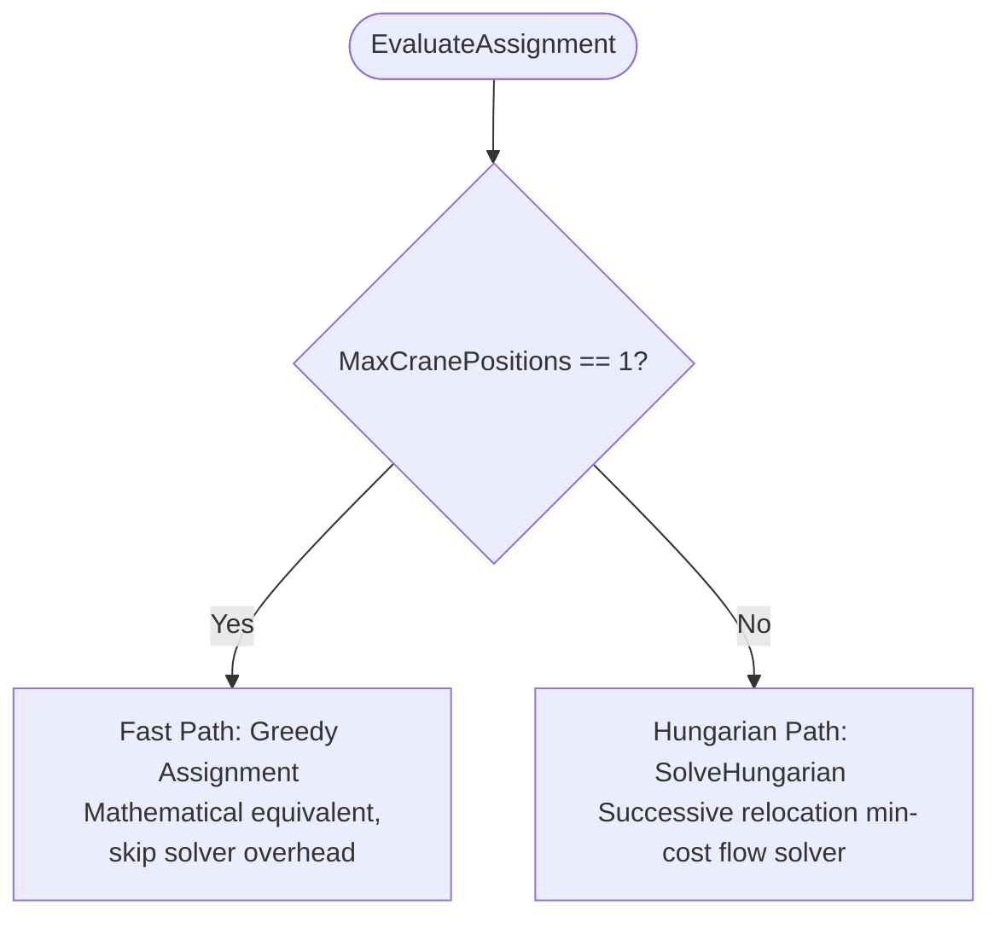

# Assignment Engine - Hungarian Solver

This document details the architecture, routing, and algorithm implementation of the bipartite matching assignment engine.

---

## 1. Overview

The [HungarianAssignmentService](file:///F:/06-ITI/00-Project/Main%20Project/CraneOptimizer/CraneOptimizer.Application/Optimization/GeneticAlgorithms/Services/HungarianAssignmentService.cs) implements the [IElementAssignmentService](file:///F:/06-ITI/00-Project/Main%20Project/CraneOptimizer/CraneOptimizer.Application/Optimization/GeneticAlgorithms/Interfaces/IElementAssignmentService.cs) interface. It is responsible for globally optimizing the assignment of construction elements to crane setup positions.

Unlike the legacy greedy assignment (which assigns each element independently to its closest setup and can overload setups), the Hungarian Assignment Service models assignment as a minimum-cost bipartite matching problem with capacity constraints and load balancing.

---

## 2. Fast Path vs. Hungarian Path Routing

To optimize performance on large datasets, the service implements a clean routing strategy:



---

## 3. Successive Relocation Solver Algorithm

The Hungarian solver is implemented as an $O(N \cdot M^2)$ successive relocation min-cost flow algorithm (optimized for small setup counts $M \le 3$):

1. **Cost Matrix Construction:** 
   Evaluates all $N$ elements against all $M$ setups using the precast cache and load chart index. The cost of assigning element $i$ to setup $j$ is based on the working radius. If the element is unliftable at setup $j$, a heavy cost penalty ($1,000,000$) is added.
2. **Setup Capacity Initialization:**
   If the capacity limit `MaxElementsPerSetup` is unconstrained, a global load-balancing capacity is calculated:
   $$\text{capacity} = \lceil N / M \rceil$$
3. **Greedy Initialization:**
   Initially assigns each element to the setup position with the lowest individual cost.
4. **Successive Relocation Loop:**
   - Detects overloaded setups where the assigned count exceeds `capacity`.
   - Builds a setup-relocation residual graph where the edge cost between setup $X$ and setup $Y$ represents the cheapest cost difference to transfer an element from $X$ to $Y$:
     $$\text{weight}(X, Y) = \min_{i \in X} (\text{cost}(i, Y) - \text{cost}(i, X))$$
   - Finds the shortest path from the overloaded setup to any underloaded setup using the Bellman-Ford algorithm.
   - Calculates the path capacity $K$ (maximum number of elements that can be shifted without violating capacity limits or creating new overloads).
   - Relocates multiple elements along the shortest augmenting path in one iteration.
   - Repeats until all setup capacities are satisfied or no further paths exist.

---

## 4. Runtime Dynamic Routing

To bridge the gap between static Dependency Injection (DI) initialization and runtime UI parameter changes, the system implements the [RoutingAssignmentService](file:///F:/06-ITI/00-Project/Main%20Project/CraneOptimizer/CraneOptimizer.Application/Optimization/GeneticAlgorithms/Services/RoutingAssignmentService.cs). 

This routing proxy dynamically delegates assignment evaluation to either the greedy or Hungarian solver on a per-call basis:
- If `settings.UseHungarianAssignment` is `true`, it delegates to [HungarianAssignmentService](file:///F:/06-ITI/00-Project/Main%20Project/CraneOptimizer/CraneOptimizer.Application/Optimization/GeneticAlgorithms/Services/HungarianAssignmentService.cs).
- Otherwise, it delegates to the legacy [ElementAssignmentService](file:///F:/06-ITI/00-Project/Main%20Project/CraneOptimizer/CraneOptimizer.Application/Optimization/GeneticAlgorithms/Engines/GeneticOptimization/ElementAssignmentService.cs).

---

## 5. Benchmark_v2 Assignment Diagnostics

Compact diagnostics record both the configured routing flag and resolved engine name. Final element rows expose:

```text
RequiredCapacity = ElementWeight + AdditionalWt
CapacityUtilization = RequiredCapacity / AvailableCapacity
CapacityMarginTons = AvailableCapacity - RequiredCapacity
RadiusUtilization = Radius / CraneMaxRadius
BoomUtilization = RequiredBoomLength / CraneMaxBoomLength
```

Division-derived values are `N/A` when their denominator is not positive. These measurements support later Crane-Friendly analysis but do not add a runtime mode or utilization threshold. See [Benchmark_v2 diagnostics](../ga/benchmark-v2-diagnostics.md).
