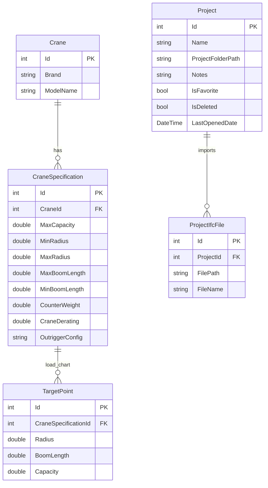
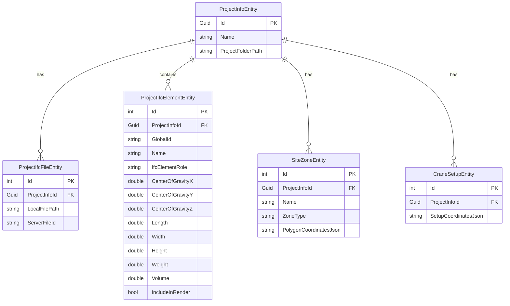

# Database Architecture

The application uses **Entity Framework Core** with the **SQLite** provider for persistent storage.

There are two distinct database configurations used in the application:
1.  **Catalog & Project History Database (`CraneDbContext`):** Main database created at `%APPDATA%/CraneOptimizer/crane.db` (or under `bin/Debug/net8.0/Data/crane.db` during development) on app startup to store catalog items (crane specifications, load charts, historical projects list).
2.  **Project Files (`.craneopt` / `CreatedProjectDbContext`):** Individual SQLite files created at user-specified paths that store site boundaries, obstacles, green zones, crane setups, and structural elements for a specific planning project.

---

## Catalog Schema (`CraneDbContext`)

The catalog database model is configured within [CraneDbContext.cs](file:///f:/06-ITI/00-Project/Main%20Project/CraneOptimizer/CraneOptimizer.Infrastructure/Contexts/CraneDbContext.cs).

---

## Project File Schema (`CreatedProjectDbContext`)

The `.craneopt` database model is configured within [CreatedProjectDbContext.cs](file:///f:/06-ITI/00-Project/Main%20Project/CraneOptimizer/CraneOptimizer.Infrastructure/Contexts/CreatedProject/CreatedProjectDbContext.cs) and represents the serialized state of a specific project scene.

---

## Migration History

Database changes are tracked via EF Core migrations located in [Migrations/](file:///f:/06-ITI/00-Project/Main%20Project/CraneOptimizer/CraneOptimizer.Infrastructure/Migrations):

### Catalog migrations:
*   `20260224012129_InitialCreate` - Sets up standard catalog schema.
*   `20260427211132_AddProjectTables` - Connects imported project history metadata.
*   `20260428183336_AddCSVToCeaneSpecification` - Adds CSV mapping support for specs.
*   `20260519000100_NormalizeUnitSystemStorage` - Standardizes metrics conversions.
*   `20260521194249_AddProjectFolderpathtoProject` - Integrates directory paths.

### Project `.craneopt` migrations:
*   `20260521202008_InitialCreatedProjectDb` - Sets up baseline schema for project elements.
*   `20260523163420_AddProjectStateTables` - Adds scene snapshots and optimization run tables.
*   `20260525231817_AddLightweightElementMetadata` - Integrates element properties and visibility flags.

---

## Cascade Delete Rules

All relationships are configured with **Cascade Delete** via EF Core Fluent API:
*   Deleting a `Crane` deletes all its child `Specifications`.
*   Deleting a `CraneSpecification` deletes all its child `TargetPoints`.
*   Deleting a `Project` deletes all associated imported `ProjectIfcFiles`.
*   Deleting a `ProjectInfoEntity` in `.craneopt` deletes all child elements, snapshots, zones, and setups.

### Implementation Reference

File:
[CraneDbContext.cs](file:///f:/06-ITI/00-Project/Main%20Project/CraneOptimizer/CraneOptimizer.Infrastructure/Contexts/CraneDbContext.cs) and [CreatedProjectDbContext.cs](file:///f:/06-ITI/00-Project/Main%20Project/CraneOptimizer/CraneOptimizer.Infrastructure/Contexts/CreatedProject/CreatedProjectDbContext.cs)
