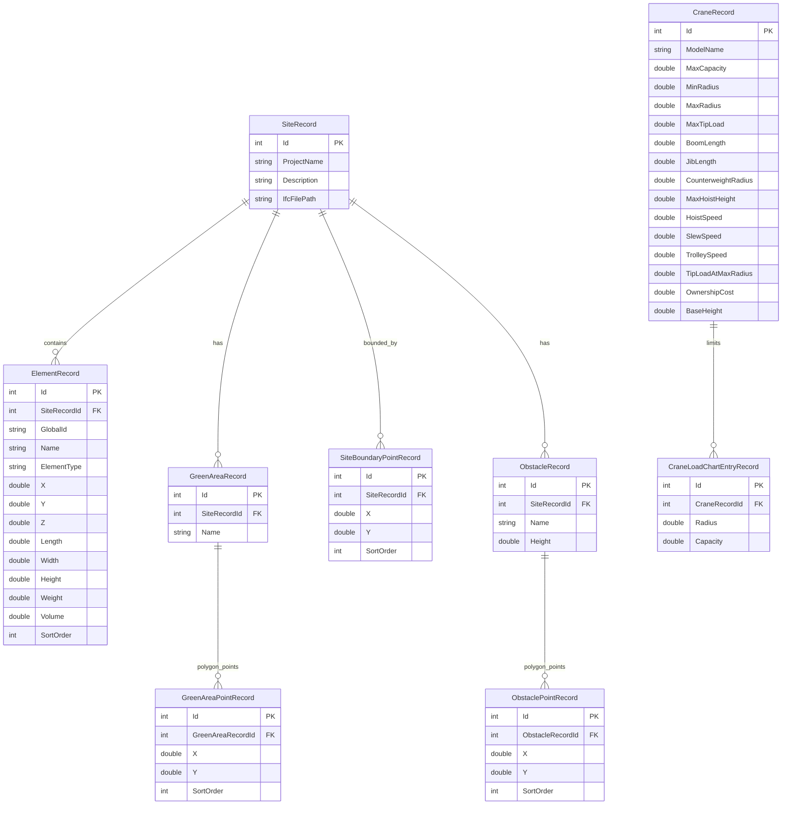

# Database Architecture

The application uses **Entity Framework Core** with the **SQLite** provider for persistent storage.

There are two distinct database configurations used in the application:
1. **Primary Workspace Database:** Main database created at `%APPDATA%/CraneOptimizer/craneoptimizer.db` on app startup to store catalog items (cranes, saved sites).
2. **Project Files (`.craneopt`):** Individual SQLite files created at user-specified paths that store site boundaries, obstacles, green areas, crane setups, and structural elements for a specific project.

---

## Entity Relationship (ER) Schema

The database model is configured within the [AppDbContext](file:///f:/06-ITI/00-Project/Main%20Project/CraneOptimizer/CraneOptimizer.Infrastructure/Contexts/AppDbContext.cs) class.

---

## Migration History

Database changes are tracked via EF Core migrations located in the [Migrations](file:///f:/06-ITI/00-Project/Main%20Project/CraneOptimizer/CraneOptimizer.Infrastructure/Migrations) folder:

### 1. `InitialCreate`
Creates the main entity tables:
* `CraneRecords` & `SiteRecords`
* `ElementRecords` (bound to `SiteRecords`)
* `GreenAreaRecords` & `GreenAreaPointRecords`
* `SiteBoundaryPointRecords`
* `ObstacleRecords` & `ObstaclePointRecords`

### 2. `AddCraneLoadChart`
* Adds the `CraneLoadChartEntryRecords` table.
* Adds the `BaseHeight` column to `CraneRecords`.

---

## Cascade Delete Rules

All relationships are configured with **Cascade Delete** via EF Core Fluent API:
* Deleting a `SiteRecord` deletes all associated elements, site boundary points, green areas, and obstacles.
* Deleting a `GreenAreaRecord` deletes all its child points (`GreenAreaPointRecord`).
* Deleting a `ObstacleRecord` deletes all its child points (`ObstaclePointRecord`).
* Deleting a `CraneRecord` deletes all its load chart entries (`CraneLoadChartEntryRecord`).
