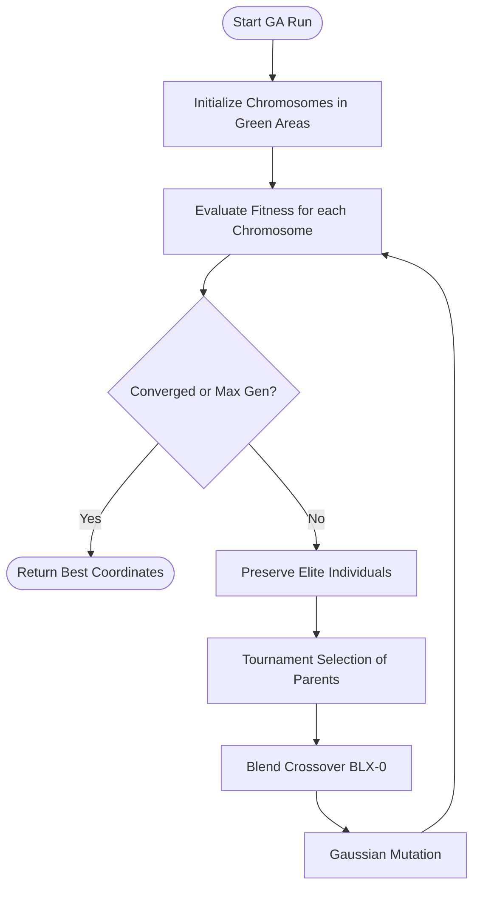

# System Engines

The system is organized around several specialized logic components called "Engines" or "Model Services". This document details their architecture and responsibilities.

---

## 1. Genetic Algorithm (GA) Engine

The optimization pipeline runs within the [GeneticAlgorithmEngine](file:///f:/06-ITI/00-Project/Main%20Project/CraneOptimizer/CraneOptimizer.Application/Optimization/GeneticAlgorithmEngine.cs).

### Flowchart of GA Run

### Components
* **Chromosome:** [CranePlacementChromosome](file:///f:/06-ITI/00-Project/Main%20Project/CraneOptimizer/CraneOptimizer.Application/Optimization/CranePlacementChromosome.cs) represents the $(X, Y)$ location of the crane. Initializes coordinates inside randomly chosen green area polygons.
* **Crossover:** Performs Blend Crossover ($\text{BLX}-\alpha$ with $\alpha=0$) to generate coordinates between parents:
  $$X_{child} = X_{p1} + \beta \times (X_{p2} - X_{p1}) \quad \text{where } \beta \in [0,1]$$
* **Mutation:** Applies Gaussian distribution perturbations. Clamps out-of-bounds mutations back to the nearest green area bounds.
* **Fitness Function:** [CranePlacementFitness](file:///f:/06-ITI/00-Project/Main%20Project/CraneOptimizer/CraneOptimizer.Application/Optimization/CranePlacementFitness.cs) sums reachable/liftable elements, checks manufacturer load charts, subtracts penalties for obstacles/boundary overlaps, and adds bonuses for efficiency (closeness to precast elements).

---

## 2. IFC Processing Engine

Implemented in [IfcModelService](file:///f:/06-ITI/00-Project/Main%20Project/CraneOptimizer/CraneOptimizer.Infrastructure/Ifc/IfcModelService.cs).

* **Technology:** Uses the xBIM library (xBim.Essentials & xBim.Geometry).
* **Extraction Pipeline:**
  1. Opens the model file via `IfcStore.Open()`.
  2. Builds the 3D geometry engine context with `Xbim3DModelContext`.
  3. Iterates over all elements derived from `IIfcBuildingElement`.
  4. Classifies element type based on C# pattern matching (e.g. `IIfcColumn` $\rightarrow$ `IfcElementType.Column`).
  5. Computes local-to-world placements and bounding box dimensions.
  6. Determines volume (either via quantity properties or bounding box fallback) and calculates weight assuming concrete density of $2400 \text{ kg/m}^3$.

---

## 3. Persistent Project Engine

Implemented in [ProjectService](file:///f:/06-ITI/00-Project/Main%20Project/CraneOptimizer/CraneOptimizer.Application/Services/ProjectService.cs).

* **Concept:** Instead of using customized JSON or XML formats, a `.craneopt` project file is an SQLite database.
* **Operation:**
  * **Save:** Dynamically spins up an `AppDbContext` using the target file path, runs migrations/creates schema via `EnsureCreatedAsync()`, strips existing IDs (setting them to 0), and batch-inserts the site and crane entities.
  * **Load:** Instantiates an `AppDbContext` pointing to the file path and uses Entity Framework Core eager loading (`Include()`) to pull all nodes from the site tree, as well as the list of cranes.

---

## 4. Planned Engines (Roadmap)

### Path Engine
* **Purpose:** Planning the movement of the crane between multiple setup locations.
* **Planned Algorithm:** A* pathfinding over site coordinate grids, constrained by crane width and turning radius.

### Lifting Engine
* **Purpose:** Ensuring collision clearances of boom/jib lines against precast structures.
* **Planned Algorithm:** Swept-volume intersection checks in 3D space during the hoist/slew trajectory.
