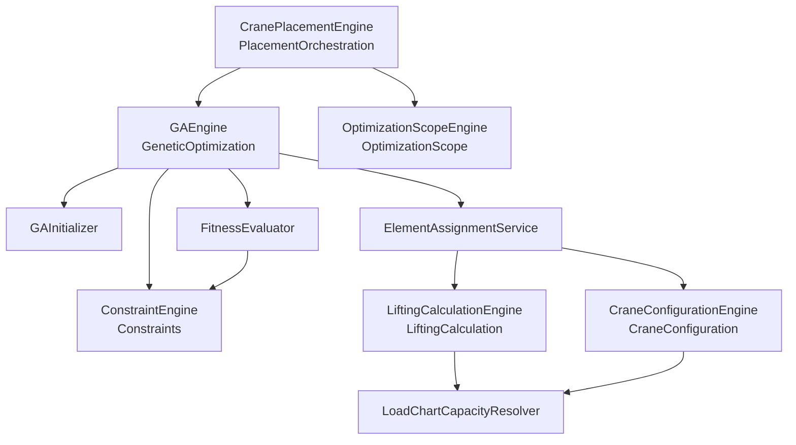
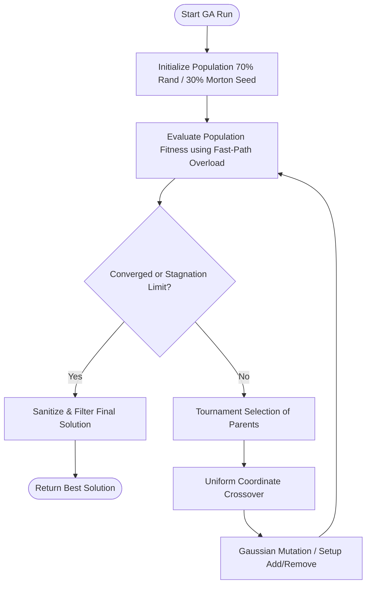

# System Engines

The system is organized around several specialized logic components called "Engines" or "Model Services". This document details their architecture, responsibilities, and relationships.

---

## 1. Core Optimization & GA Engines

The optimization pipeline runs within the application layer under [Optimization/GeneticAlgorithms/Engines/](file:///f:/06-ITI/00-Project/Main%20Project/CraneOptimizer/CraneOptimizer.Application/Optimization/GeneticAlgorithms/Engines). It consists of 7 specialized engines that manage different stages of the optimization process:

### Architectural Engine Map

---

### The 7 Implemented Engines

### 1. CranePlacementEngine
*   **Path:** [CranePlacementEngine.cs](file:///f:/06-ITI/00-Project/Main%20Project/CraneOptimizer/CraneOptimizer.Application/Optimization/GeneticAlgorithms/Engines/PlacementOrchestration/CranePlacementEngine.cs)
*   **Interface:** `ICranePlacementEngine`
*   **Responsibility:** Orchestrates the top-level optimization pipeline. It supports two modes:
    *   **Concurrent (Default):** Runs a single GA optimization pass using multi-position chromosomes.
    *   **Set-Cover Iterative (Greedy):** Loops finding the best single point per iteration, removing covered elements, up to 4 iterations or 95% target coverage.
*   **Post-processing:** Deduplicates redundant crane setups, resolves final element assignments, and logs profiling information via `GAProfiler`.

### 2. GAEngine
*   **Path:** [GAEngine.cs](file:///f:/06-ITI/00-Project/Main%20Project/CraneOptimizer/CraneOptimizer.Application/Optimization/GeneticAlgorithms/Engines/GeneticOptimization/GAEngine.cs)
*   **Interface:** `IGeneticAlgorithmEngine`
*   **Responsibility:** Manages the main Genetic Algorithm evolutionary loop.
*   **Flowchart of GA Run:**

### 3. ConstraintEngine
*   **Path:** [ConstraintEngine.cs](file:///f:/06-ITI/00-Project/Main%20Project/CraneOptimizer/CraneOptimizer.Application/Optimization/GeneticAlgorithms/Engines/Constraints/ConstraintEngine.cs)
*   **Interface:** `IConstraintEngine`
*   **Responsibility:** Enforces spatial constraints during initialization and mutation sweeps:
    *   **Allowed Zone Inclusion:** Ensures crane footprints are fully contained in `Allowed` zones.
    *   **Forbidden Zone Exclusion:** Prevents crane setups from overlapping obstacles or `Forbidden` zones.
    *   **Minimum Spacing:** Enforces minimum coordinate distances between multiple crane positions in a solution to prevent duplicates.

### 4. CoverageEngine
*   **Path:** [CoverageEngine.cs](file:///f:/06-ITI/00-Project/Main%20Project/CraneOptimizer/CraneOptimizer.Application/Optimization/GeneticAlgorithms/Engines/Coverage/CoverageEngine.cs)
*   **Interface:** `ICoverageEngine`
*   **Responsibility:** Recomputes final coverage statistics post-run and merges setup positions that are closer than the duplicate threshold (based on proximity and contribution).

### 5. CraneConfigurationEngine
*   **Path:** [CraneConfigurationEngine.cs](file:///f:/06-ITI/00-Project/Main%20Project/CraneOptimizer/CraneOptimizer.Application/Optimization/GeneticAlgorithms/Engines/CraneConfiguration/CraneConfigurationEngine.cs)
*   **Interface:** `ICraneConfigurationEngine`
*   **Responsibility:** Calculates required boom lengths using hinge offsets, resolves capacities using `ILoadChartCapacityResolver`, and maintains a thread-safe cache (`ConcurrentDictionary`) to optimize redundant capacity evaluations.

### 6. LiftingCalculationEngine
*   **Path:** [LiftingCalculationEngine.cs](file:///f:/06-ITI/00-Project/Main%20Project/CraneOptimizer/CraneOptimizer.Application/Optimization/GeneticAlgorithms/Engines/LiftingCalculation/LiftingCalculationEngine.cs)
*   **Interface:** `ILiftingCalculationEngine`
*   **Responsibility:** Computes physics-based lift metrics:
    *   **Horizontal Radius:** Horizontal distance from slew center to element COG (2D reach check).
    *   **Lift Height:** Vertical height check from crane base to hook point (element Z + half-height + sling/wire length).
    *   **Required Weight:** Element weight + rigging weight adjustments.

### 7. OptimizationScopeEngine
*   **Path:** [OptimizationScopeEngine.cs](file:///f:/06-ITI/00-Project/Main%20Project/CraneOptimizer/CraneOptimizer.Application/Optimization/GeneticAlgorithms/Engines/OptimizationScope/OptimizationScopeEngine.cs)
*   **Interface:** `IOptimizationScopeEngine`
*   **Responsibility:** Filters precast elements prior to optimization based on criteria like allowed IDs, excluded IDs, categories, and 2D bounding boxes.

---

## 2. IFC Processing Engine

Implemented in [IfcReaderRepository.cs](file:///f:/06-ITI/00-Project/Main%20Project/CraneOptimizer/CraneOptimizer.Infrastructure/Repositories/IfcReaderRepository.cs).

*   **Technology:** Uses xBIM packages (`Xbim.Ifc`, `xBim.Essentials`, `xBim.Geometry.Engine.Interop`) to parse IFC files.
*   **Extraction Pipeline:**
    1. Opens the model file and builds the 3D geometry engine context.
    2. Filters products that inherit from `IIfcElement` (excluding spaces, openings, and virtual elements).
    3. Normalizes elements, assigns normalization roles (`LiftableElement`, `GroupingOnly`, etc.), and extracts dimensions, centers of gravity (COG), and volume.
    4. Resolves weight in metric tons using explicit quantities/properties or applies fallback estimations (e.g., $2500 \text{ kg/m}^3$ concrete density multiplier).

---

## 3. Persistent Project Engine

Implemented in [ProjectService.cs](file:///f:/06-ITI/00-Project/Main%20Project/CraneOptimizer/CraneOptimizer.UI/Features/F10_ProjectManagement/Services/ProjectService.cs).

*   **Concept:** `.craneopt` files are standalone SQLite database files managed via Entity Framework Core.
*   **Operation:**
    *   **Save:** Instantiates a database context for the target file path, applies migrations, maps entities, and batch-inserts site zones, target elements, and crane setups.
    *   **Load:** Rebuilds the active in-memory scene by reading all project entities from the SQLite file.

---

## 4. Planned Engines (Future Design Roadmap)

### Path Engine
*   **Purpose:** Planning movement routes for mobile cranes traveling between relocation setups on site.
*   **Status:** Non-existent in the current implementation. Crane travel path planning is not active.
*   **Planned Algorithm:** A* pathfinding over site coordinate grids with turning radius smoothing (Dubins paths).
