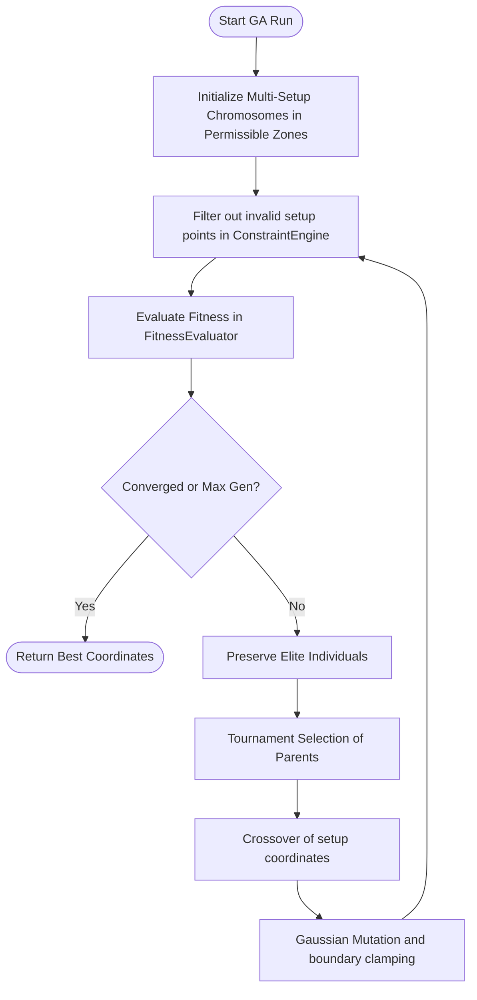

# System Engines

The system is organized around several specialized logic components called "Engines" or "Model Services". This document details their architecture and responsibilities.

---

## 1. Genetic Algorithm (GA) Engine

The optimization pipeline runs within the [GAEngine.cs](file:///f:/06-ITI/00-Project/Main%20Project/CraneOptimizer/CraneOptimizer.Application/Optimization/GeneticAlgorithms/Engines/GeneticOptimization/GAEngine.cs).

### Flowchart of GA Run

### Components
*   **Chromosome:** [CraneChromosome.cs](file:///f:/06-ITI/00-Project/Main%20Project/CraneOptimizer/CraneOptimizer.Application/Optimization/GeneticAlgorithms/Models/CraneChromosome.cs) represents a variable-length list of crane setup coordinates (`CranePositions`).
*   **Constraint Engine:** [ConstraintEngine.cs](file:///f:/06-ITI/00-Project/Main%20Project/CraneOptimizer/CraneOptimizer.Application/Optimization/GeneticAlgorithms/Engines/Constraints/ConstraintEngine.cs) validates each setup coordinate by ensuring the crane footprint is fully within allowed zones and does not overlap obstacles.
*   **Fitness Evaluator:** [FitnessEvaluator.cs](file:///f:/06-ITI/00-Project/Main%20Project/CraneOptimizer/CraneOptimizer.Application/Optimization/GeneticAlgorithms/Engines/GeneticOptimization/FitnessEvaluator.cs) calculates normalized failure fractions and applies settings-defined weights to score setup placements.

### Implementation Reference

File:
[GAEngine.cs](file:///f:/06-ITI/00-Project/Main%20Project/CraneOptimizer/CraneOptimizer.Application/Optimization/GeneticAlgorithms/Engines/GeneticOptimization/GAEngine.cs)

Class:
`GAEngine`

Method:
`Run()`

---

## 2. IFC Processing Engine

Implemented in [IfcReaderRepository.cs](file:///f:/06-ITI/00-Project/Main%20Project/CraneOptimizer/CraneOptimizer.Infrastructure/Repositories/IfcReaderRepository.cs) and [IfcModelSessionService.cs](file:///f:/06-ITI/00-Project/Main%20Project/CraneOptimizer/CraneOptimizer.Infrastructure/Ifc/IfcModelSessionService.cs).

*   **Technology:** Uses the xBIM library (xBim.Essentials & xBim.Geometry).
*   **Extraction Pipeline:**
    1. Opens the model file via `IfcStore.Open()`.
    2. Builds the 3D geometry engine context with `Xbim3DModelContext`.
    3. Iterates over all elements derived from `IIfcBuildingElement`.
    4. Classifies element type based on C# pattern matching (e.g. `IIfcColumn` $\rightarrow$ `IfcElementRole.Column`).
    5. Computes local-to-world placements and bounding box dimensions.
    6. Determines volume (either via quantity properties or bounding box fallback) and calculates weight assuming concrete density of $2500 \text{ kg/m}^3$ (withOverrides for steel, aluminum, glass, wood).

### Implementation Reference

File:
[IfcReaderRepository.cs](file:///f:/06-ITI/00-Project/Main%20Project/CraneOptimizer/CraneOptimizer.Infrastructure/Repositories/IfcReaderRepository.cs)

Class:
`IfcReaderRepository`

Method:
`ReadElements()` and `ExtractGeometryInfo()`

---

## 3. Persistent Project Engine

Implemented in [ProjectService.cs](file:///f:/06-ITI/00-Project/Main%20Project/CraneOptimizer/CraneOptimizer.UI/Features/F10_ProjectManagement/Services/ProjectService.cs).

*   **Concept:** Instead of using customized JSON or XML formats, a `.craneopt` project file is an SQLite database.
*   **Operation:**
    *   **Save:** Instantiates a `CreatedProjectDbContext` pointing to the target file path, runs migrations via `Database.Migrate()`, maps project entities, and batch-inserts the site configurations, obstacles, and precast element snapshots.
    *   **Load:** Instantiates a `CreatedProjectDbContext` pointing to the file path and pulls all nodes to rebuild the active in-memory scene.

---

## 4. Planned Engines (Future Design Roadmap)

### Path Engine
*   **Purpose:** Planning the movement of the crane between multiple setup locations.
*   **Planned Algorithm:** A* pathfinding over site coordinate grids, constrained by crane width and turning radius.

### Lifting Engine
*   **Purpose:** Ensuring collision clearances of boom/jib lines against precast structures.
*   **Planned Algorithm:** Swept-volume intersection checks in 3D space during the hoist/slew trajectory.
