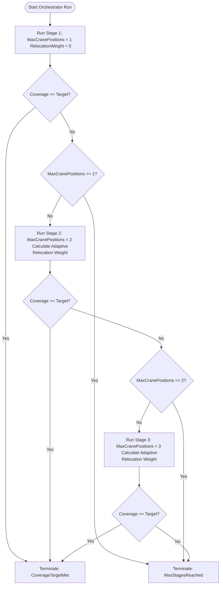

# Optimization Engine - Multi-Stage GA Orchestrator

This document details the architecture, routing, and escalation logic of the multi-stage Genetic Algorithm optimization engine.

---

## 1. Overview

The [MultiStageGAOrchestrator](file:///F:/06-ITI/00-Project/Main%20Project/CraneOptimizer/CraneOptimizer.Application/Optimization/GeneticAlgorithms/Services/MultiStageGAOrchestrator.cs) implements the [IMultiStageGAOrchestrator](file:///F:/06-ITI/00-Project/Main%20Project/CraneOptimizer/CraneOptimizer.Application/Optimization/GeneticAlgorithms/Interfaces/IMultiStageGAOrchestrator.cs) interface. It is responsible for orchestrating the escalation loop of the Genetic Algorithm to dynamically discover the optimal number of crane setup positions.

By scaling setup counts incrementally from 1 to 3, the orchestrator minimizes travel/relocation overhead while ensuring the project's target lifting coverage is achieved.

---

## 2. Escalation Workflow

---

## 3. CSV Diagnostics System

After each stage completes, the [GACsvDiagnosticsService](file:///F:/06-ITI/00-Project/Main%20Project/CraneOptimizer/CraneOptimizer.Application/Optimization/GeneticAlgorithms/Services/GACsvDiagnosticsService.cs) writes structured CSV reports to the diagnostics reports directory.

### CSV Schema Identity Fields

Every CSV file includes the following identity columns for cross-file joining:

| Field | Description |
|---|---|
| `OptimizationRunId` | Stable GUID per optimizer execution — shared by all stages of one run |
| `StageRunId` | Unique GUID per stage execution |
| `DiagnosticsSchemaVersion` | Version identifier for the CSV schema — currently `1.0` |
| `StageIndex` | 1-based stage number within the optimization run |

### Files Generated

The following CSV files are written for each optimization run, all keyed on `OptimizationRunId`/`StageRunId`:

| File | Content |
|---|---|
| `ga_run_summary.csv` | One row per run — overall coverage, fitness, position count, runtime |
| `ga_settings_snapshot.csv` | One row per stage — full GASettings dump |
| `ga_stage_summary.csv` | One row per stage — stage-level results, includes `AssignmentEngineUsed` |
| `ga_generation_summary.csv` | One row per generation per stage |
| `ga_reachability_hotspots.csv` | One row per hot spot — includes `ZoneId`, global rank, per-zone rank |
| `ga_positions.csv` | One row per final position — includes `ZoneId`, `AssignmentEngineUsed` |
| `ga_element_assignments.csv` | One row per element — lift status, radius, capacity, assigned position |
| `ga_failure_breakdown.csv` | One row per failure category — counts and percentages |
| `ga_diagnostics.csv` | Detailed diagnostics matrix |
| `ga_assignment_matrix.csv` | Element-to-position assignment matrix |
| `ga_final_assignments.csv` | Final resolved element ownership |

### Formatting Rules

- All numeric output uses `CultureInfo.InvariantCulture` to ensure cross-locale parsability.
- CSV headers and data rows have matching column counts (no ragged columns).
- `UseHungarianAssignment` is written to the settings snapshot.
- `AssignmentEngineUsed` is emitted in the stage summary and positions files, set to `Hungarian` or `Greedy` depending on the active assignment engine.

---

## 4. Key Responsibilities

1. **Dynamic Setup Scaling:** 
   Increments `MaxCranePositions` on each stage to ensure single-crane solutions are prioritized and multi-position setups are only introduced when physically necessary.
2. **Adaptive Weight Scaling:** 
   Computes a reduced relocation penalty for subsequent stages to allow multi-position chromosomes to survive in the GA population.
3. **Best Result Selection:**
   Across all stages, the best result is selected by prioritizing higher coverage first. When two stages achieve the same coverage, the result with fewer crane positions is preferred (minimizing relocation cost). If coverage and position counts are identical, the higher GA fitness score (internal metric) breaks the tie. This ensures that the orchestrator returns the most efficient solution that meets or approaches the coverage target.
4. **Early Break:** 
   Monitors execution and breaks out immediately if the coverage target is met during any intermediate stage, conserving CPU cycles.
5. **Cancellation Propagation:** 
   Monitors the `CancellationToken` and gracefully returns the best results obtained in completed stages if interrupted mid-run.
