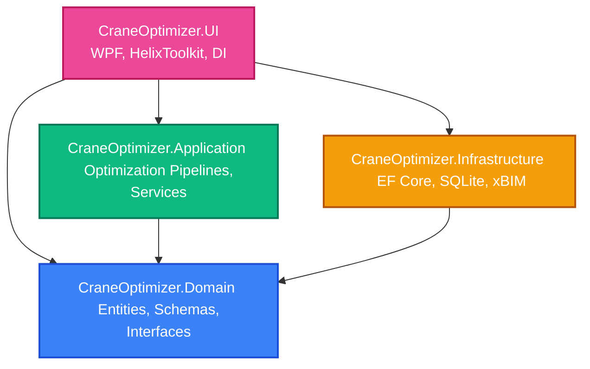

# System Architecture Overview

The **Mobile Crane Path Optimizer** is built using **Clean Architecture** (also known as Onion Architecture). This design style guarantees separation of concerns, high testability, and decoupling of core business rules from external frameworks, user interfaces, and databases.

---

## Architectural Layers

### 1. Domain Layer (`CraneOptimizer.Domain`)
* **Dependencies:** Zero external dependencies (neither NuGet packages nor other projects in the solution). It is pure .NET Standard / .NET 8.0.
* **Responsibilities:**
  * **Core Domain Entities:** [CraneRecord](file:///f:/06-ITI/00-Project/Main%20Project/CraneOptimizer/CraneOptimizer.Domain/Entities/CraneRecord.cs), [SiteRecord](file:///f:/06-ITI/00-Project/Main%20Project/CraneOptimizer/CraneOptimizer.Domain/Entities/SiteRecord.cs), etc.
  * **Value Objects & Schemas:** [Point2D](file:///f:/06-ITI/00-Project/Main%20Project/CraneOptimizer/CraneOptimizer.Domain/Schemas/Point2D.cs), [GreenArea](file:///f:/06-ITI/00-Project/Main%20Project/CraneOptimizer/CraneOptimizer.Domain/Schemas/GreenArea.cs), [Obstacle](file:///f:/06-ITI/00-Project/Main%20Project/CraneOptimizer/CraneOptimizer.Domain/Schemas/Obstacle.cs).
  * **Repository & Service Contracts:** Core abstractions (e.g., `ICraneRepository`, `ISiteRepository`, `IIfcModelService`) implemented by outer layers.
  * **Domain Logic:** Geometry calculations, unit conversions, and diagnostics structures.

### 2. Application Layer (`CraneOptimizer.Application`)
* **Dependencies:** Depends only on the Domain layer.
* **Responsibilities:**
  * **Genetic Algorithm Engine:** [GeneticAlgorithmEngine](file:///f:/06-ITI/00-Project/Main%20Project/CraneOptimizer/CraneOptimizer.Application/Optimization/GeneticAlgorithmEngine.cs), [CranePlacementFitness](file:///f:/06-ITI/00-Project/Main%20Project/CraneOptimizer/CraneOptimizer.Application/Optimization/CranePlacementFitness.cs), [CranePlacementChromosome](file:///f:/06-ITI/00-Project/Main%20Project/CraneOptimizer/CraneOptimizer.Application/Optimization/CranePlacementChromosome.cs).
  * **Application Services:** Service implementations (e.g., [CraneService](file:///f:/06-ITI/00-Project/Main%20Project/CraneOptimizer/CraneOptimizer.Application/Services/CraneService.cs), [SiteService](file:///f:/06-ITI/00-Project/Main%20Project/CraneOptimizer/CraneOptimizer.Application/Services/SiteService.cs)) mediating between UI and Repositories.
  * **Project File Management:** [ProjectService](file:///f:/06-ITI/00-Project/Main%20Project/CraneOptimizer/CraneOptimizer.Application/Services/ProjectService.cs) handling sqlite-based database migration, resets, and save/load logic.

### 3. Infrastructure Layer (`CraneOptimizer.Infrastructure`)
* **Dependencies:** Depends on the Domain layer.
* **Responsibilities:**
  * **ORM & Database:** [AppDbContext](file:///f:/06-ITI/00-Project/Main%20Project/CraneOptimizer/CraneOptimizer.Infrastructure/Contexts/AppDbContext.cs) with SQLite provider mapping.
  * **Repositories:** [CraneRepository](file:///f:/06-ITI/00-Project/Main%20Project/CraneOptimizer/CraneOptimizer.Infrastructure/Repositories/CraneRepository.cs), [SiteRepository](file:///f:/06-ITI/00-Project/Main%20Project/CraneOptimizer/CraneOptimizer.Infrastructure/Repositories/SiteRepository.cs).
  * **BIM / IFC Processing:** [IfcModelService](file:///f:/06-ITI/00-Project/Main%20Project/CraneOptimizer/CraneOptimizer.Infrastructure/Ifc/IfcModelService.cs) utilizing xBIM Essentials and Geometry to parse building models.

### 4. Presentation/UI Layer (`CraneOptimizer.UI`)
* **Dependencies:** References all three underlying projects (Domain, Application, Infrastructure).
* **Responsibilities:**
  * **WPF Views & ViewModels:** Implementing MVVM architecture using DataTemplates for Navigation.
  * **3D Visualizer:** Viewports powered by `HelixToolkit.Wpf.SharpDX`.
  * **Bootstrapper:** Configures the dependency injection container ([Microsoft.Extensions.DependencyInjection](file:///f:/06-ITI/00-Project/Main%20Project/CraneOptimizer/CraneOptimizer.UI/App.xaml.cs)) and sets up the primary workspace sqlite file.

---

## Dependency Flow and Coupling Rule

A strict architectural constraint is that **dependencies point inwards**. Outer rings (UI, Infrastructure) can depend on inner rings (Application, Domain), but inner rings must never reference details of outer rings.

> [!WARNING]
> **Known Violation (Technical Debt):** The `CraneOptimizer.Application.csproj` currently references `CraneOptimizer.Infrastructure.csproj` directly. This was done to instantiate `AppDbContext` inside `ProjectService.cs` during project save/load routines. This creates a circular compilation boundary violating the Clean Architecture rule.
>
> **Remediation Plan:** In future refactoring, `IProjectService` save/load logic should be defined inside `CraneOptimizer.Infrastructure` or `AppDbContext` instantiation should be abstracted behind a factory interface registered via Dependency Injection, resolving the direct dependency from Application to Infrastructure.
