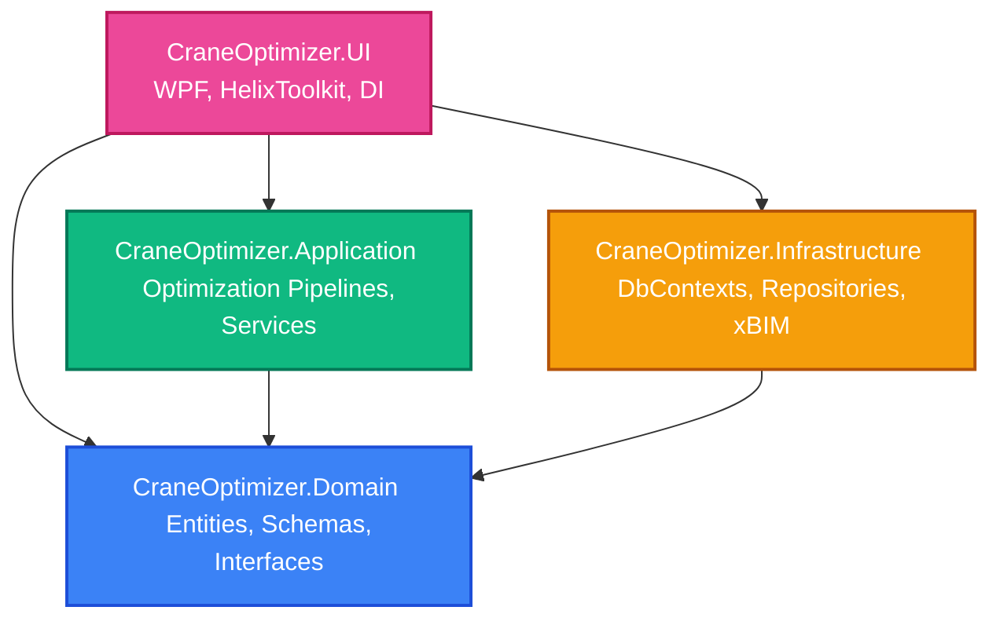

# System Architecture Overview

The **Mobile Crane Path Optimizer** is built using **Clean Architecture** (also known as Onion Architecture). This design style guarantees separation of concerns, high testability, and decoupling of core business rules from external frameworks, user interfaces, and databases.

---

## Architectural Layers

### 1. Domain Layer (`CraneOptimizer.Domain`)
*   **Dependencies:** Zero external dependencies on outer projects or external packages. It is pure .NET Standard / .NET 8.0.
*   **Responsibilities:**
    *   **Core Domain Entities:** [CraneSpecification.cs](file:///f:/06-ITI/00-Project/Main%20Project/CraneOptimizer/CraneOptimizer.Domain/Entities/CraneSpecification.cs), [Crane.cs](file:///f:/06-ITI/00-Project/Main%20Project/CraneOptimizer/CraneOptimizer.Domain/Entities/Crane.cs), [TargetPoint.cs](file:///f:/06-ITI/00-Project/Main%20Project/CraneOptimizer/CraneOptimizer.Domain/Entities/TargetPoint.cs), [Project.cs](file:///f:/06-ITI/00-Project/Main%20Project/CraneOptimizer/CraneOptimizer.Domain/Entities/Project.cs).
    *   **Value Objects & Schemas:** [GreenAreaZone.cs](file:///f:/06-ITI/00-Project/Main%20Project/CraneOptimizer/CraneOptimizer.Domain/Schemas/GreenAreaZone.cs), [PrecastElement.cs](file:///f:/06-ITI/00-Project/Main%20Project/CraneOptimizer/CraneOptimizer.Domain/Schemas/PrecastElement.cs).
    *   **Repository & Service Contracts:** Core abstractions (e.g., [ICraneRepository.cs](file:///f:/06-ITI/00-Project/Main%20Project/CraneOptimizer/CraneOptimizer.Domain/Interfaces/ICraneRepository.cs), [IIfcReaderRepository.cs](file:///f:/06-ITI/00-Project/Main%20Project/CraneOptimizer/CraneOptimizer.Domain/Interfaces/IIfcReaderRepository.cs), [IIfcDiagnosticAuditService.cs](file:///f:/06-ITI/00-Project/Main%20Project/CraneOptimizer/CraneOptimizer.Domain/Interfaces/IIfcDiagnosticAuditService.cs)).
    *   **Domain Logic:** Basic unit conversion and logging formats.

### 2. Application Layer (`CraneOptimizer.Application`)
*   **Dependencies:** Depends only on the Domain layer. It is fully decoupled from Infrastructure and UI.
*   **Responsibilities:**
    *   **Genetic Algorithm Engine:** [GAEngine.cs](file:///f:/06-ITI/00-Project/Main%20Project/CraneOptimizer/CraneOptimizer.Application/Optimization/GeneticAlgorithms/Engines/GeneticOptimization/GAEngine.cs), [FitnessEvaluator.cs](file:///f:/06-ITI/00-Project/Main%20Project/CraneOptimizer/CraneOptimizer.Application/Optimization/GeneticAlgorithms/Engines/GeneticOptimization/FitnessEvaluator.cs), [CraneChromosome.cs](file:///f:/06-ITI/00-Project/Main%20Project/CraneOptimizer/CraneOptimizer.Application/Optimization/GeneticAlgorithms/Models/CraneChromosome.cs).
    *   **Application Services:** Coordinate Readout Formatter and helper services mediating between UI and repositories.

### 3. Infrastructure Layer (`CraneOptimizer.Infrastructure`)
*   **Dependencies:** Depends on the Domain layer.
*   **Responsibilities:**
    *   **ORM & Databases:** [CraneDbContext.cs](file:///f:/06-ITI/00-Project/Main%20Project/CraneOptimizer/CraneOptimizer.Infrastructure/Contexts/CraneDbContext.cs) (for catalog data) and [CreatedProjectDbContext.cs](file:///f:/06-ITI/00-Project/Main%20Project/CraneOptimizer/CraneOptimizer.Infrastructure/Contexts/CreatedProject/CreatedProjectDbContext.cs) (for `.craneopt` project files).
    *   **Repositories:** [CraneRepository.cs](file:///f:/06-ITI/00-Project/Main%20Project/CraneOptimizer/CraneOptimizer.Infrastructure/Repositories/CraneRepository.cs), [ProjectRepository.cs](file:///f:/06-ITI/00-Project/Main%20Project/CraneOptimizer/CraneOptimizer.Infrastructure/Repositories/ProjectRepository.cs).
    *   **BIM / IFC Processing:** [IfcModelSessionService.cs](file:///f:/06-ITI/00-Project/Main%20Project/CraneOptimizer/CraneOptimizer.Infrastructure/Ifc/IfcModelSessionService.cs), [IfcReaderRepository.cs](file:///f:/06-ITI/00-Project/Main%20Project/CraneOptimizer/CraneOptimizer.Infrastructure/Repositories/IfcReaderRepository.cs), [IfcDiagnosticAuditService.cs](file:///f:/06-ITI/00-Project/Main%20Project/CraneOptimizer/CraneOptimizer.Infrastructure/Repositories/IfcDiagnosticAuditService.cs), and [IfcNormalizationDecisionService.cs](file:///f:/06-ITI/00-Project/Main%20Project/CraneOptimizer/CraneOptimizer.Infrastructure/Repositories/IfcNormalizationDecisionService.cs) utilizing xBIM to open models, create geometry contexts, audit quantities/properties, normalize elements, and return `PrecastElement` data.

### 4. Presentation/UI Layer (`CraneOptimizer.UI`)
*   **Dependencies:** References all three underlying projects (Domain, Application, Infrastructure) and builds the Dependency Injection container.
*   **Responsibilities:**
    *   **WPF Views & ViewModels:** Implementing MVVM architecture using DataTemplates and Navigation Services.
    *   **3D Visualizer:** Viewports powered by `HelixToolkit.Wpf.SharpDX`.
    *   **Bootstrapper:** Configures DI in [App.xaml.cs](file:///f:/06-ITI/00-Project/Main%20Project/CraneOptimizer/CraneOptimizer.UI/App.xaml.cs) and initializes db contexts.

---

## Dependency Flow and Coupling Rule

A strict architectural constraint is that **dependencies point inwards**. Outer rings (UI, Infrastructure) can depend on inner rings (Application, Domain), but inner rings must never reference details of outer rings.

> [!NOTE]
> **Decoupled Architecture:** Unlike earlier configurations, the `CraneOptimizer.Application.csproj` contains **no project references** to `CraneOptimizer.Infrastructure.csproj`. Database operations inside the Application layer are abstracted strictly behind domain repository interfaces, preserving the Onion coupling constraint.
