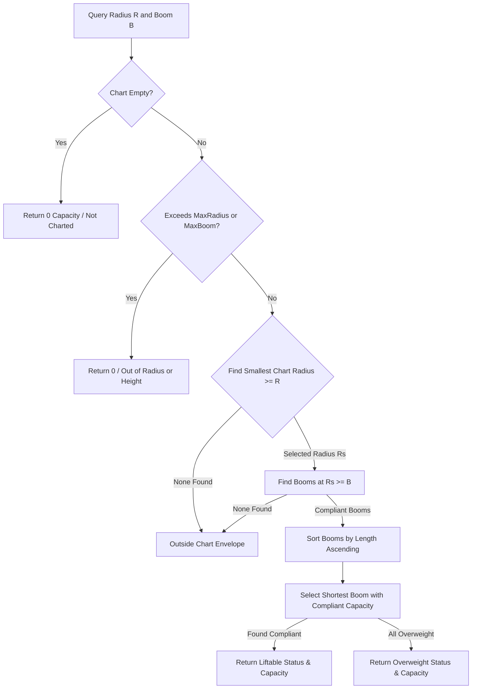

# Domain: Crane Engine & Load Charts

The Crane Engine evaluates whether a crane is physically capable of lifting a given load at a specific operating radius and boom length.

---

## 1. Data Models

Crane metrics are defined in [CraneSpecification.cs](file:///f:/06-ITI/00-Project/Main%20Project/CraneOptimizer/CraneOptimizer.Domain/Entities/CraneSpecification.cs) and its sub-entries [TargetPoint.cs](file:///f:/06-ITI/00-Project/Main%20Project/CraneOptimizer/CraneOptimizer.Domain/Entities/TargetPoint.cs).

*   **Boundary Limits:** Operating range is bounded by `MinRadius` and `MaxRadius`. A lift is unreachable if:
    $$\text{Distance} < \text{MinRadius} \quad \text{or} \quad \text{Distance} > \text{MaxRadius}$$
*   **Boom Limitations:** Boom capabilities are bounded by `MinBoomLength` and `MaxBoomLength`.
*   **Hoist Speeds & Costs:** `HoistSpeed`, `SlewSpeed`, `TrolleySpeed`, and `OwnershipCost` are database parameters defined in [Crane.cs](file:///f:/06-ITI/00-Project/Main%20Project/CraneOptimizer/CraneOptimizer.Domain/Entities/Crane.cs).

---

## 2. Load Chart Evaluation (ConservativeStep Lookup)

Unlike systems that use linear interpolation between capacity points, the system utilizes a **ConservativeStep** lookup algorithm to resolve capacity at arbitrary coordinates. This guarantees safety by rounding up radius requirements and enforcing strict discrete intervals matching the manufacturer's load charts.

### Evaluation Algorithm Steps:

1.  **Geometric Limits Check:** The system verifies the candidate operating radius $R$ and required boom length $B$ are within the absolute bounds defined in `CraneSpecification` (`MaxRadius` and `MaxBoomLength`).
2.  **Envelope Radius Step-up:** Filters chart entries to find those with `tp.Radius >= R`, selecting the smallest matching radius (`selectedChartRadius`). If no entries match, the placement is rejected as `OutsideChartEnvelope`.
3.  **Boom Compliant Selection:** Within that `selectedChartRadius`, the resolver filters entries where `tp.BoomLength >= B`, sorted ascending by boom length.
4.  **Shortest Compliant Selection:** The system iterates over the sorted configurations:
    *   It applies settings-defined multipliers:
        $$\text{AvailableCapacity} = \text{Capacity}_{\text{Chart}} \times \text{DeratingRatio} \times \text{SafetyFactor}$$
    *   It selects the first (shortest) configuration that meets the target weight:
        $$\text{AvailableCapacity} \ge \text{ElementWeight}$$
    *   If no configuration has sufficient capacity, it returns the best overweight configuration (LiftStatus = `Overweight`).
    *   If cell capacities are blank ($<=-1$) or zero, it flags the status as `InvalidBlankCell` or `InvalidZeroCell`.

### Implementation Reference

File:
[LoadChartCapacityResolver.cs](file:///f:/06-ITI/00-Project/Main%20Project/CraneOptimizer/CraneOptimizer.Application/Optimization/GeneticAlgorithms/Services/LoadChartCapacityResolver.cs)

Class:
`LoadChartCapacityResolver`

Method:
`Resolve()`
