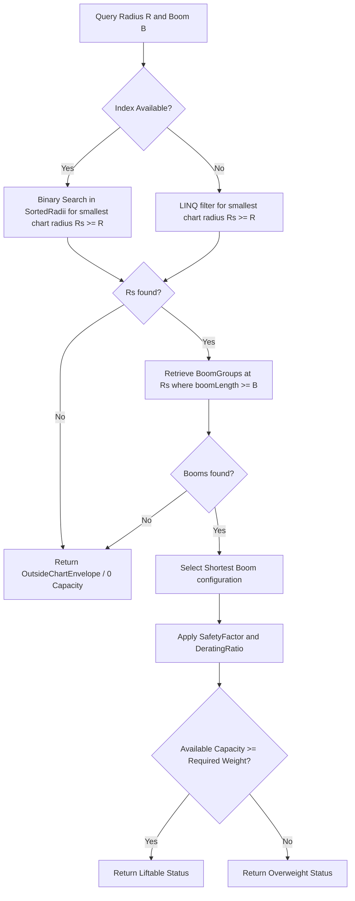

# Domain: Crane Engine & Load Charts

The Crane Engine evaluates whether a crane configuration is capable of lifting a given load at a specific operating radius and boom length.

---

## 1. Load Chart Representation & Storage

*   **Catalog Database Entity:** Crane characteristics and load charts are stored in [CraneSpecification.cs](file:///f:/06-ITI/00-Project/Main%20Project/CraneOptimizer/CraneOptimizer.Domain/Entities/CraneSpecification.cs) and its related collection of [TargetPoint.cs](file:///f:/06-ITI/00-Project/Main%20Project/CraneOptimizer/CraneOptimizer.Domain/Entities/TargetPoint.cs) entries in the catalog SQLite database.
*   **Storage Modes:** Configurable via `CraneSpecification.LoadChartStorageMode`:
    *   `Standard2D`: Standard 2D (Radius vs Capacity) lookup.
    *   `ExactPdfVisual`: Raw grid structures representing exact visual columns extracted from manufacturer PDF datasheets.

### Blank & Zero Cell Safeguards
Inside [LoadChartCapacityResolver.cs](file:///f:/06-ITI/00-Project/Main%20Project/CraneOptimizer/CraneOptimizer.Application/Optimization/GeneticAlgorithms/Services/LoadChartCapacityResolver.cs#L367-L380):
*   **Blank Cells (`Capacity <= -1.0`):** Mapped to `ChartStatus.InvalidBlankCell` and `LiftStatus.NotCharted` (failure reason `CapacityFailureReason.InvalidBlankCell`).
*   **Zero Cells (`Capacity == 0.0`):** Mapped to `ChartStatus.InvalidZeroCell` and `LiftStatus.NotCharted` (failure reason `CapacityFailureReason.InvalidZeroCell`).
*   **Positive Capacity (`Capacity > 0.0`):** Used to compute effective lifting capacities.

---

## 2. Capacity Resolution Algorithm (ConservativeStep)

Rather than using linear interpolations (which could overestimate capacity between discrete manufacturer-defined steps), the engine implements a **ConservativeStep** lookup algorithm in [LoadChartCapacityResolver.cs](file:///f:/06-ITI/00-Project/Main%20Project/CraneOptimizer/CraneOptimizer.Application/Optimization/GeneticAlgorithms/Services/LoadChartCapacityResolver.cs). This algorithm rounds up operating radius requirements and enforces discrete intervals matching the manufacturer's charts.

### Key Execution Paths

1.  **Binary Search Fast-Path (Hot-Path):** When a [LoadChartIndex.cs](file:///f:/06-ITI/00-Project/Main%20Project/CraneOptimizer/CraneOptimizer.Application/Optimization/GeneticAlgorithms/Services/LoadChartIndex.cs) index is provided, the solver runs `ResolveWithIndex`. It executes a fast binary search on sorted radii ($O(\log N)$) using `FindFirstRadiusIndex` to find the smallest chart radius $R_s \ge R$, then fetches pre-grouped boom lengths ($O(1)$) from a hash-map.
2.  **Legacy Scan Fallback:** When no index is present, it uses LINQ to filter target points directly from the raw database collections.

### Load Chart Index Pre-Sorting and Grouping
Inside [LoadChartIndex.cs](file:///f:/06-ITI/00-Project/Main%20Project/CraneOptimizer/CraneOptimizer.Application/Optimization/GeneticAlgorithms/Services/LoadChartIndex.cs#L44-L118):
*   **Distinct Radii Array:** `SortedRadii` is distinct and pre-ordered ascending.
*   **Boom Length Grouping:** Targets at each radius are grouped using `Math.Round(tp.BoomLength, 4)` and ordered ascending.
*   **Conservative Selection on Duplicates:** To handle full-fidelity PDF visual sheets that may preserve duplicate visual columns for a single numeric boom length (e.g. for different operating modes or line counts), the entries in each boom length group are sorted by `VisualColumnIndex` then `Capacity`. Positive capacities (`Capacity > 0.0`) are sorted ascending by capacity, and the **minimum positive capacity** is selected as `MinPositiveEntry`. This ensures the solver evaluates complying lifts under the most conservative crane configuration.

### Interpolation & Capacity Scaling

Once a discrete load chart cell is resolved, the system calculates the effective capacity by applying scaling factors from `GASettings`:

$$\text{Capacity}_{\text{effective}} = \text{Capacity}_{\text{Chart}} \times \text{settings.DeratingRatio} \times \text{settings.SafetyFactor}$$

Where:
*   `settings.DeratingRatio` represents the capacity derating ratio (default `0.9` in [GASettings.cs](file:///f:/06-ITI/00-Project/Main%20Project/CraneOptimizer/CraneOptimizer.Application/Optimization/GeneticAlgorithms/Settings/GASettings.cs#L50)).
*   `settings.SafetyFactor` represents the user-defined operational safety limit (default `0.95` in [GASettings.cs](file:///f:/06-ITI/00-Project/Main%20Project/CraneOptimizer/CraneOptimizer.Application/Optimization/GeneticAlgorithms/Settings/GASettings.cs#L56)).
*   If $\text{Capacity}_{\text{effective}} \ge W_{\text{req}}$, the status is resolved as `Liftable`. Otherwise, it is flagged as `Overweight`.

