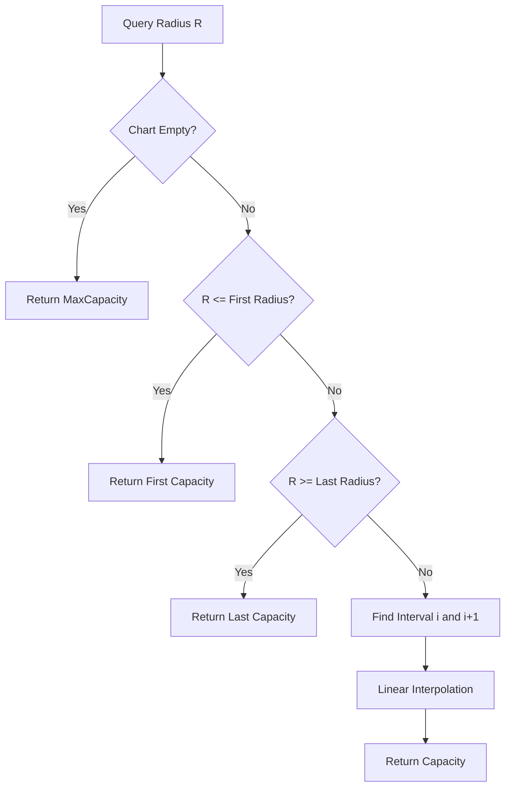

# Domain: Crane Engine & Load Charts

The Crane Engine evaluates whether a crane is physically capable of lifting a given load at a specific operating radius.

---

## 1. Data Models

Crane metrics are defined in [CraneRecord.cs](file:///f:/06-ITI/00-Project/Main%20Project/CraneOptimizer/CraneOptimizer.Domain/Entities/CraneRecord.cs) and its sub-entries [CraneLoadChartEntryRecord.cs](file:///f:/06-ITI/00-Project/Main%20Project/CraneOptimizer/CraneOptimizer.Domain/Entities/CraneLoadChartEntryRecord.cs).

* **Boundary Limits:** Operating range is bounded by `MinRadius` and `MaxRadius`. A lift is unreachable if:
  $$\text{Distance} < \text{MinRadius} \quad \text{or} \quad \text{Distance} > \text{MaxRadius}$$
* **Structural Clearance:** `BoomLength`, `JibLength`, and `BaseHeight` establish static height limits.
* **Hoist Speeds & Costs:** `HoistSpeed`, `SlewSpeed`, `TrolleySpeed`, and `OwnershipCost` are database parameters defined for schedule and budget optimizations (see Roadmap).

---

## 2. Load Chart Interpolation

Each crane has a list of radius-to-capacity entries. The capacity at a specific radius $R$ is computed inside `GetCapacityAtRadius` using linear interpolation:

### Linear Interpolation Formula
If the radius falls between entry $i$ and entry $i+1$, the interpolation factor $t$ is calculated:
$$t = \frac{R - R_i}{R_{i+1} - R_i}$$

The lifting capacity $C$ at that radius is then:
$$C = C_i + t \times (C_{i+1} - C_i)$$

Where:
* $R$ is the distance from crane center to element coordinates.
* $R_i, R_{i+1}$ are the radii of surrounding load chart entries.
* $C_i, C_{i+1}$ are the capacities corresponding to those entries.
