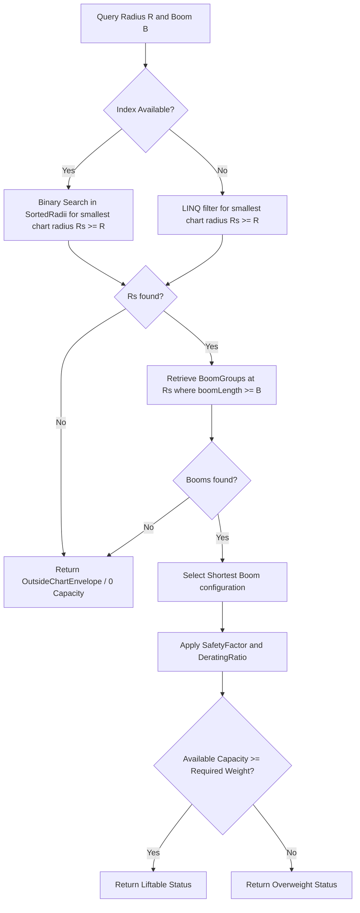

# Domain: Crane Engine & Load Charts

The Crane Engine evaluates whether a crane configuration is capable of lifting a given load at a specific operating radius and boom length.

---

## 1. Load Chart Representation & Storage

*   **Catalog Database Entity:** Crane characteristics and load charts are stored in `CraneSpecification.cs` and its related collection of `TargetPoint.cs` entries in the catalog SQLite database.
*   **Storage Modes:** Configurable via `CraneSpecification.LoadChartStorageMode`:
    *   `Standard2D`: Standard 2D (Radius vs Capacity) lookup.
    *   `ExactPdfVisual`: Raw grid structures representing exact visual columns extracted from manufacturer PDF datasheets.
*   **Blank & Zero Cell Safeguards:** Empty visual cells ($<=-1$) or zero capacity columns are marked as `InvalidBlankCell` or `InvalidZeroCell` to prevent unsafe operations.

---

## 2. Capacity Resolution Algorithm (ConservativeStep)

Rather than using unsafe linear interpolations (which could overestimate capacity between charted steps), the engine implements a **ConservativeStep** lookup algorithm in [LoadChartCapacityResolver.cs](file:///f:/06-ITI/00-Project/Main%20Project/CraneOptimizer/CraneOptimizer.Application/Optimization/GeneticAlgorithms/Services/LoadChartCapacityResolver.cs). This algorithm rounds up operating radius requirements and enforces discrete intervals matching the manufacturer's charts.

### Key Execution Paths

1.  **Binary Search Fast-Path (Hot-Path):** Utilizes a pre-built [LoadChartIndex.cs](file:///f:/06-ITI/00-Project/Main%20Project/CraneOptimizer/CraneOptimizer.Application/Optimization/GeneticAlgorithms/Services/LoadChartIndex.cs) built once for the crane specification. It executes an $O(\log N)$ binary search on sorted chart radii, retrieves pre-grouped boom length arrays (`BoomGroup`), and evaluates capacities immediately.
2.  **Legacy Scan Fallback:** Scans the target point database tables using LINQ to locate matching radius boundaries when no index is present.

### Interpolation & Capacity Scaling

Once a discrete load chart cell is resolved, the system calculates the effective capacity by applying scaling factors from `GASettings`:

$$\text{Capacity}_{\text{effective}} = \text{Capacity}_{\text{Chart}} \times \text{settings.DeratingRatio} \times \text{settings.SafetyFactor}$$

Where:
*   `settings.DeratingRatio` represents the capacity derating ratio (default `0.9`).
*   `settings.SafetyFactor` represents the user-defined operational safety limit (default `0.95`).
*   If $\text{Capacity}_{\text{effective}} \ge W_{\text{req}}$, the status is resolved as `Liftable`. Otherwise, it is flagged as `Overweight`.
*   If multiple configurations share duplicate visual columns, the capacity resolution policy selects the conservative minimum capacity across those duplicate columns.
