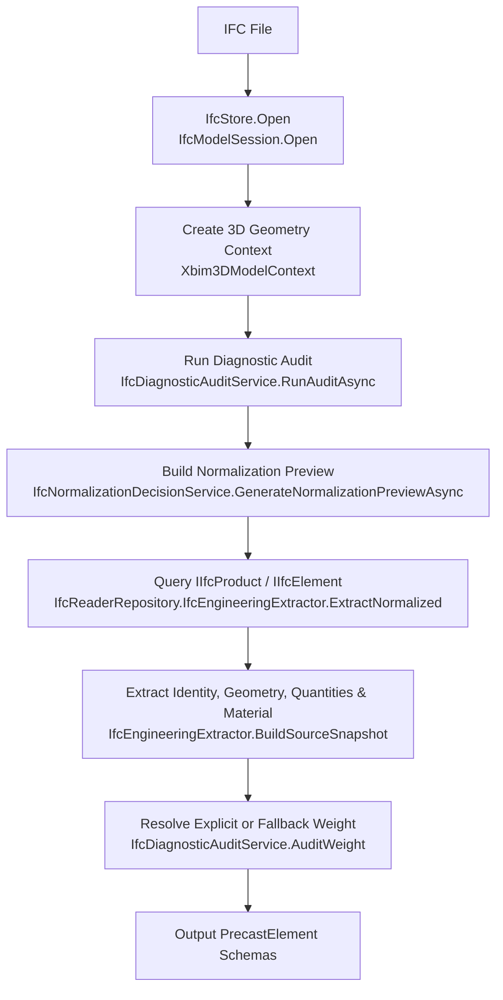

# Domain: IFC Processing Workflow

The IFC Processing Workflow extracts structural geometry from BIM models to define optimization targets.

---

## 1. Extraction Pipeline Process Flow

The concrete implementation is found in:
*   [IfcModelSession.cs](file:///f:/06-ITI/00-Project/Main%20Project/CraneOptimizer/CraneOptimizer.Infrastructure/Ifc/IfcModelSession.cs) (Class: `IfcModelSession`, Method: `Open`)
*   [IfcReaderRepository.cs](file:///f:/06-ITI/00-Project/Main%20Project/CraneOptimizer/CraneOptimizer.Infrastructure/Repositories/IfcReaderRepository.cs) (Class: `IfcReaderRepository`, Method: `ReadElementsCore` and nested `IfcEngineeringExtractor.ExtractNormalized`)
*   [IfcDiagnosticAuditService.cs](file:///f:/06-ITI/00-Project/Main%20Project/CraneOptimizer/CraneOptimizer.Infrastructure/Repositories/IfcDiagnosticAuditService.cs) (Class: `IfcDiagnosticAuditService`, Method: `ResolveCandidateCategory`, `AuditWeight`, and `AuditVolumeMaterial`)
*   [IfcNormalizationDecisionService.cs](file:///f:/06-ITI/00-Project/Main%20Project/CraneOptimizer/CraneOptimizer.Infrastructure/Repositories/IfcNormalizationDecisionService.cs) (Class: `IfcNormalizationDecisionService`, Method: `GenerateNormalizationPreviewAsync`)

---

## 2. Element Classification

The system parses physical IFC products and maps them to two distinct concepts:

### A. Resolved Category
Resolved via `IfcDiagnosticAuditService.ResolveCandidateCategory` using heuristic text matching on the raw IFC class name, element name, and object type description.
*   **Resolved Values:** `Column`, `Beam`, `Slab`, `Wall`, `Roof`, `Stair`, `Ramp`, `Footing`, `Pile`, `Plate`, `Member`, `Assembly`, `Proxy`, `Unknown`

### B. Normalization Role
Defined by the enum `IfcElementRole` inside [IfcNormalizationModels.cs](file:///f:/06-ITI/00-Project/Main%20Project/CraneOptimizer/CraneOptimizer.Domain/Diagnostics/IfcNormalizationModels.cs). Mapped during the normalization decision phase to determine how the optimizer interacts with each element:
*   `LiftableElement`: Standalone structural items that can be erected individually.
*   `LiftAssembly`: Grouped elements (e.g. nested precast assemblies) that are lifted as a single consolidated load.
*   `GroupingOnly`: Container assemblies (like `IIfcElementAssembly` parents) whose sub-components are extracted as independent liftable entities.
*   `InternalAuxiliary`: Internal reinforcing objects (like embedded rebar, plates, or joints) whose weight and geometry are swallowed by the parent liftable element.
*   `Excluded`: Elements completely ignored by the optimization (e.g., spaces, openings, openings templates).
*   `NeedsReview`: Elements with missing or contradictory metadata (e.g. missing weight or volume) that are hidden from the GA until resolved.

### Product Filtering
The extraction candidate set is resolved using `_model.Instances.OfType<IIfcProduct>().Where(IsEngineeringProduct)`. The predicate `IsEngineeringProduct()` requires an `IIfcElement` with a valid `GlobalId` and non-empty `Name`, while explicitly excluding non-physical or spatial items:
*   `IIfcOpeningElement` (Excluded)
*   `IIfcSpace` (Excluded)
*   `IIfcVirtualElement` (Excluded)

---

## 3. Weight Resolution & Fallbacks

Because IFC models do not always include explicit mass properties, the import path and UI display layers use separate fallback paths.

### A. Import Weight Priority Chain (`IfcDiagnosticAuditService.AuditWeight`)
During the normalized import path, the element weight is resolved in a strict priority chain:
1.  **Explicit Quantity Weight (`IIfcQuantityWeight`):** Searches the element's quantity sets for a weight property containing `"weight"` or `"mass"`. Values are converted from kilograms to metric tons:
    $$\text{Weight}_{\text{Tons}} = \frac{\text{Weight}_{\text{kg}}}{1000}$$
2.  **Explicit Property Set Weight (`IIfcPropertySingleValue`):** Searches property sets for single value properties containing `"weight"` or `"mass"`. Properties are parsed and scaled based on unit indicators (`kg`, `lb`, `ton`, `tonne`). Tekla-specific weights $>100.0$ are heuristically scaled to tons assuming the raw property was exported in kilograms.
3.  **Direct Volume Fallback:** If no explicit weight property exists, the importer fetches direct volume (from `IIfcQuantityVolume` or volume properties) and applies the concrete density fallback:
    $$\text{Weight}_{\text{Tons}} = \frac{\text{Volume (m}^3\text{)} \times 2500 \text{ kg/m}^3}{1000}$$
4.  **No Bounding Box Fallback:** The normalized import path does **not** fall back to bounding-box volume to estimate the import weight. If volume is missing, the element is flagged with `IfcElementRole.NeedsReview` and blocked from the GA.

### B. UI / Display Estimated Weight (`ElementWeightCalculator`)
When a restored `PrecastElement` lacks a positive `ElementWT` in the database, the UI filter and element-management display code uses [ElementWeightCalculator.cs](file:///f:/06-ITI/00-Project/Main%20Project/CraneOptimizer/CraneOptimizer.UI/Features/F16_Filter/Services/ElementWeightCalculator.cs) (Methods: `GetWeightTons()`, `GetDensityKgPerCubicMeter()`) as a display-only estimation helper. It uses the following material and type heuristics:
*   **Steel:** $7850 \text{ kg/m}^3$ (Matches keywords `STEEL`, `REBAR`, `REINFORC`, `METAL`)
*   **Aluminum:** $2700 \text{ kg/m}^3$ (Matches keyword `ALUMIN`)
*   **Glass:** $2500 \text{ kg/m}^3$ (Matches keyword `GLASS`)
*   **Timber:** $600 \text{ kg/m}^3$ (Matches keywords `TIMBER`, `WOOD`)
*   **Concrete / Default Fallback:** $2500 \text{ kg/m}^3$

---

## 4. IFC Schema Coverage

The application does not enforce a project-specific schema allow-list. File opening is delegated to `IfcStore.Open()` inside `IfcModelSession.Open`, and the schema version is recorded in metadata through `model.SchemaVersion` (saved in [IfcDiagnosticAuditService.cs](file:///f:/06-ITI/00-Project/Main%20Project/CraneOptimizer/CraneOptimizer.Infrastructure/Repositories/IfcDiagnosticAuditService.cs#L214) via `SchemaVersion = model.SchemaVersion.ToString()`).

| Schema | xBIM Support | Known Differences |
|---|---|---|
| **IFC2X3** | Full | Property set names (`Pset_BeamCommon` vs `Pset_BeamCommon`) and quantity names frequently differ from IFC4. Unit designations and classification associations require heuristic mappings. |
| **IFC4** | Full | Standardized quantities (`Qto_BeamBaseQuantities` and `BaseQuantities`) are queryable directly. Material layer sets and element profiles are highly structured. |
| **IFC4X1 / IFC4X2 / IFC4X3** | Partial (via xBIM) | Supported via the underlying xBIM Interop engine. Geometry representation conventions can vary, but standard extrusion and boundary representation meshes extract successfully. |

---

## 5. Authoring Tool Compatibility

Revit-exported and Tekla-exported IFC files carry metadata and spatial structures differently, which triggers specific normalization role mappings:

### Revit IFC Exports
*   **Property Sets:** Weight/mass quantities are typically carried in `Pset_BeamCommon` or `Pset_ColumnCommon`.
*   **Volume:** Volume is expressed as `GrossVolume` or `NetVolume` inside quantity sets, or under custom Revit property tabs.
*   **Storey Assignments:** Visual spatial elements are assigned to `IfcBuildingStorey` containers via `IfcRelContainedInSpatialStructure`.
*   **Assemblies:** Revit exports nested elements as flat lists of independent elements or groups assemblies as `IfcElementAssembly` (often with both parent and children carrying geometry). This triggers `GroupingOnly` for the parent container to extract the children independently, or `LiftAssembly` if consolidated.
*   **Naming Pattern:** Naming conventions typically match family names followed by Revit Element IDs (e.g. `M_Concrete-Column : 400x400mm : 185430`).

### Tekla Structures IFC Exports
*   **Property Sets:** Weights are usually found in `BaseQuantities` or custom sets such as `TeklaQuantities`.
*   **Volume:** Volumes are represented as `Volume` or computed from bounding profiles.
*   **Naming Conventions:** Often contain descriptive prefix names (e.g. `COLUMN`, `BEAM`, `SLAB`) and detail-level marks in the `Name` or `Description` fields (e.g. `C-1`, `B-12`).
*   **Embedded Elements:** Tekla exports frequently include tiny embedded rebar, anchors, or connection plates. These are categorized as `InternalAuxiliary` under `IfcNormalizationDecisionService` and swallowed by their respective parents.

---

## 6. Spatial Structure Handling

*   **IfcProject:** Evaluated in `IfcModelSession.Open` to retrieve units in context (e.g., `LENGTHUNIT` millimetre vs metre scaling).
*   **IfcBuildingStorey:** Mapped to resolve model ground elevation and filter building storeys in the UI sidebar.
*   **IfcSite / IfcBuilding:** Not imported as physical optimization targets.
*   **IfcSpace:** Explicitly excluded from physical extraction inside `IfcReaderRepository.IfcEngineeringExtractor.IsEngineeringProduct()`.
*   **Placement Offset:** The user-selected coordinate reference offset (configured in the UI and processed in [ProjectStateService.cs](file:///f:/06-ITI/00-Project/Main%20Project/CraneOptimizer/CraneOptimizer.UI/Features/F10_ProjectManagement/Services/ProjectStateService.cs)) is applied to the shape geometry mesh centroids and bounding boxes when the model coordinates are saved or restored.
