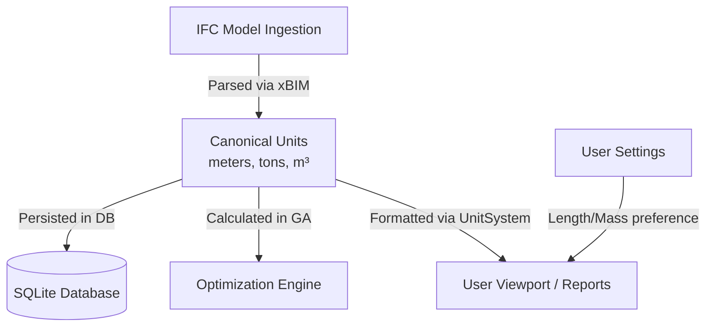

# Unit System Documentation

This document describes the design, conversions, and persistence of the physical units system within the Mobile Crane Path Optimizer.

---

## 1. Core Architecture Principles

The project uses a strict separation between **Canonical Storage/Runtime Units** and **User Display Preferences**:

1. **Calculations and Storage are strictly Metric**: All physical math (operating radii, load chart capacities, crane boom lengths, and element weight constraints) uses canonical metric values. This prevents rounding errors and layout mismatches.
2. **Display formatting is lazy**: Value conversions to imperial or non-meter units happen only in the UI presentation layer (e.g., in XAML value converters or report text builders) using the active project unit settings.

---

## 2. Canonical Units (Database & Calculation)

All properties on domain entities (e.g. `PrecastElement`, `CraneSpecification`, `CranePositionResult`) store values in these units:

| Dimension | Canonical Unit | C# Type | Database Representation |
| :--- | :--- | :--- | :--- |
| **Length / Coordinates** | Meters ($m$) | `double` | Real |
| **Weight / Mass** | Metric Tons ($t$) | `double` | Real |
| **Area** | Square Meters ($m^2$) | `double` | Real |
| **Volume** | Cubic Meters ($m^3$) | `double` | Real |

---

## 3. IFC Model Ingestion & Scaling

IFC files can encode geometries and properties using various unit systems (e.g., millimeters or feet). During ingestion, [IfcReaderRepository](file:///f:/06-ITI/00-Project/Main%20Project/CraneOptimizer/CraneOptimizer.Infrastructure/Repositories/IfcReaderRepository.cs) reads the unit context and scales all quantities to canonical metrics.

### Length & Coordinates Scaling
The parser inspects the `IIfcProject.UnitsInContext` definition to extract length unit multipliers:
- **Millimeter**: Multiplied by `0.001`
- **Centimeter**: Multiplied by `0.01`
- **Foot / Feet**: Multiplied by `0.3048`
- **Inch**: Multiplied by `0.0254`
- **Meter**: Multiplied by `1.0` (Default length factor)

### Weight Extraction & Conversions
Under the IFC4 standard, mass quantities (`IIfcQuantityWeight`) are stored in kilograms ($kg$).
- Runtime elements must use **metric tons ($t$)**, so weights are divided by `1000` (defined by `UnitSystem.KilogramsPerTon`).

### Fallback Weight Calculations
If an element's weight is zero, null, or missing in the IFC properties, the weight is estimated using its physical geometry volume ($m^3$) and material density:

$$\text{Weight (tons)} = \frac{\text{Volume } (m^3) \times \text{Density } (\text{kg/m}^3)}{1000}$$

Material densities are mapped as follows:
- **Steel, Rebar, Metal**: $7850 \text{ kg/m}^3$
- **Aluminum**: $2700 \text{ kg/m}^3$
- **Glass**: $2500 \text{ kg/m}^3$
- **Timber, Wood**: $600 \text{ kg/m}^3$
- **Default (Concrete / Unknown)**: $2500 \text{ kg/m}^3$

---

## 4. User Display Preferences & Setting Persistence

Users can select their preferred display unit system for dialog lists, charts, and metadata cards.

### Display Unit Enums
- [LengthUnit.cs](file:///f:/06-ITI/00-Project/Main%20Project/CraneOptimizer/CraneOptimizer.Domain/Units/LengthUnit.cs): `Millimeter` (mm), `Centimeter` (cm), `Meter` (m), `Inch` (in), `Foot` (ft).
- [MassUnit.cs](file:///f:/06-ITI/00-Project/Main%20Project/CraneOptimizer/CraneOptimizer.Domain/Units/MassUnit.cs): `Kilogram` (kg), `Ton` (t).
- [AreaUnit.cs](file:///f:/06-ITI/00-Project/Main%20Project/CraneOptimizer/CraneOptimizer.Domain/Units/AreaUnit.cs): `SquareMeter` (m²), `SquareFoot` (ft²).

### Persistence & Storage
Settings are persistent per project. The project configuration is managed by [IUnitSettingsService](file:///f:/06-ITI/00-Project/Main%20Project/CraneOptimizer/CraneOptimizer.Domain/Units/IUnitSettingsService.cs) and stored directly on the SQLite `Project` table:
- `DisplayLengthUnit` (stored as integer representing LengthUnit enum)
- `DisplayMassUnit` (stored as integer representing MassUnit enum)
- `DisplayAreaUnit` (stored as integer representing AreaUnit enum)
- `UnitDecimalPlaces` (number of decimal places in string display, clamped between `0` and `6`)

---

## 5. Central Code Reference

### UnitSystem Class
[UnitSystem.cs](file:///f:/06-ITI/00-Project/Main%20Project/CraneOptimizer/CraneOptimizer.Domain/Units/UnitSystem.cs) contains constants and conversion methods:
- `ToMeters()` / `FromMeters()`
- `ToTons()` / `FromTons()`
- `FormatLength()` / `FormatMass()` / `FormatArea()` (handles localization and decimal clamping)

### WPF UI Converters
UI conversion in XAML is managed dynamically using WPF binding converters that reference the current runtime settings service:
- [LengthDisplayConverter.cs](file:///f:/06-ITI/00-Project/Main%20Project/CraneOptimizer/CraneOptimizer.UI/Core/Converters/LengthDisplayConverter.cs)
- [MassDisplayConverter.cs](file:///f:/06-ITI/00-Project/Main%20Project/CraneOptimizer/CraneOptimizer.UI/Core/Converters/MassDisplayConverter.cs)
- [ElementWeightDisplayConverter.cs](file:///f:/06-ITI/00-Project/Main%20Project/CraneOptimizer/CraneOptimizer.UI/Features/F5_ElementManagement/Views/ElementWeightDisplayConverter.cs)
