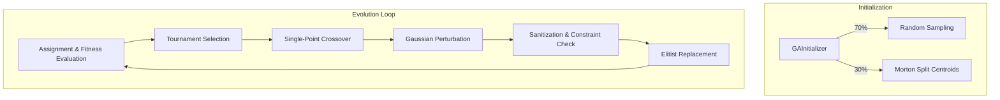

# Genetic Algorithm Engine & Pipeline Flow Design

This consolidated document explains chromosome encoding, selection, crossover, and pipeline execution flow.

## Consolidated from: Domain: Genetic Algorithm (GA) Optimization Engine (domain/ga-engine-design.md)


The optimization engine is responsible for finding the most effective sequence of coordinate positions to set up a mobile crane to maximize precast erection coverage while minimizing costs and satisfying safety regulations.

For a detailed walkthrough of the complete execution pipeline flow, see the pipeline section below.

---

## 1. Chromosome Representation

A candidate relocation sequence is represented by the [CraneChromosome.cs](file:///f:/06-ITI/00-Project/Main%20Project/CraneOptimizer/CraneOptimizer.Application/Optimization/GeneticAlgorithms/Models/CraneChromosome.cs) class:
*   **Gene Sequence:** A chromosome contains a list of [DomainPoint3D](file:///f:/06-ITI/00-Project/Main%20Project/CraneOptimizer/CraneOptimizer.Domain/Common/DomainPoint3D.cs) points representing the sequential coordinates of the crane setups:
    $$\text{Chromosome} = \langle \mathbf{P}_1, \mathbf{P}_2, \dots, \mathbf{P}_n \rangle$$
    where each setup $\mathbf{P}_i = (X_i, Y_i, Z_i)$ represents a distinct location.
*   **Variable Length:** The number of setups $n$ is dynamic and bounded by `settings.MaxCranePositions` (default 3, though configurable up to 4 or more).
*   **Sanitization:** The engine sanitizes final chromosomes during mutation, crossover, and replacement stages to filter out duplicate, invalid, or out-of-boundary points.

---

## 2. Spatial Constraints & Footprints

Constraints are evaluated at different stages to ensure valid search spaces:
1.  **Allowed Zone Inclusion:** Evaluated in `ConstraintEngine.IsValidSetupPoint()`. The entire crane footprint (circle of radius `CraneFootprintRadius` around the setup point) must lie completely inside the `Allowed` zone polygon.
2.  **Forbidden Zone Overlap:** Checked using ray-casting and segment distance algorithms in [SpatialMath.cs](file:///f:/06-ITI/00-Project/Main%20Project/CraneOptimizer/CraneOptimizer.Application/Optimization/Utilities/SpatialMath.cs). The crane footprint must not intersect any forbidden zone polygon or obstacle.
3.  **Proximity Constraints:** Crane setups must be separated by at least `settings.MinimumRelocationDistance` to be considered unique relocations. Proximity violations trigger similarity penalties.
4.  **Zone Boundary Projection:** If a perturbed point (during mutation) or a heuristic centroid (during initialization in [GAInitializer.cs](file:///f:/06-ITI/00-Project/Main%20Project/CraneOptimizer/CraneOptimizer.Application/Optimization/GeneticAlgorithms/Engines/GeneticOptimization/GAInitializer.cs#L295-L301)) falls outside the allowed zones, it is projected onto the nearest boundary of the closest allowed zone using `ProjectPointToZoneBoundary` before checking for validity.

---

## 3. Fitness Function

The fitness of a solution is calculated in [FitnessEvaluator.cs](file:///f:/06-ITI/00-Project/Main%20Project/CraneOptimizer/CraneOptimizer.Application/Optimization/GeneticAlgorithms/Engines/GeneticOptimization/FitnessEvaluator.cs#L254-L265) using a multi-objective weighted deduction formula:

$$\text{Fitness} = \max\left(0, W_{\text{cov}} \cdot M_{\text{dom}} \cdot R_{\text{cov}} - \text{Penalty}_{\text{rel}} - W_{\text{rad}} \cdot P_{\text{rad}} - W_{\text{ow}} \cdot P_{\text{ow}} - W_{\text{h}} \cdot P_{\text{h}} - W_{\text{sc}} \cdot P_{\text{sc}} - W_{\text{rq}} \cdot P_{\text{rq}} - P_{\text{bal}} - P_{\text{sd}} - W_{\text{sim}} \cdot P_{\text{sim}} - W_{\text{dist}} \cdot P_{\text{dist}}\right)$$

### Components & Deductions

*   **Coverage Dominance Multiplier ($M_{\text{dom}}$):** The coverage term is scaled by `CoverageDominanceMultiplier` (default `100.0`) times `CoverageWeight` to ensure that any coverage improvement overrides all penalties combined. This is critical for multi-zone discovery where a coverage gain might otherwise be cancelled by relocation or failure penalties. `CoverageDominanceMultiplier` does not change the physical lift safety checks — unsafe overweight elements remain unliftable regardless of fitness scaling.

*   **Coverage Ratio ($R_{\text{cov}}$):** Number of successfully liftable elements divided by total elements. A coverage ratio of 0 immediately results in a total fitness of 0.
*   **Step-wise Relocation Penalty ($\text{Penalty}_{\text{rel}}$):** In [FitnessEvaluator.cs](file:///f:/06-ITI/00-Project/Main%20Project/CraneOptimizer/CraneOptimizer.Application/Optimization/GeneticAlgorithms/Engines/GeneticOptimization/FitnessEvaluator.cs#L160-L162), this is calculated as `settings.RelocationWeight * (craneCount - 1)` for crane counts greater than 1 (0 penalty for a single setup). Note: This is an un-normalized step-wise deduction, whereas the diagnostic CSV logs the normalized fraction `(double)craneCount / MaxCranePositions` for `RelocationPenalty`.
*   **Out of Radius Fraction ($P_{\text{rad}}$):** The proportion of elements that are out of reach of all crane setups in the solution.
*   **Overweight Fraction ($P_{\text{ow}}$):** The proportion of elements that exceed the crane's load-chart lifting limits at their respective radii.
*   **Height Failure Fraction ($P_{\text{h}}$):** The proportion of elements that exceed hook height limits.
*   **Special Case Fraction ($P_{\text{sc}}$):** The proportion of elements marked as unchartable or invalid.
*   **Radius Quality ($P_{\text{rq}}$):** Encourages solutions to use shorter working radii: average radius of liftable elements divided by `MaxRadiusForNormalisation`.
*   **Balance Penalty ($P_{\text{bal}}$):** Weighted variance of liftable elements distributed across setups to favor balanced work distribution.
*   **Radius Std Dev Penalty ($P_{\text{sd}}$):** Penalizes variations in lifting radii to ensure consistent operations.
*   **Setup Proximity Penalty ($P_{\text{sim}}$):** Normalised proximity penalty for setups placed closer than `MinimumRelocationDistance`.
*   **Relocation Distance Penalty ($P_{\text{dist}}$):** Normalized total coordinate distance between sequential crane setups.

---

## 4. Genetic Operators

*   **Selection:** Implemented in [TournamentSelection.cs](file:///f:/06-ITI/00-Project/Main%20Project/CraneOptimizer/CraneOptimizer.Application/Optimization/GeneticAlgorithms/Operators/TournamentSelection.cs). Executes tournament selection with size $k = 3$. Wins are decided by fitness, then coverage, then setup count.
*   **Crossover:** Implemented in [CrossoverOperator.cs](file:///f:/06-ITI/00-Project/Main%20Project/CraneOptimizer/CraneOptimizer.Application/Optimization/GeneticAlgorithms/Operators/CrossoverOperator.cs). Performs uniform coordinate crossover per index with a 50% swap rate. Setups closer than the duplicate threshold ($2 \times \text{CraneFootprintRadius}$) are skipped rather than merged, which dynamically alters chromosome length.
*   **Mutation:** Implemented in [MutationOperator.cs](file:///f:/06-ITI/00-Project/Main%20Project/CraneOptimizer/CraneOptimizer.Application/Optimization/GeneticAlgorithms/Operators/MutationOperator.cs#L29-L112). Applies one of three mutations based on a hardcoded **80/10/10 probability split**:
    1.  **Coordinate Perturbation (80%):** Perturbs coordinates using Gaussian noise. Sigma is calculated from `MutationSigma` and can adaptively decrease over generations if `EnableAdaptiveSigma` is active. If the perturbed coordinate falls out of boundary, it is projected onto the closest zone boundary.
    2.  **Setup Addition (10%):** Spawns a new coordinate inside permissible zones, capped by `MaxCranePositions`. This increases chromosome length.
    3.  **Setup Removal (10%):** Deletes a random coordinate setup, maintaining a minimum of 1 setup. This decreases chromosome length.

---

## 5. Parallel Execution & Profiling (Phase 3A Implemented)

*   **Parallel Candidate Evaluation**: The GA engine parallelizes both the initial population evaluation loop and the child evaluation loop in [GAEngine.cs](file:///f:/06-ITI/00-Project/Main%20Project/CraneOptimizer/CraneOptimizer.Application/Optimization/GeneticAlgorithms/Engines/GeneticOptimization/GAEngine.cs) utilizing `Parallel.ForEach` with `ParallelOptions` and the existing `cancellationToken`.
*   **Evaluation Encapsulation**: The shared evaluation logic is encapsulated in the private helper method `EvaluateSolution`, which evaluates crane coordinate assignments and sets solution fitness and coverage ratios in-place on the candidate solution instance.
*   **Sequential Genetic Operators**: The core genetic operator pipeline remains sequential, including parent selection (`TournamentSelection`), crossover (`CrossoverOperator`), mutation (`MutationOperator`), replacement (`ReplacementStrategy`), and the random seed generation (`GARandomManager`). The random number generator is called exclusively from sequential steps and is not invoked inside the parallel evaluation loops, resulting in a low determinism risk because random generation remains sequential.
*   **Thread Safety**: Thread safety is safe for the audited candidate evaluation loops, because evaluations write only to the private instance fields (`Fitness`, `CoverageRatio`) of the candidate being processed and read from thread-safe indices (`LoadChartIndex` and `ElementStaticCache`). Timing metrics are accumulated concurrently via `ConcurrentDictionary` and `Interlocked` counters in `GAProfiler`.
*   **Diagnostics & Collection Order**: Diagnostics exports, generation logs, and CSV output writes are executed sequentially outside the parallel loops. The collection order of candidate populations and child lists is preserved exactly.
*   **Runtime Performance & Validation**:
    *   *Hungarian Solver Speedup*: Because the Hungarian solver is computationally heavy (~3.4 ms per sequential evaluation), parallelization yields a substantial speedup—decreasing the total run duration by **56.4%** and generation loop duration by **54.0%** (a **2.17x generation-loop speedup**) for a population of 100 on the tested datasets.
    *   *Greedy Solver Speedup*: The Greedy assignment path is already highly lightweight (~1.4 ms per sequential evaluation). Parallelization yields a smaller but steady **13.6% total run reduction** due to concurrent task scheduling overhead.
    *   *Equivalence*: No differences were detected in fixed-seed validation; coverages, setups, placements, and fitness scores match the sequential baseline identically. Build and tests compiled and passed successfully.
*   **Profiling Traces:** Profiling metrics (such as cache hit ratios, allocation deltas, and CPU generation timings) are gathered in real-time by the [GAProfiler.cs](file:///f:/06-ITI/00-Project/Main%20Project/CraneOptimizer/CraneOptimizer.Application/Optimization/Utilities/GAProfiler.cs) utility.

---

## 6. Termination & Convergence

The optimization loop terminates when:
1.  **Max Generations** is reached (configured via `GASettings.MaxGenerations`).
2.  **Stagnation Limit** is met: No improvement in the best fitness score for a sliding window of `EarlyStoppingGenerations` (default 20).
3.  **Relative Progress Convergence** is reached: Relative improvements in fitness drop below `ConvergenceThresholdPercent`. If `ConvergenceThresholdPercent == 0` (the default value), this progress convergence check is bypassed, meaning early stopping is solely determined by a complete lack of fitness improvement over the stagnation window.

---

## 7. Default UI/Dialog Execution Parameters

When running from the UI dialog (e.g., in [CraneOptimizerDialogWorkflow.cs](file:///f:/06-ITI/00-Project/Main%20Project/CraneOptimizer/CraneOptimizer.UI/Features/F8_GAOptimizer/Workflows/CraneOptimizerDialogWorkflow.cs#L90-L96)), the default parameters are:
*   **Population Size:** 30
*   **Max Generations:** 30
*   **Mutation Rate:** 0.1
*   **Crossover Rate:** 0.8
*   **Random Seed:** 42 (allows deterministic runs)


---

## Consolidated from: Domain: Genetic Algorithm (GA) Execution Pipeline (domain/ga-engine-design.md)


This document describes the complete execution pipeline of the Genetic Algorithm (GA) optimizer in the Mobile Crane Path Optimizer.

---

## 1. Full Run Optimization Flow

```mermaid
graph TD
    %% User Trigger & Scope Building
    User[User Triggers Run] --> InputBuilder[OptimizationInputBuilder.Build]
    
    subgraph Input Validation & Settings Mutation
        InputBuilder --> ValElements{Elements Valid?<br/>IncludeInGa=true & weight > 0}
        ValElements -- No --> FailExit[Return Failure Result<br/>User-Facing Message]
        ValElements -- Yes --> ValSpecs{Cranes Valid?<br/>Load Chart present & MaxRadius > 0}
        
        ValSpecs -- No --> FailExit
        ValSpecs -- Yes --> ValZones{Zones Valid?<br/>At least 1 Allowed Zone}
        
        ValZones -- No --> FailExit
        ValZones -- Yes --> MutateSettings[Mutate Settings:<br/>MaxRadiusForNormalisation, DeratingRatio, CraneFootprintRadius]
        MutateSettings --> PassInput[Build PlacementInput Bundle]
    end
    
    %% Placement Orchestration Path
    PassInput --> RunOpt[CranePlacementEngine.RunOptimization]
    RunOpt --> CheckConcurrent{Settings.EnableConcurrentOptimization?}
    
    %% Legacy Path
    CheckConcurrent -- False --> SetCover[Legacy Greedy Set-Cover Loop<br/>Max 4 iterations or target coverage reached]
    SetCover --> GAEngineLegacy[GAEngine.Run]
    
    %% Concurrent Path
    CheckConcurrent -- True --> GAEngineConcurrent[GAEngine.Run]
    
    %% GA Initialization
    subgraph GA Core Solver (GAEngine.Run)
        GAEngineConcurrent --> GAInit[GAInitializer.InitializePopulation]
        GAInit --> PopulationMix[70% Random Samples<br/>30% Heuristic Morton Curve Centroids]
        PopulationMix --> TrackGen[Track GAProfiler:<br/>CandidatePointsGenerated, ValidPointsGenerated]
        
        %% GA Generation Loop
        TrackGen --> GenLoop{Generation Loop<br/>0 to MaxGenerations}
        GenLoop -- Loop --> EvalPop[EvaluatePopulation: Parallel.ForEach]
        
        subgraph Solution Assignment & Scoring
            EvalPop --> AssignService[ElementAssignmentService.EvaluateAssignment<br/>Using LoadChartIndex & ElementStaticCache]
            AssignService --> CalcRadius[Calculate Reach Radius R]
            CalcRadius --> CalcHeight[Calculate Lift Height H]
            CalcHeight --> CalcBoom[Calculate Required Boom Length B]
            CalcBoom --> ResolveChart[LoadChartCapacityResolver.Resolve]
            ResolveChart --> FitnessEvaluator[FitnessEvaluator.EvaluateFitness]
        end
        
        FitnessEvaluator --> SelectParents[TournamentSelection.SelectParents<br/>Size k=3]
        SelectParents --> Crossover[CrossoverOperator.Crossover]
        Crossover --> Mutate[MutationOperator.Mutate<br/>80% Perturb / 10% Add / 10% Remove]
        Mutate --> Sanitize[ConstraintEngine.SanitizeChromosome / FilterDistinctValidPoints]
        Sanitize --> Replace[ReplacementStrategy.Replace]
        
        Replace --> CheckStagnation{Stagnant for EarlyStoppingGenerations?}
        CheckStagnation -- Yes --> EndLoop[Stop Loop & Return Best CraneSolution]
        CheckStagnation -- No --> GenLoop
    end
    
    %% Mapping Result & Deduplication
    EndLoop --> MapResult[CranePlacementEngine.MapResult]
    GAEngineLegacy --> MapResult
    
    subgraph Result Formatting & Post-Processing
        MapResult --> ReEvaluate[Re-evaluate final positions]
        ReEvaluate --> ResolveAssignments[AssignmentPolicy.ResolveFinalAssignments<br/>Unique element-crane ownership]
        ResolveAssignments --> RecalcCoverage[CoverageEngine.RecalculateCoverage]
        RecalcCoverage --> Deduplicate[CoverageEngine.DeduplicateFinalPositions]
        Deduplicate --> BuildResult[Build PlacementResult with statistics]
    end
    
    BuildResult --> FinalOutput[Final Output Result Visualized in Viewport]
```

The classes and methods coordinating this pipeline are:
*   **Input Scope Builder:** [OptimizationInputBuilder.cs](file:///f:/06-ITI/00-Project/Main%20Project/CraneOptimizer/CraneOptimizer.Application/Optimization/GeneticAlgorithms/Engines/OptimizationScope/OptimizationInputBuilder.cs) (Class: `OptimizationInputBuilder`, Method: `Build`)
*   **Optimization Orchestrator:** [CranePlacementEngine.cs](file:///f:/06-ITI/00-Project/Main%20Project/CraneOptimizer/CraneOptimizer.Application/Optimization/GeneticAlgorithms/Engines/PlacementOrchestration/CranePlacementEngine.cs) (Class: `CranePlacementEngine`, Method: `RunOptimization`)
*   **GA Core Solver:** [GAEngine.cs](file:///f:/06-ITI/00-Project/Main%20Project/CraneOptimizer/CraneOptimizer.Application/Optimization/GeneticAlgorithms/Engines/GeneticOptimization/GAEngine.cs) (Class: `GAEngine`, Method: `Run`)
*   **Population Initializer:** [GAInitializer.cs](file:///f:/06-ITI/00-Project/Main%20Project/CraneOptimizer/CraneOptimizer.Application/Optimization/GeneticAlgorithms/Engines/GeneticOptimization/GAInitializer.cs) (Class: `GAInitializer`, Method: `InitializePopulation`)
*   **Assignment Evaluator:** [ElementAssignmentService.cs](file:///f:/06-ITI/00-Project/Main%20Project/CraneOptimizer/CraneOptimizer.Application/Optimization/GeneticAlgorithms/Engines/GeneticOptimization/ElementAssignmentService.cs) (Class: `ElementAssignmentService`, Method: `EvaluateAssignment`)
*   **Fitness Evaluator:** [FitnessEvaluator.cs](file:///f:/06-ITI/00-Project/Main%20Project/CraneOptimizer/CraneOptimizer.Application/Optimization/GeneticAlgorithms/Engines/GeneticOptimization/FitnessEvaluator.cs) (Class: `FitnessEvaluator`, Method: `EvaluateFitness`)
*   **Selection Operator:** [TournamentSelection.cs](file:///f:/06-ITI/00-Project/Main%20Project/CraneOptimizer/CraneOptimizer.Application/Optimization/GeneticAlgorithms/Operators/TournamentSelection.cs) (Class: `TournamentSelection`, Method: `SelectParents`)
*   **Crossover Operator:** [CrossoverOperator.cs](file:///f:/06-ITI/00-Project/Main%20Project/CraneOptimizer/CraneOptimizer.Application/Optimization/GeneticAlgorithms/Operators/CrossoverOperator.cs) (Class: `CrossoverOperator`, Method: `Crossover`)
*   **Mutation Operator:** [MutationOperator.cs](file:///f:/06-ITI/00-Project/Main%20Project/CraneOptimizer/CraneOptimizer.Application/Optimization/GeneticAlgorithms/Operators/MutationOperator.cs) (Class: `MutationOperator`, Method: `Mutate`)
*   **Sanitization & Constraints:** [ConstraintEngine.cs](file:///f:/06-ITI/00-Project/Main%20Project/CraneOptimizer/CraneOptimizer.Application/Optimization/GeneticAlgorithms/Engines/Constraints/ConstraintEngine.cs) (Class: `ConstraintEngine`, Method: `FilterDistinctValidPoints` / `IsValidSetupPoint`)
*   **Replacement Strategy:** [ReplacementStrategy.cs](file:///f:/06-ITI/00-Project/Main%20Project/CraneOptimizer/CraneOptimizer.Application/Optimization/GeneticAlgorithms/Operators/ReplacementStrategy.cs) (Class: `ReplacementStrategy`, Method: `Replace`)
*   **Final Policy & Coverage:** [AssignmentPolicy.cs](file:///f:/06-ITI/00-Project/Main%20Project/CraneOptimizer/CraneOptimizer.Application/Optimization/GeneticAlgorithms/Services/AssignmentPolicy.cs) (Class: `AssignmentPolicy`, Method: `ResolveFinalAssignments`) and [CoverageEngine.cs](file:///f:/06-ITI/00-Project/Main%20Project/CraneOptimizer/CraneOptimizer.Application/Optimization/GeneticAlgorithms/Engines/Coverage/CoverageEngine.cs) (Class: `CoverageEngine`, Methods: `DeduplicateFinalPositions`, `RecalculateCoverage`, and `FilterRemainingElements`).

---

## 2. Element Assignment Decision Tree

For every precast element evaluated against every crane setup candidate coordinate in a chromosome, the feasibility is determined step-by-step. The logic is implemented in `ElementAssignmentService.ComputeEvaluationResult` and resolved via `LoadChartCapacityResolver.Resolve`.

```
For each (element, craneSetupPosition) pair:
│
├── 1. Calculate R = OperatingRadius (accounting for SlewOffsetX/Y offsets)
│    └── R < MinRadius OR R > MaxRadius?
│         ├── YES ──> [Status: OutOfRadius]
│         └── NO
│              │
│              ├── 2. Calculate H = LiftHeight (accounting for half-height and WireLength)
│              ├── 3. Calculate Required Boom Length B (accounting for hinge offset)
│              │    └── B > MaxBoomLength?
│              │         ├── YES ──> [Status: HeightFail]
│              │         └── NO
│              │              │
│              │              └── 4. Query ConservativeStep load chart (with pre-sorted LoadChartIndex lookup):
│              │                   ├── No listed chart radii where radius >= R?
│              │                   │    └── YES ──> [Status: OutsideChartEnvelope]
│              │                   │
│              │                   ├── No listed boom configurations where boom length >= B at selected radius?
│              │                   │    └── YES ──> [Status: OutsideChartEnvelope]
│              │                   │
│              │                   ├── Lowest positive capacity entry resolved in boom group:
│              │                   │    ├── Capacity cell <= -1? (Empty/blank)
│              │                   │    │    └── YES ──> [Status: InvalidBlankCell (NotCharted)]
│              │                   │    │
│              │                   │    ├── Capacity cell == 0? (Zero capacity)
│              │                   │    │    └── YES ──> [Status: InvalidZeroCell (NotCharted)]
│              │                   │    │
│              │                   │    └── Positive Capacity resolved:
│              │                   │         │
│              │                   │         ├── Calculate AvailableCapacity = ChartCapacity × DeratingRatio × SafetyFactor
│              │                   │         │
│              │                   │         └── Is AvailableCapacity >= RequiredWeight?
│              │                   │              ├── YES ──> [Status: Liftable] ✓
│              │                   │              └── NO  ──> [Status: Overweight]
```

*   **Status Codes:** Mapped to the `LiftStatus` enum inside [LiftStatus.cs](file:///f:/06-ITI/00-Project/Main%20Project/CraneOptimizer/CraneOptimizer.Application/Optimization/GeneticAlgorithms/Models/LiftStatus.cs).
*   **Capacity Errors:** Mapped via the `CapacityFailureReason` enum inside [LoadChartResolverResult.cs](file:///f:/06-ITI/00-Project/Main%20Project/CraneOptimizer/CraneOptimizer.Application/Optimization/GeneticAlgorithms/Models/LoadChartResolverResult.cs).

---

## 3. Fitness Formulation & Penalization Metrics

The core GA selection pressure is driven by the fitness formula implemented in [FitnessEvaluator.cs](file:///f:/06-ITI/00-Project/Main%20Project/CraneOptimizer/CraneOptimizer.Application/Optimization/GeneticAlgorithms/Engines/GeneticOptimization/FitnessEvaluator.cs) (Method: `EvaluateFitness`).

### Core Deductions and Calculations

1.  **Coverage Ratio ($R_{\text{cov}}$):**
    The positive signal of the GA. Calculated using the count of unique liftable element IDs divided by total elements:
    $$R_{\text{cov}} = \frac{\text{uniqueLiftableCount}}{\text{total}}$$
    *   **Zero Coverage Threshold:** If $\text{uniqueLiftableCount} = 0$, fitness is immediately resolved as $0$ to bypass futile selection evaluations.

2.  **Relocation Penalty ($\text{Penalty}_{\text{rel}}$):**
    Instead of scaling by chromosome capacities, the raw fitness deduction is step-wise based on the number of active crane setups:
    $$\text{Penalty}_{\text{rel}} = \text{settings.RelocationWeight} \times (n - 1)$$
    where $n = \text{craneCount}$. (A single setup has 0 relocation penalty; each additional setup adds a full weight penalty).

3.  **Failure Fractions:**
    To normalize scale across projects, unliftable elements are counted and divided by the total number of elements in the current pass (`total`):
    *   **Out of Radius Fraction:** $P_{\text{rad}} = \frac{\text{outOfRadiusCount}}{\text{total}}$
    *   **Overweight Fraction:** $P_{\text{ow}} = \frac{\text{overweightCount}}{\text{total}}$
    *   **Height Failure Fraction:** $P_{\text{h}} = \frac{\text{heightFailCount}}{\text{total}}$
    *   **Special Case / Uncharted Fraction:** $P_{\text{sc}} = \frac{\text{specialCaseCount}}{\text{total}}$

4.  **Complete Fitness Equation:**
    $$\text{Fitness} = \max\left(0, W_{\text{cov}} \times M_{\text{dom}} \times R_{\text{cov}} - \text{Penalty}_{\text{rel}} - W_{\text{rad}} \times P_{\text{rad}} - W_{\text{ow}} \times P_{\text{ow}} - W_{\text{h}} \times P_{\text{h}} - W_{\text{sc}} \times P_{\text{sc}} - W_{\text{rq}} \times P_{\text{rq}} - P_{\text{bal}} - P_{\text{sd}} - W_{\text{sim}} \times P_{\text{sim}} - W_{\text{dist}} \times P_{\text{dist}}\right)$$

    *   **Double Penalization Caveat:** Under this formula, any unliftable element decreases positive $R_{\text{cov}}$ *and* simultaneously increases its corresponding failure fraction (e.g. $P_{\text{rad}}$). This creates a steep fitness gradient to quickly weed out unfeasible coordinates.

### Coverage vs Fitness Score Separation

| Metric | Scope | Range | Description |
|---|---|---|---|
| `CoverageRatio` | User-facing | 0.0 – 1.0 | Fraction of elements lifted (internal storage) |
| `CoveragePercent` | User-facing | 0 – 100 | `CoverageRatio × 100`, displayed to users |
| `FitnessScore` | Internal GA | ≥ 0 (may be >> 1) | Raw GA score used for selection pressure, scaled by `CoverageWeight × CoverageDominanceMultiplier`. Not comparable across different settings. |

> **UI Rule:** Show Coverage % and lifted count in the result panel. Raw `FitnessScore` must be labeled **GA Score** if shown.

---

## Consolidated from: Genetic Algorithm Architecture & Mathematical Review (project/ga-engine-design.md)


This document presents a comprehensive, evidence-based architectural and mathematical review of the **Genetic Algorithm (GA) Optimization Engine** in the Mobile Crane Path Optimizer. Grounded in the actual C# implementations in `CraneOptimizer.Application/Optimization/GeneticAlgorithms/`, this review compares the current optimization design against modern metaheuristic and evolutionary algorithm best practices.

The goal is to determine if the GA is mathematically sound, identify structural and algorithmic limitations that hinder convergence or cause stagnation, and outline concrete recommendations for future improvement before any optimization code is implemented.

---

## Executive Summary

The Mobile Crane Path Optimizer uses a Genetic Algorithm to solve the multi-setup crane placement problem. The current implementation uses a hybrid (70% random / 30% heuristic) initialization, tournament selection, single-point coordinate crossover, Gaussian mutation, and an elitist replacement strategy.

While functional, the GA design has several **critical mathematical and architectural flaws** that lead to premature convergence, inefficient search space exploration, and a high risk of local minima:
1. **Dynamic Length Shrinkage Lock:** Crossover and mutation operators cannot increase chromosome length. Chromosomes can only shrink during sanitization, locking the search space into a unidirectional reduction of crane setup counts.
2. **Symmetry & Permutation Redundancy:** Relocations are represented as an ordered sequence of coordinates, introducing $N!$ equivalent representations for a set of $N$ positions. This artificially inflates the search space and makes crossover highly disruptive.
3. **Loss of Heuristic Guidance:** The element-centroid initialization heuristic discards spatial information for off-zone centroids by placing a random point in the nearest zone, rather than projecting it.
4. **Greedy Single-Pass Assignment:** Elements are assigned to cranes deterministically by local proximity, preventing the GA from exploring balance trade-offs.
5. **Linear Double-Penalization:** The fitness function double-penalizes unlifted elements, distorting selection pressure and leading to flat fitness landscapes.
6. **Aggressive Selection Pressure:** The combination of tournament selection and $(\mu + \lambda)$ replacement quickly collapses population diversity.

---

## Detailed Architectural Review



---

### 1. Population Initialization Strategy

#### Current Implementation
Implemented in [GAInitializer.cs](file:///f:/06-ITI/00-Project/Main%20Project/CraneOptimizer/CraneOptimizer.Application/Optimization/GeneticAlgorithms/Engines/GeneticOptimization/GAInitializer.cs).
* **Population Mix:** 70% random, 30% heuristic.
* **Heuristic Clustering:** Precast elements are sorted using a 1D Morton (Z-order) curve projection and divided into $K$ equal-sized chunks (where $K \in [1, \text{MaxCranePositions}]$ is randomly chosen). The centroid of each chunk is calculated.
* **Zone Mapping:** If a centroid is inside an allowed green zone, it is snapped to the grid. If it is outside all zones, the closest zone is selected by centroid-to-centroid distance, and a **completely random point** is sampled inside that zone.

#### Critique & Discrepancies
1. **Morton Chunking is not Clustering:** Splitting a sorted list of points into equal-sized chunks groups elements by coordinate order rather than spatial density. If element density is uneven, chunks will cross natural spatial boundaries, yielding centroids located in empty space.
2. **Centroid Information Discarded:** In `FindNearestValidPoint()`, when a centroid falls outside allowed zones, sampling a random point inside the closest zone completely discards the spatial coordinates of the centroid. This negates the heuristic's purpose and introduces random noise in the 30% seed.
3. **Lack of Diversity Control:** No checks ensure that the initial population does not contain identical or near-identical solutions.

#### Comparison & Recommendations
* **Best Practice:** Use a density-based spatial clustering algorithm (e.g., K-Means or DBSCAN) to group elements into compact, natural spatial clusters. Project off-zone centroids onto the boundary of the nearest zone (using minimum distance projection) rather than sampling randomly.
* **Expected Benefit:** Highly localized crane seeds that cover maximum elements, significantly accelerating convergence in the early generations.
* **Complexity:** Medium (requires implementing standard K-Means and polygon projection math).
* **Risk Level:** Low.

---

### 2. Chromosome Encoding & Search Space Representation

#### Current Implementation
Implemented in [CraneChromosome.cs](file:///f:/06-ITI/00-Project/Main%20Project/CraneOptimizer/CraneOptimizer.Application/Optimization/GeneticAlgorithms/Models/CraneChromosome.cs).
* **Representation:** A chromosome consists of a list of 3D points representing crane setup locations:
  $$\text{Chromosome} = \langle (X_1, Y_1, Z_1), (X_2, Y_2, Z_2), \dots, (X_n, Y_n, Z_n) \rangle$$
* **Length:** Dynamic, bounded by $1 \le n \le \text{settings.MaxCranePositions}$.

#### Critique & Discrepancies
1. **Unidirectional Length Shrinkage:** The GA crossover and mutation operators cannot add new positions to a chromosome. Crossover only copies parent lengths, and mutation only perturbs existing points. Sanitization (`FilterDistinctValidPoints`) and duplicate removal can *only reduce* the list size. Consequently, over generations, the average chromosome length can only shrink or stagnate. It can never expand to discover that adding a setup would improve coverage.
2. **Permutation Symmetries ($N!$ Problem):** The coordinates are stored in a standard ordered list. Since crane coverage is evaluated as a set (order of placement doesn't affect total erection capacity), a solution with positions $\{A, B\}$ is equivalent to $\{B, A\}$. Treating them as distinct individuals introduces a redundancy of $N!$ in the search space, which dilutes selection pressure and causes crossover to disrupt good coordinate sets.

#### Comparison & Recommendations
* **Best Practice:** 
  1. Introduce structural mutations: an "Addition Mutation" (inserts a new valid setup point with probability $p_{add}$) and a "Deletion Mutation" (removes a random setup point with probability $p_{del}$).
  2. Normalize the coordinate order in chromosomes (e.g., sort by X, then Y) before crossover and replacement to eliminate permutation symmetry.
* **Expected Benefit:** Enables the GA to explore different numbers of crane setups dynamically, finding the optimal balance between coverage and relocation costs, while reducing the search space size by $N!$.
* **Complexity:** Medium.
* **Risk Level:** Medium (requires tuning addition/deletion rates to prevent chromosome length explosion).

---

### 3. Selection Strategy & Selection Pressure

#### Current Implementation
Implemented in [TournamentSelection.cs](file:///f:/06-ITI/00-Project/Main%20Project/CraneOptimizer/CraneOptimizer.Application/Optimization/GeneticAlgorithms/Operators/TournamentSelection.cs).
* **Operator:** Tournament selection with a fixed tournament size of $3$.
* **Tie-Breaking:** Deterministic sorting based on `Fitness`, then `CoverageRatio`, and finally `Chromosome.CranePositions.Count` (ascending).

#### Critique & Discrepancies
* **High Selection Pressure:** While $k=3$ is a standard selection size, the selection pressure becomes excessively high when combined with the replacement strategy:
  `nonElitesMerged = oldPopulation.Except(elites).Concat(children)`
  Because parents and children are merged and the best are selected, parents that are superior to children survive indefinitely. This $(\mu + \lambda)$ style survival selection, combined with tournament selection, causes the best genes to dominate the population in very few generations, leading to premature convergence.

#### Comparison & Recommendations
* **Best Practice:** Switch to a $(\mu, \lambda)$ replacement strategy (where parents are replaced by children, preserving only a small elite subset) or decrease the tournament size to $2$ to lower selection pressure. Alternatively, implement stochastic tournament selection to maintain diversity.
* **Expected Benefit:** Slows down premature convergence, allowing the population to explore alternative spatial peaks before focusing on a single local minimum.
* **Complexity:** Low (simple parameters tweak).
* **Risk Level:** Low.

---

### 4. Crossover Operators

#### Current Implementation
Implemented in [CrossoverOperator.cs](file:///f:/06-ITI/00-Project/Main%20Project/CraneOptimizer/CraneOptimizer.Application/Optimization/GeneticAlgorithms/Operators/CrossoverOperator.cs).
* **Operator:** Single-point crossover on the sequence of crane setup positions.
* **Logic:** Chooses a random index `cut` in range $[1, \min(N_1, N_2) - 1]$. The child receives points $[0, \text{cut})$ from Parent 1 and $[\text{cut}, N_2)$ from Parent 2.

#### Critique & Discrepancies
1. **Spatial Disruption:** Swapping slices of an ordered list of points is highly disruptive. If Parent 1 has coordinates clustered in the north and south, and Parent 2 has coordinates in the east and west, crossover might yield a child with coordinates in the north and west, which is fine, but because the list indices are arbitrary, the resulting positions are combined blindly without considering their spatial relationships.
2. **Duplicate/Redundant Offspring:** If Parent 1 and Parent 2 share a similar crane position at different indices, crossover will frequently produce offspring with duplicate or near-duplicate positions, which are immediately filtered out by sanitization, shrinking the chromosome size.

#### Comparison & Recommendations
* **Best Practice:** Implement a spatial-aware crossover or uniform crossover. For example, group parent positions by spatial coordinates (e.g., matching the closest points) before crossover, or use a **uniform set crossover** where each position in the child is chosen randomly from either Parent 1 or Parent 2 based on spatial proximity.
* **Expected Benefit:** Better preservation of spatial features and building coverage zones, reducing the generation of invalid or duplicate children.
* **Complexity:** Medium (requires spatial matching calculations).
* **Risk Level:** Low.

---

### 5. Mutation Operators & Local Search

#### Current Implementation
Implemented in [MutationOperator.cs](file:///f:/06-ITI/00-Project/Main%20Project/CraneOptimizer/CraneOptimizer.Application/Optimization/GeneticAlgorithms/Operators/MutationOperator.cs).
* **Operator:** Gaussian perturbation on a single random crane setup point:
  $$X_{\text{mutated}} = \text{SnapToGrid}(X + \mathcal{N}(0, \sigma^2))$$
* **Constraints Verification:** If the mutated point is invalid (fails allowed/forbidden zones) or is too close to another setup point, it is discarded. The operator attempts up to `PositionSamplingAttempts / 4` times. If all attempts fail, the mutation is aborted and the point remains unchanged.

#### Critique & Discrepancies
1. **High Failure Rate in Constrained Sites:** In sites with small allowed zones or complex obstacles, the probability of a random Gaussian perturbation landing in a valid location is extremely low. As a result, the loop frequently fails all attempts, meaning **no mutation occurs** for that chromosome, stalling exploration.
2. **Static Sigma ($\sigma$):** The mutation spread $\sigma$ is constant throughout the run. Early in the GA, large mutations are needed to explore the site (high $\sigma$). Late in the GA, small mutations are needed to fine-tune placements (low $\sigma$). A static $\sigma$ compromises both goals.
3. **No Local Search:** The GA lacks a local search step (e.g., hill climbing or Hooke-Jeeves) to fine-tune crane coordinates. Relocating a crane by 1 meter could increase coverage of a critical element, but Gaussian mutation is too random to perform this fine adjustment reliably.

#### Comparison & Recommendations
* **Best Practice:**
  1. Implement **adaptive mutation (cooling schedule):** Scale $\sigma$ dynamically based on the current generation:
     $$\sigma_t = \sigma_0 \times (1 - \frac{t}{T})^\alpha$$
     where $t$ is the current generation and $T$ is the max generations.
  2. Implement a **repair mutation** that slides invalid mutated points to the nearest boundary of the allowed zone instead of discarding them.
  3. Introduce a hybrid memetic algorithm by performing local gradient-free search (e.g. pattern search) on the best solution.
* **Expected Benefit:** Higher mutation success rate, efficient local tuning of crane setups, and thorough exploration of tight site geometries.
* **Complexity:** Medium to High (adaptive scaling is low; local search integration is medium).
* **Risk Level:** Medium (local search must be fast to avoid increasing runtime).

---

### 6. Constraint Handling Mechanics

#### Current Implementation
Implemented in [ConstraintEngine.cs](file:///f:/06-ITI/00-Project/Main%20Project/CraneOptimizer/CraneOptimizer.Application/Optimization/GeneticAlgorithms/Engines/Constraints/ConstraintEngine.cs).
* **Mechanism:** Hard constraints checked during initialization, mutation, and crossover.
* **Sanitization:** Children are immediately passed through `FilterDistinctValidPoints` which strips out invalid or duplicate points.
* **Centroid Fallback:** If sanitization removes all setup points, the chromosome falls back to the centroid of the first allowed zone.

#### Critique & Discrepancies
1. **Disconnected Search Space:** Enforcing hard constraints at all steps blocks the GA from traversing "infeasible" regions. For example, if two allowed zones are separated by a forbidden zone, a crane position cannot cross from one to the other via small mutations because intermediate steps are rejected, creating isolated islands in the search space.
2. **Centroid Fallback Bias:** If a child's positions are all filtered, replacing them with a zone centroid creates a strong genetic bias towards the center of the first zone, reducing population diversity.

#### Comparison & Recommendations
* **Best Practice:** Implement **soft constraints** using a dynamic penalty function. Allow coordinates to temporarily reside in forbidden zones or outside allowed zones, but apply a fitness penalty proportional to the distance of violation:
  $$\text{Penalty}_{\text{constraint}} = W_{\text{pen}} \times \text{DistanceToValidZone}(\text{SetupPoint})$$
  Increase the penalty weight dynamically over generations so that by the end of the GA, all solutions are forced to be feasible.
* **Expected Benefit:** Allows the GA to bridge disconnected allowed areas, maintaining smooth gradients on the fitness surface.
* **Complexity:** High (requires computing distance from point to arbitrary polygons).
* **Risk Level:** Low.

---

### 7. Fitness Function & Multi-Objective Trade-offs

#### Current Implementation
Implemented in [FitnessEvaluator.cs](file:///f:/06-ITI/00-Project/Main%20Project/CraneOptimizer/CraneOptimizer.Application/Optimization/GeneticAlgorithms/Engines/GeneticOptimization/FitnessEvaluator.cs).
* **Formula:**
  $$\text{Fitness} = \max\left(0, W_{\text{cov}} \times R_{\text{cov}} - W_{\text{rel}} \times P_{\text{rel}} - W_{\text{rad}} \times P_{\text{rad}} - W_{\text{ow}} \times P_{\text{ow}} - W_{\text{h}} \times P_{\text{h}} - W_{\text{sc}} \times P_{\text{sc}} - P_{\text{bal}} - P_{\text{sd}} - W_{\text{sim}} \times P_{\text{sim}} - W_{\text{dist}} \times P_{\text{dist}}\right)$$

#### Critique & Discrepancies
1. **Double Penalization Defect:** An element that cannot be lifted because it is out of radius is penalized twice:
   * It reduces the positive coverage ratio: $-W_{\text{cov}} \times \frac{1}{N_{\text{total}}}$.
   * It increases the out-of-radius fraction: $-W_{\text{rad}} \times \frac{1}{N_{\text{total}}}$.
   This double penalization occurs for all failure states (overweight, height, etc.), distorting selection pressure.
2. **Linear Weighted Sum Limitations:** Combining coverage, setup count, and mobilization distance into a single linear sum assumes a linear trade-off. In reality, these are conflicting, discrete objectives. The weights are highly sensitive; a slight change can make the GA prefer a 1-setup solution with 50% coverage over a 3-setup solution with 98% coverage.
3. **Flat Landscape Risk:** Clamping fitness at $0$ means that in early generations, if solutions fail basic lifting checks, their fitness is clamped to $0$. When multiple individuals have $0$ fitness, selection becomes a random walk, wasting early search cycles.

#### Comparison & Recommendations
* **Best Practice:**
  1. Remove double-penalization: The fitness function should reward coverage and penalize operational constraints (like relocation count, balance, and travel distance), but failures of unlifted elements should not be penalized separately if they are already accounted for by the coverage ratio.
  2. Implement **lexicographical comparison** or a **Pareto-based multi-objective approach (e.g., NSGA-II)**, optimizing two objectives: Maximize Coverage and Minimize Crane Setups.
  3. Ensure fitness is never clamped to 0 for active solutions by adding a small positive gradient (e.g., based on how close out-of-radius elements are to the lifting radius).
* **Expected Benefit:** Highly stable optimization that naturally outputs a Pareto front of solutions (e.g., showing the user the best 1-setup, 2-setup, and 3-setup options).
* **Complexity:** High (requires refactoring the GA engine to support multi-objective populations).
* **Risk Level:** Low.

---

### 8. Diversity Preservation & Premature Convergence

#### Current Implementation
* **Mechanism:** None. The engine relies solely on mutation and the random seed portion of initialization to maintain diversity.

#### Critique & Discrepancies
* **Fast Convergence Stagnation:** Due to the combination of tournament selection, $(\mu + \lambda)$ elitist replacement, and the lack of length-increasing operators, the population rapidly converges to a single local peak. Once converged, mutation is too weak to escape the local minimum, resulting in early termination.

#### Comparison & Recommendations
* **Best Practice:**
  1. Implement **Deterministic Crowding:** Children replace parents only if they are more fit and spatially similar, preventing the population from collapsing onto a single peak.
  2. Implement an **Island Model** or **Sub-Populations:** Evolve independent populations in parallel, occasionally migrating individuals between islands to introduce new genetic material.
  3. Introduce a **re-initialization / cataclysmic mutation** trigger: If the population's genetic variance falls below a threshold, keep the best individual and re-initialize the rest of the population.
* **Expected Benefit:** Robust avoidance of local minima, ensuring consistent quality across different site layouts.
* **Complexity:** Medium.
* **Risk Level:** Low.

---

### 9. Convergence & Termination Criteria

#### Current Implementation
Implemented in [GAEngine.cs](file:///f:/06-ITI/00-Project/Main%20Project/CraneOptimizer/CraneOptimizer.Application/Optimization/GeneticAlgorithms/Engines/GeneticOptimization/GAEngine.cs).
* **Generations:** Fixed maximum of 500.
* **Early Stopping:** Stops if there is no fitness improvement (above `ConvergenceThresholdPercent`) for `EarlyStoppingGenerations` (default 20).

#### Critique & Discrepancies
* **Stagnation Check is Too Simple:** The stagnation counter only tracks the *best* fitness value. If the best fitness is flat for 20 generations, it stops. However, during these 20 generations, the rest of the population might still be diversifying or exploring other regions that could eventually lead to a better peak. Stopping solely on the best fitness index limits late-stage exploration.

#### Comparison & Recommendations
* **Best Practice:** base early stopping on **population-wide convergence** (e.g., when the difference between the average fitness and the best fitness is less than a small threshold $\epsilon$, or when the spatial variance of the population is near zero), combined with a minimum number of generations (e.g., at least 100).
* **Expected Benefit:** Prevents premature termination when the population is still actively exploring the search space.
* **Complexity:** Low.
* **Risk Level:** Low.

## 8. Assembly Lift Consolidation & Rollup (Grouped Lifts)

When optimization is executed, the pipeline handles parent assemblies and their child elements depending on the `EnableGroupedLifts` configuration:

### Grouped Lifts Mode (EnableGroupedLifts = true)
1. **Container Exclusion:** The parent assembly container (which lacks direct physical geometry/mesh) is excluded from entering the GA solver as a physical lift target.
2. **Child Swallowing:** Sibling components (structural, accessory, and reinforcement members) belonging to a valid assembly are consolidated. They are marked as `Role = Excluded` and `IncludeInGa = false` with the reason `"Swallowed as child component of valid Lift Assembly."`.
3. **Representative Lift Unit (Option E):** The solver constructs a single representative `PrecastElement` lift unit:
   * **Identity:** Its `LiftUnitId` (passed as `ElementID` to the GA solver) is mapped to the physical **`MainPartGlobalId`** of the assembly.
   * **Weight Rollup:** The weight is mapped to `AssemblyLiftWeight`. This uses the parent assembly's explicit weight if trusted, or falls back to the sum of all eligible children.
   * **COG Rollup:** The center of gravity is mapped to `AssemblyLiftCOG`. This is computed as the child-weighted centroid COG from children with physical geometry. Minor reinforcing/accessory parts lacking direct geometries fall back to the main part COG if their weight is $\le 2\%$ of the assembly total.
   * **Metadata:** The `ParentAssemblyGlobalId` and child member list `AssemblyMemberIds` are stored on the representative lift unit.
   * **Gating Promotion:** Valid mixed assemblies (containing structural main parts combined with secondary components of different classes) are promoted naturally to `Role = LiftAssembly` and `IncludeInGa = true` if they have a trusted parent-child hierarchy, a valid main part, a trusted weight, and a safe rollup COG.

### Ungrouped Lifts Mode (EnableGroupedLifts = false)
1. **Container Exclusion:** The parent assembly container is still excluded from entering the GA solver because it does not represent a physical individual lift target.
2. **Child Unrolling:** Sibling components are unrolled and enter the GA solver independently as individual physical lift units (e.g., the concrete wall and the secondary steel beams are lifted separately with their raw individual properties).

---

## Comparative Assessment & Improvement Roadmap

The table below summarizes the key recommendations, their complexity, and priority to guide the optimization strategy:

| Feature Area | Current Weakness | Recommended Best Practice | Expected Benefit | Priority | Complexity | Risk |
|---|---|---|---|---|---|---|
| **Chromosome Length** | Length can only shrink; no addition operator | Add Coordinate Insertion and Deletion mutation operators | Dynamic exploration of setup counts | **Critical** | Medium | Medium |
| **Symmetry** | $N!$ permutation redundancy in coordinate lists | Normalize/Sort coordinate list before evaluation | Reduces search space size by $N!$ | **High** | Low | Low |
| **Centroid Seeding** | Discards spatial coordinates for off-zone centroids | Project centroids onto zone boundaries | Preserves heuristic spatial guidance | **High** | Medium | Low |
| **Constraint Handling** | Disconnected search space via hard checks | Soft constraints with dynamic penalty functions | Smooth fitness surface; bridges obstacles | **Medium** | High | Low |
| **Fitness Function** | Double-penalizes failures; linear sum instability | Hierarchical or Pareto-based multi-objective (NSGA-II) | Eliminates weight tuning; outputs trade-off front | **High** | High | Low |
| **Diversity** | High premature convergence risk | Deterministic crowding or cataclysmic mutation | Prevents local minima stagnation | **High** | Medium | Low |
| **Local Search** | Lacks precision coordinate tuning | Memetic local search on the best solution | Fine-tuning coordinates for tight lifts | **Medium** | Medium | Medium |
| **Termination** | Stops early based only on best fitness | Stop based on average-to-best fitness delta | Prevents premature stopping | **Low** | Low | Low |


---

