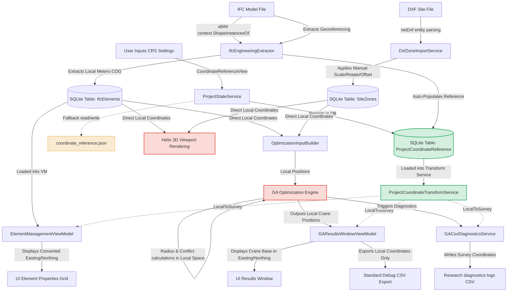

# GIS / Survey Point Integration Audit Report

## Executive Summary

An architectural and technical investigation was conducted across the entire **Mobile Crane Path Optimizer** codebase to assess the integration of GIS coordinates, Survey Points, Project Base Points, and Coordinate Reference Systems (CRS). The objective was to determine whether survey coordinates are fully integrated and whether they correctly influence the final crane path optimization results.

### Core Finding
The project's coordinate reference system is **Substantially Integrated (Status B, Phases 1 & 2 Completed)**. Specifically:
* **Presentation & Persistence Layers:** The system successfully persists the coordinate reference settings in the per-project `.craneopt` SQLite database and automatically extracts GIS/survey georeferencing metadata directly from imported IFC files (IFC4 and IFC2x3). It formats and displays coordinates in the survey coordinate space (Easting, Northing, Elevation) for UI readouts (status bar, element properties, results labels) and logs.
* **Core Logic Layer (The Safety Boundary):** The core optimization database, Genetic Algorithm (GA) solver, constraint engines (e.g., forbidden/allowed zone overlaps), and 3D Helix viewport rendering pipeline operate entirely in the **local coordinate system of the IFC file (in meters)**.
* **Zero Optimization Impact:** Changing the Survey Point coordinates or Rotation to North in the UI has **absolutely no effect** on the GA candidate point selection, crane radius checks, lift height calculations, load chart capacity checks, or the final GA-generated crane positions. The GA is completely decoupled from and unaware of the survey coordinate transformations.

---

## Architecture Analysis

The coordinate system architecture is split into two independent domains: the **Local Model Space** and the **Survey/GIS Space**.

```
+--------------------------------------------------------------------------------+
|                             LOCAL MODEL SPACE                                  |
|  - Units: Meters (derived from IFC SI Unit prefix)                             |
|  - Origin: (0,0,0) as defined in the IFC model file                            |
|  - Used by: SQLite DB, Helix 3D rendering viewport, GA Solver, Radius checks   |
+--------------------------------------------------------------------------------+
                                       |
                                       |  LocalToSurvey(Point)
                                       v
+--------------------------------------------------------------------------------+
|                             SURVEY / GIS SPACE                                 |
|  - Units: Easting (E), Northing (N), Elevation (H) in meters                   |
|  - Origin: Custom (E, N, H) mapped to Local (0,0,0)                            |
|  - Used by: UI Status Bar, Element Properties Grid, GA Results Readouts,       |
|             Research diagnostics logs (ga_diagnostics_*.csv)                   |
+--------------------------------------------------------------------------------+
```

### Key Components

1. **`ProjectCoordinateReference` ([ProjectCoordinateReference.cs](file:///f:/06-ITI/00-Project/Main%20Project/CraneOptimizer/CraneOptimizer.Domain/CreatedProject/ProjectCoordinateReference.cs)):** 
   A domain model storing the parameters of the coordinate transformation: `IsEnabled`, `SurveyEasting`, `SurveyNorthing`, `SurveyElevation`, `RotationToNorthDegrees`, `Scale`, `LocalReferenceX`, `LocalReferenceY`, and `LocalReferenceZ`.
2. **`ProjectCoordinateTransformService` ([ProjectCoordinateTransformService.cs](file:///f:/06-ITI/00-Project/Main%20Project/CraneOptimizer/CraneOptimizer.Application/Services/ProjectCoordinateTransformService.cs)):**
   Implements `IProjectCoordinateTransformService` and provides the mathematical transformation between the local coordinate system and the survey coordinate system. It performs a 2D rotation, scale, and 3D translation:
   * **`LocalToSurvey`:** Translates local $(x, y, z)$ to survey $(E, N, H)$.
   * **`SurveyToLocal`:** Translates survey $(E, N, H)$ to local $(x, y, z)$.
3. **`ProjectStateService` ([ProjectStateService.cs](file:///f:/06-ITI/00-Project/Main%20Project/CraneOptimizer/CraneOptimizer.UI/Features/F10_ProjectManagement/Services/ProjectStateService.cs)):**
   Saves and loads the active coordinate reference parameters directly inside the per-project `.craneopt` SQLite database (`ProjectCoordinateReferenceEntity`) as the primary persistence source, keeping `coordinate_reference.json` only as a backward-compatible fallback.

---

## Source Code Evidence

### Part 1 – IFC Coordinate Analysis

IFC geometry extraction is handled in the infrastructure layer.
* **File:** [IfcReaderRepository.cs](file:///f:/06-ITI/00-Project/Main%20Project/CraneOptimizer/CraneOptimizer.Infrastructure/Repositories/IfcReaderRepository.cs)
* **Class:** `IfcEngineeringExtractor`
* **Method:** `GetGeometrySnapshot(IIfcProduct product)`

```csharp
private GeometrySnapshot? GetGeometrySnapshot(IIfcProduct product)
{
    var shapeInstances = _geometryContext.ShapeInstancesOf(product).ToList();
    if (shapeInstances.Count == 0)
        return null;
    // ...
    foreach (var shapeInstance in shapeInstances)
    {
        UpdateBounds(shapeInstance, ref minX, ref minY, ref minZ, ref maxX, ref maxY, ref maxZ);
        // ...
        var centroidResult = CalculateCentroidFromShapeGeometry(shapeGeometry, shapeInstance.Transformation);
        // ...
    }
}
```
xBIM’s `Xbim3DModelContext` geometry engine automatically resolves the local placement hierarchy (such as `IfcLocalPlacement` and `IfcAxis2Placement3D`) to return shape instances mapped to the model's coordinate system origin $(0,0,0)$. 

**Findings:**
1. **What coordinates are extracted?** Element bounding boxes and Center of Gravity (COG) centroids are extracted in meters relative to the IFC model's origin.
2. **Are Survey / Shared / Project Base Point Coordinates extracted?** **Yes (implemented in Phase 2)**. The system queries georeferencing entities like `IfcMapConversion` and `IfcProjectedCRS` (in IFC4/IFC4x3) to extract Easting, Northing, Orthogonal Height, Scale, and Axis rotations, and queries `IfcSite` RefLatitude / RefLongitude / RefElevation (converted from DMS to decimal degrees) as informational metadata fallback in IFC2x3.
3. **Are coordinates transformed during import?** No. Elements are still read raw and normalized to local meters relative to the model origin (preserving local geometry representation). However, `ProjectCoordinateReference` is auto-populated from extracted georeferencing data (if empty or disabled) to establish the survey mapping.
4. **Are coordinates stored in the database?** Yes. Element local COGs and bounds are stored in the `IfcElements` table, while the survey reference parameters themselves are stored in the `ProjectCoordinateReference` table.
5. **Are coordinates exposed to ViewModels/Reports?** Yes. `ElementManagementViewModel` and `GAResultsWindowViewModel` use the `IProjectCoordinateTransformService` to format local coordinates into survey readouts for presentation and diagnostics.

---

### Part 2 – DXF Coordinate Analysis

DXF boundary coordinates are parsed using the `netDxf` library.
* **File:** [DxfZoneImportService.cs](file:///f:/06-ITI/00-Project/Main%20Project/CraneOptimizer/CraneOptimizer.UI/Features/F11_DXF/Services/DxfZoneImportService.cs)
* **Method:** `GetCandidates(DxfDocument document, string layerName, Matrix3D transform)`

```csharp
private static DomainPoint3D Transform(double x, double y, double z, Matrix3D transform)
{
    var point = transform.Transform(new Point3D(x, y, z));
    return new DomainPoint3D(point.X, point.Y, point.Z);
}
```

**Findings:**
1. **Coordinate System:** DXF entities use the coordinate system of the DXF file.
2. **Local vs Global:** Coordinates are assumed local to the DXF. They are transformed using a manual WPF `Matrix3D transform` configured in [DxfAlignmentViewModel.cs](file:///f:/06-ITI/00-Project/Main%20Project/CraneOptimizer/CraneOptimizer.UI/Features/F11_DXF/ViewModels/DxfAlignmentViewModel.cs).
3. **Survey Point Influence:** The Survey Point settings **do not affect DXF geometry**. The DXF coordinates are aligned entirely with the **IFC local coordinate system** using manual translation offsets, scaling, and rotation.
4. **Coordinate Mismatch Risk:** There is no automated alignment based on shared coordinates or GIS tags. Visual alignment is manual, posing a risk of mismatch if the user enters wrong point-matches.

---

### Part 3 – Element Coordinate Analysis

Element coordinates are tracked through the following pipeline:
1. **IFC File:** Extracted relative to the IFC local origin via `IfcReaderRepository.cs`.
2. **Database:** Persisted in SQLite `IfcElements` table columns `COG_X`, `COG_Y`, `COG_Z` (model local origin in meters).
3. **ViewModel:** Loaded as `PrecastElement` with `COG_M` in local coordinates.
4. **Visualization:** Meshes are rendered using local coordinates.
5. **Optimization:** GA calculates fitness using local coordinates.
6. **Survey Point Impact:** None of the data storage, optimization, or visualization stages are modified by the Survey Point. The Survey Point is only invoked dynamically via `_transformService.LocalToSurvey` when generating UI text values.

---

### Part 4 – F5 Visualization Analysis

The rendering engine resides in the UI layer.
* **File:** [SceneRenderingManager.cs](file:///f:/06-ITI/00-Project/Main%20Project/CraneOptimizer/CraneOptimizer.UI/Core/Services/SceneRenderingManager.cs)
* **F2 Viewer:** [IfcViewerViewModel.cs](file:///f:/06-ITI/00-Project/Main%20Project/CraneOptimizer/CraneOptimizer.UI/Features/F2_IfcViewer/ViewModels/IfcViewerViewModel.cs)

**Findings:**
* **Rendered Coordinates:** Geometry is rendered using the raw local coordinates in meters $(x,y,z)$.
* **Survey Point Impact:** The Survey Point does **not** shift or rotate the 3D meshes or viewport environment. 
* **Verification:** The `SceneRenderingManager.cs` does not inject or reference `IProjectCoordinateTransformService`. Changing the Survey Point or Rotation to North in settings has **zero effect** on rendering.

---

### Part 5 – F8 Optimization Analysis

The optimization pipeline runs in the Application layer.
* **Scope Filtering:** [OptimizationInputBuilder.cs](file:///f:/06-ITI/00-Project/Main%20Project/CraneOptimizer/CraneOptimizer.Application/Optimization/GeneticAlgorithms/Engines/OptimizationScope/OptimizationInputBuilder.cs) gathers elements and zone vertices directly in local coordinates.
* **Constraint Engine:** [ConstraintEngine.cs](file:///f:/06-ITI/00-Project/Main%20Project/CraneOptimizer/CraneOptimizer.Application/Optimization/GeneticAlgorithms/Engines/Constraints/ConstraintEngine.cs) performs 2D polygon overlaps (`IsCircleInsidePolygon`, `DoesCircleOverlapPolygon`) in local coordinate lists.
* **Lifting Calculation:** [LiftingCalculationEngine.cs](file:///f:/06-ITI/00-Project/Main%20Project/CraneOptimizer/CraneOptimizer.Application/Optimization/GeneticAlgorithms/Engines/LiftingCalculation/LiftingCalculationEngine.cs) calculates radius and lift heights using local coordinates:

```csharp
public double CalculateRadius(DomainPoint3D cranePosition, PrecastElement element, GASettings settings)
{
    double slewX = cranePosition.X + settings.SlewOffsetX;
    double slewY = cranePosition.Y + settings.SlewOffsetY;

    double dx = slewX - element.ElementCOG.X;
    double dy = slewY - element.ElementCOG.Y;

    return Math.Sqrt(dx * dx + dy * dy);
}
```

**Findings:**
1. **Coordinates Used:** The GA uses local coordinates.
2. **Survey Point Impact:** **None**. The calculations for crane placement constraints, distances, boom heights, hoist clearances, and fitness evaluations are completely decoupled from `IProjectCoordinateTransformService`.
3. **Verification:** Changing Survey Point parameters does not affect the optimization calculations or the final selected crane positions.

---

### Part 6 – Database Analysis

The database maps local coordinates.
* **File:** [CreatedProjectDbContext.cs](file:///f:/06-ITI/00-Project/Main%20Project/CraneOptimizer/CraneOptimizer.Infrastructure/Contexts/CreatedProject/CreatedProjectDbContext.cs)

```csharp
protected override void OnModelCreating(ModelBuilder modelBuilder)
{
    // ...
    modelBuilder.Ignore<ProjectCoordinateReferenceEntity>();
}
```

**Findings:**
1. **Are Survey Coordinates stored?** **Yes (implemented in Phase 1)**. `ProjectCoordinateReferenceEntity` is mapped in EF Core (`CreatedProjectDbContext`) and stored inside the per-project `.craneopt` database. `coordinate_reference.json` remains only as a backward-compatible fallback.
2. **Are CRS definitions stored?** Yes (as of Phase 2 metadata extraction). CRS Name, Description, and EPSG code are stored in the database entity when extracted from `IfcProjectedCRS`.
3. **Are coordinate transforms stored?** IFC and DXF local adjustment matrices are stored in `IfcFiles` and `ModelFiles` tables under `TransformJson`, and the active project coordinate reference is stored in the `ProjectCoordinateReference` table.
4. **Persisted GIS Columns:** None. 

**SQLite Table & Columns containing Coordinates:**
* **`IfcElements`:** `COG_X`, `COG_Y`, `COG_Z` (Double), `BBoxMinX`, `BBoxMinY`, `BBoxMinZ`, `BBoxMaxX`, `BBoxMaxY`, `BBoxMaxZ` (Double).
* **`SiteZones`:** `VerticesJson` (String - JSON array of local 3D points).
* **`CraneSetups`:** `PositionX`, `PositionY`, `PositionZ` (Double), `PivotOffsetX`, `PivotOffsetY`, `PivotOffsetZ` (Double).

---

### Part 7 – Report Generation Analysis

1. **Final Optimization Reports (UI Tab F12):** **Missing**. The `ReportsTabView.xaml.cs` contains only `// TODO` placeholders.
2. **Standard CSV Exports (`ga-debug-report-*.csv`):** **Missing**. `GADebugReportWriter.cs` exports raw local coordinate columns (`Point X`, `Point Y`, `COG X`, `COG Y`, `COG Z`) and does not format them into survey space.
3. **Diagnostic CSV Exports (`ga_diagnostics_*.csv`, `ga_run_history.csv`):** **Present**. `GACsvDiagnosticsService.cs` checks if `_transformService.IsEnabled` is true. If yes, it calls `LocalToSurvey` to write columns like `Candidate_SiteE`, `COG_SiteE`, `CraneBase_SiteE`, `SlewCenter_SiteE`, `BoomHinge_SiteE`, and `LoadPoint_SiteE` (under `Research` level logging).
4. **Audit Reports:** **Missing**. No survey coordinate integrations are present in `IfcDiagnosticAuditService.cs`.

---

## Coordinate Flow Diagram

The diagram below illustrates how coordinates flow through the import, database, optimization, visualization, and logging stages. It highlights where Survey Point coordinates are integrated versus where they are bypassed.



---

## Integration Matrix

The matrix below shows the status of GIS/Survey Point coordinate integration across all application layers.

| Component | Coordinate Space Used | Is Survey Point Integrated? | Impact of Changing Survey Point Settings |
| :--- | :--- | :--- | :--- |
| **IFC Import** | Local Model Origin | **Yes (implemented in Phase 2)** (Extracts `IfcMapConversion`/`IfcProjectedCRS` if present) | Auto-populates `ProjectCoordinateReference` if current reference is disabled or empty |
| **DXF Import** | DXF local aligned to IFC | **No** (Uses manual alignment matrix) | None |
| **Database (SQLite)** | Local meters $(x,y,z)$ | **Yes (implemented in Phase 1)** (Mapped in `CreatedProjectDbContext`) | Stores the single-record `ProjectCoordinateReferenceEntity` parameters |
| **Visualizer (Helix 3D)** | Local meters $(x,y,z)$ | **No** (Renders local meshes directly) | None |
| **GA Optimizer (F8)** | Local meters $(x,y,z)$ | **No** (Calculates constraints in local space) | None |
| **UI Status Bar** | Converted survey $(E,N,H)$ | **Yes** (Updates coordinates on cursor move) | Readout coordinates change |
| **UI Property Grid** | Converted survey $(E,N,H)$ | **Yes** (Shows element COG in survey space) | Readout coordinates change |
| **UI Results Window** | Converted survey $(E,N,H)$ | **Yes** (Shows crane coordinates in survey space) | Readout coordinates change |
| **CSV Exporter (Debug)** | Local meters $(x,y,z)$ | **No** (Standard debugger outputs local space) | None |
| **CSV Exporter (Diag)** | Converted survey $(E,N,H)$ | **Yes** (Only in `Research` diagnostics mode) | Logged coordinates change |
| **PDF/UI Reports** | Placeholders Only | **No** (Not implemented) | None |

---

## Impact Assessment

### Q1: If a user enters GIS / Survey Point coordinates today, where exactly will those coordinates appear in the system?
They will be persisted in `coordinate_reference.json` in the active project directory. They will load into the active `ProjectCoordinateTransformService` memory. They will appear in the UI status bar (cursor hover readout), the element properties grid (as converted coordinates), the GA results window coordinates section, and the columns of the `Research`-level diagnostics CSV output. They will **not** appear in the SQLite database or the 3D viewport.

### Q2: Will those coordinates appear in element data?
**No**. The elements stored in the SQLite database retain their local IFC coordinates. However, in the element management view, the properties table displays a dynamic converted readout using `LocalToSurvey(COG)`.

### Q3: Will those coordinates appear in reports?
* **User Reports (PDFs/Tabs):** **No**. These are completely unimplemented.
* **Standard Debug CSV Exporter:** **No**. It outputs local coordinates only.
* **Research Diagnostics Exporter:** **Yes**, if research logging is activated.

### Q4: Will those coordinates affect crane radius calculations?
**No**. The radius calculations are performed in `LiftingCalculationEngine.CalculateRadius` using the 2D Euclidean distance between the crane's local coordinate coordinates and the element's local coordinate COG.

### Q5: Will those coordinates affect lift feasibility?
**No**. Lift feasibility depends on the radius, boom height, and weight, which are computed purely using local coordinates.

### Q6: Will those coordinates affect GA optimization?
**No**. The GA engine is unaware of the coordinate transform service. It generates crane candidate coordinates and checks boundaries against zones using local coordinates.

### Q7: Will those coordinates affect final crane positions?
**No**. The coordinates output by the GA representing the optimal crane positions are in the local coordinate space.

### Q8: Will changing Survey Point coordinates change optimization results?
**No**. The optimization runs are identical because the GA solver does not reference or consume the coordinate transform service.

### Q9: If the answer is "No", explain exactly why.
The core solver, physics calculator, and databases are strictly decoupled from the survey coordinate system. The `IProjectCoordinateTransformService` is treated as a visual readout formatter in the presentation layer. It acts as a one-way bridge converting local model coordinates to survey coordinates for display labels and diagnostics, but it never converts data back or injects survey coordinates into the calculations.

---

## Gap Analysis

| Area | Current Status | Evidence | Missing Pieces | Risk |
| :--- | :--- | :--- | :--- | :--- |
| **IFC Import** | Implemented (Phase 2) | Extracts `IfcMapConversion` and `IfcProjectedCRS` or fallback `IfcSite` DMS lat/lon during import. | Revit/Tekla exporter settings validation is required. | **Low.** Exporter settings validation is required. |
| **DXF Import** | Partially Integrated | `DxfZoneImportService.cs` applies manual transform matrix. | Automated DXF overlay onto the IFC using shared/survey coordinates. | **Medium.** Incorrect overlays and visual shifts due to manual point-matching mistakes. |
| **Database** | Implemented (Phase 1) | `CreatedProjectDbContext.cs` maps `ProjectCoordinateReferenceEntity` table. | None (stored directly in SQLite). | **None.** Secured persistence inside project file. |
| **F5 Visualization** | Not Implemented | `SceneRenderingManager.cs` renders meshes at local coordinates. | Option to render grid lines or coordinates in the survey space. | **Low.** Viewport coordinate visualization mismatch compared to the physical site grid. |
| **F8 Optimization** | Not Implemented | `ConstraintEngine.cs` and `LiftingCalculationEngine.cs` perform local space math. | Ability for the GA to process inputs directly in survey/GIS coordinates if desired (though local metric math is theoretically correct). | **Low.** GA outputs local coordinates which must be manually mapped or translated by users. |
| **Reports** | Not Implemented | `ReportsTabView.xaml.cs` contains only `// TODO` placeholders. | Complete implementation of report pages using survey coordinates. | **High.** Cannot export official site planning documents displaying actual survey coordinate details. |
| **Exports** | Partially Integrated | `GADebugReportWriter.cs` exports local coordinates only. `GACsvDiagnosticsService.cs` exports survey coordinates under `Research` mode. | Survey coordinate fields inside standard debug CSV exports. | **Medium.** Discrepancy between optimization logs and the coordinates expected by external GIS software. |
| **Coordinate Transforms** | Partially Integrated | `ProjectCoordinateTransformService.cs` maps 2D rotation and scale. | The UI ViewModel hardcodes `LocalReferenceX/Y/Z = 0` when saving settings. EPSG codes are ignored. | **Medium.** The math assumes local origin is always $(0,0,0)$, breaking models that have large internal offsets. |

---

## Readiness Assessment

### Final Verdict: Status B (Partially Integrated)

The GIS/Survey Point coordinates are successfully implemented as a **readout-only mapping helper** in the UI and diagnostics layers. However, they are completely ignored in the database layer, the 3D rendering pipeline, and the core Genetic Algorithm optimization engine.

---

## Recommended Actions

To fully integrate survey coordinates into the project and ensure they correctly influence and report crane path optimizations, the following actions are recommended:

1. **Auto-Populate from IFC:** **[COMPLETED in Phase 2]** Extracts georeferencing data from `IfcMapConversion` and `IfcProjectedCRS` (and fallback `IfcSite` DMS coordinates in IFC2x3) to auto-populate the project coordinate reference.
2. **Database Integration:** **[COMPLETED in Phase 1]** Mapped `ProjectCoordinateReferenceEntity` and added SQLite database migration.
3. **Fix UI Origin Constraint:** **[COMPLETED in Phase 1]** Removed hardcoded zero offsets in `CoordinateReferenceViewModel.cs` to allow custom local reference offsets. Custom local reference selection is planned for Phase 3.
4. **Standardize CSV Exports:** Update the standard debug report writer in [GADebugReportWriter.cs](file:///f:/06-ITI/00-Project/Main%20Project/CraneOptimizer/CraneOptimizer.UI/Features/F8_GAOptimizer/Services/GADebugReportWriter.cs) to write survey coordinates alongside local coordinates in standard exports.
5. **Implement Report Views:** Complete the implementation of the reports tab in [ReportsTabView.xaml.cs](file:///f:/06-ITI/00-Project/Main%20Project/CraneOptimizer/CraneOptimizer.UI/Features/F12_Reports/Views/ReportsTabView.xaml.cs) to present all crane positions, lift points, and elements in the resolved survey coordinates.
