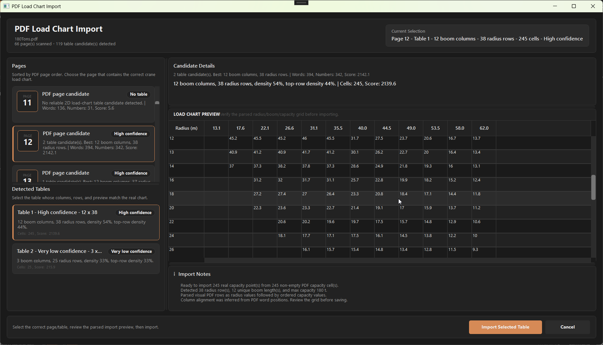

# PDF Load Chart Import Preview

This screenshot documents the reviewed PDF load chart import workflow added under the F4_LoadChart feature.

The preview shows the dedicated PDF Load Chart Import window after scanning 180Tons.pdf. The selected candidate is Page 12 / Table 1, with 12 boom columns, 38 radius rows, and 245 imported capacity cells.

The dialog keeps the PDF review step separate from the final crane load chart save step. The user can review the detected page, selected table, candidate details, parsed radius/boom/capacity grid, and import notes before handing the data into the existing Import Crane Load Chart dialog.
