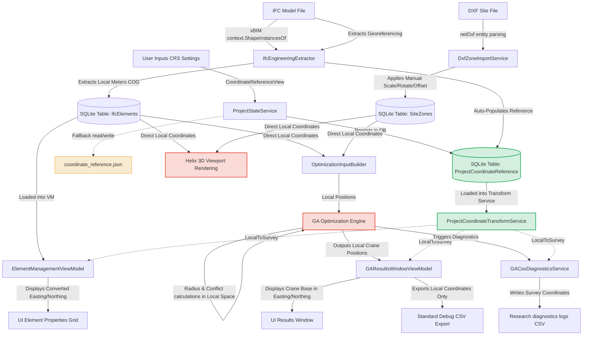

# GIS / Survey Coordinate Integration (Phases 1 & 2)

This document details the architecture, design boundaries, and implementation details for the GIS / Survey Coordinate Integration within the **Mobile Crane Path Optimizer** application.

---

## A. Coordinate Space Architecture

The application operates with two strictly separated, independent coordinate spaces: **Local Model Space** and **Survey / GIS Space**. 

```
                                  +---------------------------------------+
                                  |           LOCAL MODEL SPACE           |
                                  | - Units: Meters                       |
                                  | - Origin: IFC / DXF Local Origin      |
                                  | - Used by: SQLite DB, GA Optimizer,   |
                                  |   Helix Viewport, Constraints, Radius |
                                  +---------------------------------------+
                                                      |
                                                      |  LocalToSurvey(x, y, z)
                                                      v
                                  +---------------------------------------+
                                  |          SURVEY / GIS SPACE           |
                                  | - Units: Meters (Easting/Northing)    |
                                  | - Origin: Survey base point / grid    |
                                  | - Used by: UI Coordinate Readouts,    |
                                  |   Element Properties, Reports/Logs    |
                                  +---------------------------------------+
```

### 1. Local Model Space
* **Units**: Meters (automatically scaled and normalized from the source file's units).
* **Origin**: Defined by the $(0,0,0)$ position in the imported IFC or DXF file.
* **Engine/Functional Use**:
  * **Database Persistence**: Centroids (COGs), bounding boxes, obstacle zones, and crane setup coordinates are stored raw in local meters in the SQLite database.
  * **Genetic Algorithm (GA)**: The optimization engine runs exclusively in local coordinates.
  * **Lifting & Physics calculations**: Crane radius checks, load chart interpolations, boom lengths, and clearance checks are calculated using local coordinate values.
  * **Helix 3D Rendering**: Viewport meshes are loaded, transformed, and displayed using their raw local coordinate locations.
  * **Constraint Engine**: Allowed/forbidden zone containment checks (e.g., ray-casting polygon checks) operate in local space.

### 2. Survey / GIS Space
* **Units**: Easting (E), Northing (N), and Orthogonal Elevation (H) in meters (or informational latitude/longitude decimal degrees).
* **Origin**: Defined by `ProjectCoordinateReference` transformation parameters.
* **Functional Use**:
  * **UI Metadata Readout**: Status bar coordinates under the cursor, property grid values for precast elements, and the GA optimal base setup coordinates display converted survey coordinates.
  * **CSV Diagnostics**: Per-element diagnostics logs write survey-translated coordinates alongside local ones for integration with external GIS software.
  * **Future Reports/Exports**: Output documentation displaying crane setup parameters will use these real-world coordinates.

> [!IMPORTANT]
> **The Core Architectural Safety Rule**
> Survey and GIS coordinate coordinates are treated strictly as **presentation metadata and output readouts**. 
> They **do not** transform, shift, rotate, or scale stored IFC element coordinates or DXF zone geometries. They **do not** affect GA candidate placement generation, constraint checking, radius calculations, or viewport rendering. Keeping the GA and spatial engines in local coordinates ensures high floating-point precision, performance, and mathematical stability.

### 3. Coordinate Flow Diagram

The diagram below illustrates how coordinates flow through the import, database, optimization, visualization, and logging stages. It highlights where Survey Point coordinates are integrated versus where they are bypassed.



### 4. Integration Matrix

The matrix below shows the status of GIS/Survey Point coordinate integration across all application layers.

| Component | Coordinate Space Used | Is Survey Point Integrated? | Impact of Changing Survey Point Settings |
| :--- | :--- | :--- | :--- |
| **IFC Import** | Local Model Origin | **Yes (implemented in Phase 2)** (Extracts `IfcMapConversion`/`IfcProjectedCRS` if present) | Auto-populates `ProjectCoordinateReference` if current reference is disabled or empty |
| **DXF Import** | DXF local aligned to IFC | **No** (Uses manual alignment matrix) | None |
| **Database (SQLite)** | Local meters $(x,y,z)$ | **Yes (implemented in Phase 1)** (Mapped in `CreatedProjectDbContext`) | Stores the single-record `ProjectCoordinateReferenceEntity` parameters |
| **Visualizer (Helix 3D)** | Local meters $(x,y,z)$ | **No** (Renders local meshes directly) | None |
| **GA Optimizer (F8)** | Local meters $(x,y,z)$ | **No** (Calculates constraints in local space) | None |
| **UI Status Bar** | Converted survey $(E,N,H)$ | **Yes** (Updates coordinates on cursor move) | Readout coordinates change |
| **UI Property Grid** | Converted survey $(E,N,H)$ | **Yes** (Shows element COG in survey space) | Readout coordinates change |
| **UI Results Window** | Converted survey $(E,N,H)$ | **Yes** (Shows crane coordinates in survey space) | Readout coordinates change |
| **CSV Exporter (Debug)** | Local meters $(x,y,z)$ | **No** (Standard debugger outputs local space) | None |
| **CSV Exporter (Diag)** | Converted survey $(E,N,H)$ | **Yes** (Only in `Research` diagnostics mode) | Logged coordinates change |
| **PDF/UI Reports** | Placeholders Only | **No** (Not implemented) | None |

---

## B. Phase 1: SQLite Database Persistence

Prior to Phase 1, project coordinate reference parameters were stored in a standalone file `coordinate_reference.json` in the active project directory, completely bypassing the SQLite database, with VM coordinates defaulting to zero. In Phase 1, coordinate reference persistence was fully integrated into the database.

### Implementation Details
1. **SQLite Integration**: `ProjectCoordinateReferenceEntity` is mapped in EF Core via [CreatedProjectDbContext.cs](file:///f:/06-ITI/00-Project/Main%20Project/CraneOptimizer/CraneOptimizer.Infrastructure/Contexts/CreatedProject/CreatedProjectDbContext.cs) and configured via [ProjectCoordinateReferenceConfiguration.cs](file:///f:/06-ITI/00-Project/Main%20Project/CraneOptimizer/CraneOptimizer.Infrastructure/Contexts/CreatedProject/CreatedProjectConfigurations/ProjectCoordinateReferenceConfiguration.cs).
2. **Primary Persistence**: The per-project `.craneopt` SQLite database is the primary source of truth. The standalone `coordinate_reference.json` file is maintained only as a backward-compatible fallback for older projects.
3. **Safe Fallback & Migration**: When opening old projects lacking the database table or record, the system gracefully fallbacks to reading `coordinate_reference.json` or instantiates a default disabled reference.
4. **Single-Record Pattern**: Saving or updating uses a secure single-record pattern (Insert-or-Update) in the `ProjectCoordinateReference` table, preventing row duplication.
5. **UI Bindings**: [CoordinateReferenceViewModel.cs](file:///f:/06-ITI/00-Project/Main%20Project/CraneOptimizer/CraneOptimizer.UI/Features/F18_CoordinateReference/ViewModels/CoordinateReferenceViewModel.cs) is fully bound to the database entity. Local Reference X/Y/Z coordinates are persisted and no longer hardcoded to zero.

### Related Codebase Files
* **Entity**: [ProjectCoordinateReferenceEntity.cs](file:///f:/06-ITI/00-Project/Main%20Project/CraneOptimizer/CraneOptimizer.Domain/CreatedProject/ProjectCoordinateReferenceEntity.cs)
* **Configuration**: [ProjectCoordinateReferenceConfiguration.cs](file:///f:/06-ITI/00-Project/Main%20Project/CraneOptimizer/CraneOptimizer.Infrastructure/Contexts/CreatedProject/CreatedProjectConfigurations/ProjectCoordinateReferenceConfiguration.cs)
* **Context**: [CreatedProjectDbContext.cs](file:///f:/06-ITI/00-Project/Main%20Project/CraneOptimizer/CraneOptimizer.Infrastructure/Contexts/CreatedProject/CreatedProjectDbContext.cs)
* **Migration**: [20260612183958_AddProjectCoordinateReferenceTable.cs](file:///f:/06-ITI/00-Project/Main%20Project/CraneOptimizer/CraneOptimizer.Infrastructure/Migrations/CreatedProjectDb/20260612183958_AddProjectCoordinateReferenceTable.cs)
* **Service**: [ProjectStateService.cs](file:///f:/06-ITI/00-Project/Main%20Project/CraneOptimizer/CraneOptimizer.UI/Features/F10_ProjectManagement/Services/ProjectStateService.cs)
* **ViewModel**: [CoordinateReferenceViewModel.cs](file:///f:/06-ITI/00-Project/Main%20Project/CraneOptimizer/CraneOptimizer.UI/Features/F18_CoordinateReference/ViewModels/CoordinateReferenceViewModel.cs)

---

## C. Phase 2: IFC Georeferencing Extraction

Phase 2 automates the extraction of GIS and survey metadata from imported IFC files using the xBIM parsing engine.

### Implementation Details
1. **Extraction Flow**: During IFC model loading, the import pipeline invokes [IfcGeoreferencingExtractor.cs](file:///f:/06-ITI/00-Project/Main%20Project/CraneOptimizer/CraneOptimizer.Infrastructure/Ifc/IfcGeoreferencingExtractor.cs) to parse georeferencing coordinates.
2. **IFC4 Preferred Georeferencing**:
   * **`IfcMapConversion`** mapping:
     * `Eastings` $\rightarrow$ `SurveyEasting`
     * `Northings` $\rightarrow$ `SurveyNorthing`
     * `OrthogonalHeight` $\rightarrow$ `SurveyElevation`
     * `Scale` $\rightarrow$ `Scale`
     * `XAxisAbscissa` & `XAxisOrdinate` $\rightarrow$ Calculated `RotationToNorthDegrees` (derived via arctangent rotation of the X-axis vector).
   * **`IfcProjectedCRS`** metadata:
     * CRS Name $\rightarrow$ `CoordinateSystemName`
     * Description $\rightarrow$ `CoordinateSystemDescription`
     * EPSG code (where available) $\rightarrow$ `EpsgCode`
3. **IFC2x3Fallback**:
   * IFC2x3 files lack projected coordinate structures. The extractor fallbacks to reading **`IfcSite.RefLatitude`**, **`IfcSite.RefLongitude`**, and **`IfcSite.RefElevation`**.
   * Latitude and longitude values are parsed from DMS (Degrees, Minutes, Seconds, Microseconds) arrays into decimal degrees.
   * `CoordinateSystemName` is populated as `"WGS84"`.
   * **Warning**: DMS values represent geographic curves and are stored strictly as informational metadata. They **must not** be treated as Easting/Northing coordinate values.
4. **Manual Reference Protection**:
   * If a user has already defined or enabled a manual coordinate reference in the project (i.e., `Source` is `Manual` or `ManualSinglePoint`, or the reference is `IsEnabled`), the IFC import **will not** silently overwrite it. The georeferencing extraction will only auto-populate the reference if it is disabled/empty.
5. **Revit & Tekla Exporters**:
   * IFC4 files exported from Autodesk Revit or Tekla Structures include `IfcMapConversion` structures if "Project Base Point" or "Survey Point" shared coordinate options are set.
   * IFC2x3 exports from these systems typically only expose `IfcSite` latitude/longitude or no coordinates at all. Exporter settings validation is required for specific modeling platforms.

### Related Codebase Files
* **DTO**: [IfcGeoreferencingResult.cs](file:///f:/06-ITI/00-Project/Main%20Project/CraneOptimizer/CraneOptimizer.Domain/CreatedProject/IfcGeoreferencingResult.cs)
* **Extractor Interface**: [IIfcGeoreferencingExtractor.cs](file:///f:/06-ITI/00-Project/Main%20Project/CraneOptimizer/CraneOptimizer.Domain/Interfaces/IIfcGeoreferencingExtractor.cs)
* **Extractor Implementation**: [IfcGeoreferencingExtractor.cs](file:///f:/06-ITI/00-Project/Main%20Project/CraneOptimizer/CraneOptimizer.Infrastructure/Ifc/IfcGeoreferencingExtractor.cs)
* **Reader Repository**: [IIfcReaderRepository.cs](file:///f:/06-ITI/00-Project/Main%20Project/CraneOptimizer/CraneOptimizer.Domain/Interfaces/IIfcReaderRepository.cs) & [IfcReaderRepository.cs](file:///f:/06-ITI/00-Project/Main%20Project/CraneOptimizer/CraneOptimizer.Infrastructure/Repositories/IfcReaderRepository.cs)
* **UI ViewModel**: [IfcViewerViewModel.cs](file:///f:/06-ITI/00-Project/Main%20Project/CraneOptimizer/CraneOptimizer.UI/Features/F2_IfcViewer/ViewModels/IfcViewerViewModel.cs)
* **App Entrypoint**: [App.xaml.cs](file:///f:/06-ITI/00-Project/Main%20Project/CraneOptimizer/CraneOptimizer.UI/App.xaml.cs)
* **Migration**: [20260612192855_AddCoordinateReferenceMetadataFields.cs](file:///f:/06-ITI/00-Project/Main%20Project/CraneOptimizer/CraneOptimizer.Infrastructure/Migrations/CreatedProjectDb/20260612192855_AddCoordinateReferenceMetadataFields.cs)
* **Unit Tests**: [IfcGeoreferencingExtractorTests.cs](file:///f:/06-ITI/00-Project/Main%20Project/CraneOptimizer/CraneOptimizer.Application.Tests/IFC/Georeferencing/IfcGeoreferencingExtractorTests.cs)

---

## D. Explicit Non-Goals & Safety Boundaries

The following operations are **not** implemented in Phase 1 or Phase 2 and are intentionally out of scope to preserve engine integrity:

1. **Pick-Point Reference Mapping**: Users cannot select a 3D vertex in the viewport to define origin offsets.
2. **DXF Georeferencing Extraction**: The DXF import service does not extract coordinates from CAD projection headers; alignment remains a manual transformation matrix process.
3. **DXF/IFC Co-Registration**: There is no automated alignment or validation comparing DXF zones against IFC coordinate references.
4. **Report / Export Formatting**: Final PDF or Excel optimization reports have not been updated to output survey coordinates.
5. **GA transformations**: The Genetic Algorithm is completely insulated from georeferencing translations and operates strictly on local geometries.
6. **Mesh Transformation**: Viewport meshes are never shifted, rotated, or scaled based on survey coordinate transformations.
7. **Reprojection Engine**: The application does not perform mathematical transformations from Latitude/Longitude (geographic coordinates) to Easting/Northing (projected grid coordinates).

---

## E. Testing & Validation

### 1. Test Suite Coverage
A total of **49 coordinate-related unit tests** have been successfully executed and passed:
* **`CoordinateReferenceTests`** (30 passed): Validate the mathematical transformation service (`ProjectCoordinateTransformService`), testing translation offsets, scale, rotation angles, X-axis vector alignments (such as $(1,0)$ and $(0,1)$), and VM state properties.
* **`IfcSessionPersistenceTests`** (10 passed): Validate database CRUD operations, single-record persistence patterns, and JSON fallback compatibility.
* **`IfcGeoreferencingExtractorTests`** (9 passed): Validate the xBIM parsing logic, DMS to decimal degree conversions, extraction of IFC4 map conversion variables, and metadata properties.

### 2. Fixture Limitations
> [!WARNING]
> While the test suite uses mock models to validate extractor calculations, **real exporter validation with Revit and Tekla fixture files remains pending**. Users must verify exported settings on native BIM platforms.

---

## F. Phase 3: Coordinate Reference Modes UI

Phase 3 implements user-controlled coordinate reference modes in the user interface. The UI exposes only two selectable modes:
1. **Local Only** (`IsEnabled = false`): The application uses raw local coordinates only. Local coordinates default to local values and are isolated.
2. **IFC Origin Mapping** (`IsEnabled = true`, `Source = "IfcMapConversion"`):
   * **Behavior**: Uses the IFC local origin directly. It does **NOT** require the user to pick a point in the viewport or perform manual calibration.
   * **Mesh Isolation**: The model stays exactly in local coordinates. It is loaded where it is drawn relative to its own local origin (e.g. if drawn 10m from local X and 15m from local Y in Revit/Tekla, it appears at (10, 15, 0) locally). The model meshes are not moved, rotated, scaled, or transformed.
   * **Origin Mapping**: Local (0,0,0) maps directly to the `IfcMapConversion`-extracted survey Easting, Northing, and Elevation. `LocalReferenceX/Y/Z` are fixed at `0.0`.
   * **Readout translation**: Only the coordinate readouts in the UI are converted from local coordinates to survey coordinates (Easting, Northing, Elevation) dynamically using rotation and scale parameters.

### Mode Availability and Rules
* **IFC Origin Mapping Availability**: This mode is selectable if active IFC georeferencing is loaded in the current import session, or if a saved project already contains an IFC-derived `ProjectCoordinateReference` in the SQLite database. If neither is available, "IFC Origin Mapping" is disabled, and an informational warning message is shown.
* **IFC2x3 Restriction**: IFC Origin Mapping only activates from valid, projected `IfcMapConversion` data (Easting/Northing/Elevation). IFC2x3 `IfcSite` latitude/longitude coordinates are strictly informational and do not enable active E/N mapping.
* **Manual Mode Protection**: A third mode, **Manual Mapping (Preserved)**, is not selectable in the mode ComboBox in Phase 3, but is recognized and preserved if loaded from legacy databases or future extensions. If the project contains a manual reference (`Source = "Manual"` or `"ManualSinglePoint"`), the UI displays it as active, protecting existing manual configurations from silent overwrite.

### Safety & Engine Insulation
* **Engine Isolation**: The Genetic Algorithm (GA) solver, viewport rendering, 3D mesh geometry, collision/constraint detection, crane radius checks, load chart checks, and precast element local coordinates remain strictly local and unchanged. All calculations, bounds, and radius checks remain local and unchanged.
* **No Database Migrations**: Active coordinate mode is inferred safely at run-time from `IsEnabled` and `Source` properties, avoiding database schema changes.

---

## G. Future / Pending Phases

### Picked Local Reference Point (Future Mode 3)
* **Description**: A manual alignment method where a user selects or inputs a local coordinate point $(x_p, y_p, z_p)$ to map to a specific survey reference point $(E_s, N_s, H_s)$, with optional rotation/scale.
* **Status**: **Pending/Future**. Viewport hit-testing, pick-point UI, two-point calibration, and manual local anchor selection are NOT implemented in Phase 3.

---

## H. Phase 3.1: Move Coordinate Reference Mode Choice into IFC Load Options

Phase 3.1 optimizes the user experience by moving the choice of coordinate reference mode directly into the **IFC Load Options** dialog before importing.

### 1. IFC Load Options Dialog Integration
* **Asynchronous Pre-scan**: When a user selects an IFC file for import, the application initiates a lightweight background pre-scan using `IIfcGeoreferencingExtractor.ExtractFromFile(filePath)`. This pre-scan opens the IFC model without building full 3D geometry contexts, taking a fraction of a second.
* **Non-Blocking UI**: The pre-scan task runs on a background thread. While scanning, the dialog displays a progress message `"Scanning georeferencing..."` and keeps the UI responsive. Once the task finishes, the UI dispatcher updates the dialog state:
  * If a valid `IfcMapConversion` is found, the `"IFC Origin Mapping"` option is enabled and a success status is shown.
  * If no georeference metadata is found, or if only informational IFC2x3 latitude/longitude is found, the `"IFC Origin Mapping"` option is disabled, defaulting the choice to `"Local Only"`, and an appropriate warning message is displayed.
* **Selection Result**: The selected `CoordinateReferenceMode` is stored in the `IfcLoadOptionsDto` and passed into the import pipeline.

### 2. Import Pipeline & Metadata Review Flow
* **Apply Selected Mode**: During model placement, `IfcViewerViewModel` applies the georeferencing metadata:
  * If the user selected `"IFC Origin Mapping"`, the reference is saved with `IsEnabled = true` and `Source = "IfcMapConversion"`.
  * If the user selected `"Local Only"`, but the IFC contained valid georeferencing, the metadata is still extracted and applied to `ProjectCoordinateReference` but with `IsEnabled = false`.
* **Inactive Review Status**: If `"Local Only"` was selected for a georeferenced file, the Coordinate Reference tab remains inactive (`IsEnabled = false`) and displays `"IFC Georeferencing exists but is inactive (Local Only)."`, allowing the user to review the survey metadata without activating it. The metadata source displays `"Local Only (IFC Georeferencing Inactive)"`.

### 3. Coordinate Reference Tab UI Adjustments
* **Primary Review/Status Focus**: The Coordinate Reference tab is now primarily for review and status display.
* **ComboBox Label Cleanup**: The ComboBox displays clean user-friendly labels:
  * `"Local Only"`
  * `"IFC Origin Mapping"`
  No raw enum, object, or type names appear in the UI.
* **Legacy Mode Preservation**: If a legacy manual coordinate mapping is active in the database, the dropdown ComboBox is hidden, and a read-only label `"Manual Mapping (Preserved)"` is shown to prevent accidental overwrite.

---

## I. Phase 3.2: Clean Dropdown Mode Labels
* **UI ComboBox Clean Labels**: Updated the Reference Mode ComboBox display style and converters to guarantee that only user-friendly labels appear in the dropdown (specifically `"Local Only"` and `"IFC Origin Mapping"`).
* **Prevention of Raw Type Names**: Removed any instances of raw class or enum names (`CraneOptimizer.UI.Feature...`) from appearing in the user interface.

---

## J. Phase 3.3: Automatic IFC Origin Placement and Manual Move Prevention
* **No Placement Pick-point Prompts**: Selecting `"IFC Origin Mapping"` during IFC import completely bypasses placement mode. It does not prompt the user to choose a model landing or insertion point in the viewport, nor does it register a click listener on the interaction service.
* **Identity Placement Offset**: Uses a zero-offset identity transformation $(0, 0, 0)$ for placement coordinates. The model is positioned exactly where it was drawn in its source BIM authoring tool (e.g. Autodesk Revit, Tekla Structures).
* **Disabled Move IFC command**: While an active IFC Origin Mapping reference is loaded in the project (`IsEnabled = true` and `Source = "IfcMapConversion"`), the manual "Move IFC" operation is disabled in the UI to prevent model drift and coordinate misalignment.

---

## K. Phase 4: UI Readouts Review, Quality Improvement, and Consistency Audit
* **Standardized Coordinate Terminology**: Applied standard, uniform terminology throughout the application interface to distinguish local coordinate spaces from real-world survey coordinates:
  * Local coordinate labels: `Local X`, `Local Y`, `Local Z` (meters, formatted as `{value:F3} m` or similar).
  * Survey coordinate labels: `Easting`, `Northing`, `Elevation` (meters, formatted as `{value:F3} m`).
* **Active/Inactive State Consistency**:
  * If coordinate mapping is active (`IsEnabled = true`), the readouts display the calculated `Easting`, `Northing`, and `Elevation`.
  * If mapping is inactive/Local Only (`IsEnabled = false`), local properties continue to display local point values normally, while the survey readout clearly shows: `"Survey: Not active / Local Only"`.
* **WPF Interface Updates**:
  * **Coordinate Reference Tab**: Replaced "REFERENCE CHECK" preview labels and tooltips with the standard terms. Added read-only fields for informational `Latitude` / `Longitude` metadata fields and increased the metadata layout widths to prevent clipping.
  * **Status Bar / Cursor Readouts**: Updated the live cursor coordinate readout to display `Local X`, `Local Y`, and `[Default Local Z: 0.00m]`. When active, it displays the mapped `Easting` and `Northing`. Z coordinate is explicitly labeled as default/approximate to avoid misrepresenting cursor 2D position as accurate 3D snapped elevation.
  * **Precast Element Property Grid**: Formatted both local coordinates and active survey coordinates. Displays `"Survey: Not active / Local Only"` when survey mapping is inactive.
  * **GA Optimizer Results Panel**: Standardized the coordinate details grid and optimal base position display cards to clearly show both local and converted survey coordinate readouts without altering the optimization solver logic.

---

## L. Source Code Evidence

### Part 1 – IFC Coordinate Analysis
IFC geometry extraction is handled in the infrastructure layer.
* **File:** [IfcReaderRepository.cs](file:///f:/06-ITI/00-Project/Main%20Project/CraneOptimizer/CraneOptimizer.Infrastructure/Repositories/IfcReaderRepository.cs)
* **Class:** `IfcEngineeringExtractor`
* **Method:** `GetGeometrySnapshot(IIfcProduct product)`
```csharp
private GeometrySnapshot? GetGeometrySnapshot(IIfcProduct product)
{
    var shapeInstances = _geometryContext.ShapeInstancesOf(product).ToList();
    if (shapeInstances.Count == 0)
        return null;
    // ...
    foreach (var shapeInstance in shapeInstances)
    {
        UpdateBounds(shapeInstance, ref minX, ref minY, ref minZ, ref maxX, ref maxY, ref maxZ);
        // ...
        var centroidResult = CalculateCentroidFromShapeGeometry(shapeGeometry, shapeInstance.Transformation);
        // ...
    }
}
```
xBIM’s `Xbim3DModelContext` geometry engine automatically resolves the local placement hierarchy (such as `IfcLocalPlacement` and `IfcAxis2Placement3D`) to return shape instances mapped to the model's coordinate system origin $(0,0,0)$. 

**Findings:**
1. **What coordinates are extracted?** Element bounding boxes and Center of Gravity (COG) centroids are extracted in meters relative to the IFC model's origin.
2. **Are Survey / Shared / Project Base Point Coordinates extracted?** **Yes**. The system queries georeferencing entities like `IfcMapConversion` and `IfcProjectedCRS` (in IFC4/IFC4x3) to extract Easting, Northing, Orthogonal Height, Scale, and Axis rotations, and queries `IfcSite` RefLatitude / RefLongitude / RefElevation (converted from DMS to decimal degrees) as informational metadata fallback in IFC2x3.
3. **Are coordinates transformed during import?** No. Elements are still read raw and normalized to local meters relative to the model origin (preserving local geometry representation). However, `ProjectCoordinateReference` is auto-populated from extracted georeferencing data (if empty or disabled) to establish the survey mapping.
4. **Are coordinates stored in the database?** Yes. Element local COGs and bounds are stored in the `IfcElements` table, while the survey reference parameters themselves are stored in the `ProjectCoordinateReference` table.
5. **Are coordinates exposed to ViewModels/Reports?** Yes. `ElementManagementViewModel` and `GAResultsWindowViewModel` use the `IProjectCoordinateTransformService` to format local coordinates into survey readouts for presentation and diagnostics.

### Part 2 – DXF Coordinate Analysis
DXF boundary coordinates are parsed using the `netDxf` library.
* **File:** [DxfZoneImportService.cs](file:///f:/06-ITI/00-Project/Main%20Project/CraneOptimizer/CraneOptimizer.UI/Features/F11_DXF/Services/DxfZoneImportService.cs)
* **Method:** `GetCandidates(DxfDocument document, string layerName, Matrix3D transform)`
```csharp
private static DomainPoint3D Transform(double x, double y, double z, Matrix3D transform)
{
    var point = transform.Transform(new Point3D(x, y, z));
    return new DomainPoint3D(point.X, point.Y, point.Z);
}
```

**Findings:**
1. **Coordinate System:** DXF entities use the coordinate system of the DXF file.
2. **Local vs Global:** Coordinates are assumed local to the DXF. They are transformed using a manual WPF `Matrix3D transform` configured in [DxfAlignmentViewModel.cs](file:///f:/06-ITI/00-Project/Main%20Project/CraneOptimizer/CraneOptimizer.UI/Features/F11_DXF/ViewModels/DxfAlignmentViewModel.cs).
3. **Survey Point Influence:** The Survey Point settings **do not affect DXF geometry**. The DXF coordinates are aligned entirely with the **IFC local coordinate system** using manual translation offsets, scaling, and rotation.
4. **Coordinate Mismatch Risk:** There is no automated alignment based on shared coordinates or GIS tags. Visual alignment is manual, posing a risk of mismatch if the user enters wrong point-matches.

### Part 3 – Element Coordinate Analysis
Element coordinates are tracked through the following pipeline:
1. **IFC File:** Extracted relative to the IFC local origin via `IfcReaderRepository.cs`.
2. **Database:** Persisted in SQLite `IfcElements` table columns `COG_X`, `COG_Y`, `COG_Z` (model local origin in meters).
3. **ViewModel:** Loaded as `PrecastElement` with `COG_M` in local coordinates.
4. **Visualization:** Meshes are rendered using local coordinates.
5. **Optimization:** GA calculates fitness using local coordinates.
6. **Survey Point Impact:** None of the data storage, optimization, or visualization stages are modified by the Survey Point. The Survey Point is only invoked dynamically via `_transformService.LocalToSurvey` when generating UI text values.

### Part 4 – F5 Visualization Analysis
The rendering engine resides in the UI layer.
* **File:** [SceneRenderingManager.cs](file:///f:/06-ITI/00-Project/Main%20Project/CraneOptimizer/CraneOptimizer.UI/Core/Services/SceneRenderingManager.cs)
* **F2 Viewer:** [IfcViewerViewModel.cs](file:///f:/06-ITI/00-Project/Main%20Project/CraneOptimizer/CraneOptimizer.UI/Features/F2_IfcViewer/ViewModels/IfcViewerViewModel.cs)

**Findings:**
* **Rendered Coordinates:** Geometry is rendered using the raw local coordinates in meters $(x,y,z)$.
* **Survey Point Impact:** The Survey Point does **not** shift or rotate the 3D meshes or viewport environment. 
* **Verification:** The `SceneRenderingManager.cs` does not inject or reference `IProjectCoordinateTransformService`. Changing the Survey Point or Rotation to North in settings has **zero effect** on rendering.

### Part 5 – F8 Optimization Analysis
The optimization pipeline runs in the Application layer.
* **Scope Filtering:** [OptimizationInputBuilder.cs](file:///f:/06-ITI/00-Project/Main%20Project/CraneOptimizer/CraneOptimizer.Application/Optimization/GeneticAlgorithms/Engines/OptimizationScope/OptimizationInputBuilder.cs) gathers elements and zone vertices directly in local coordinates.
* **Constraint Engine:** [ConstraintEngine.cs](file:///f:/06-ITI/00-Project/Main%20Project/CraneOptimizer/CraneOptimizer.Application/Optimization/GeneticAlgorithms/Engines/Constraints/ConstraintEngine.cs) performs 2D polygon overlaps (`IsCircleInsidePolygon`, `DoesCircleOverlapPolygon`) in local coordinate lists.
* **Lifting Calculation:** [LiftingCalculationEngine.cs](file:///f:/06-ITI/00-Project/Main%20Project/CraneOptimizer/CraneOptimizer.Application/Optimization/GeneticAlgorithms/Engines/LiftingCalculation/LiftingCalculationEngine.cs) calculates radius and lift heights using local coordinates:
```csharp
public double CalculateRadius(DomainPoint3D cranePosition, PrecastElement element, GASettings settings)
{
    double slewX = cranePosition.X + settings.SlewOffsetX;
    double slewY = cranePosition.Y + settings.SlewOffsetY;

    double dx = slewX - element.ElementCOG.X;
    double dy = slewY - element.ElementCOG.Y;

    return Math.Sqrt(dx * dx + dy * dy);
}
```

**Findings:**
1. **Coordinates Used:** The GA uses local coordinates.
2. **Survey Point Impact:** **None**. The calculations for crane placement constraints, distances, boom heights, hoist clearances, and fitness evaluations are completely decoupled from `IProjectCoordinateTransformService`.
3. **Verification:** Changing Survey Point parameters does not affect the optimization calculations or the final selected crane positions.

### Part 6 – Database Analysis
The database maps local coordinates.
* **File:** [CreatedProjectDbContext.cs](file:///f:/06-ITI/00-Project/Main%20Project/CraneOptimizer/CraneOptimizer.Infrastructure/Contexts/CreatedProject/CreatedProjectDbContext.cs)

**Findings:**
1. **Are Survey Coordinates stored?** **Yes**. `ProjectCoordinateReferenceEntity` is mapped in EF Core (`CreatedProjectDbContext`) and stored inside the per-project `.craneopt` database. `coordinate_reference.json` remains only as a backward-compatible fallback.
2. **Are CRS definitions stored?** Yes (as of Phase 2 metadata extraction). CRS Name, Description, and EPSG code are stored in the database entity when extracted from `IfcProjectedCRS`.
3. **Are coordinate transforms stored?** IFC and DXF local adjustment matrices are stored in `IfcFiles` and `ModelFiles` tables under `TransformJson`, and the active project coordinate reference is stored in the `ProjectCoordinateReference` table.
4. **Persisted GIS Columns:** None. 

**SQLite Table & Columns containing Coordinates:**
* **`IfcElements`**: `COG_X`, `COG_Y`, `COG_Z` (Double), `BBoxMinX`, `BBoxMinY`, `BBoxMinZ`, `BBoxMaxX`, `BBoxMaxY`, `BBoxMaxZ` (Double).
* **`SiteZones`**: `VerticesJson` (String - JSON array of local 3D points).
* **`CraneSetups`**: `PositionX`, `PositionY`, `PositionZ` (Double), `PivotOffsetX`, `PivotOffsetY`, `PivotOffsetZ` (Double).

### Part 7 – Report Generation Analysis
1. **Final Optimization Reports (UI Tab F12)**: **Missing**. The `ReportsTabView.xaml.cs` contains only `// TODO` placeholders.
2. **Standard CSV Exports (`ga-debug-report-*.csv`)**: **Missing**. `GADebugReportWriter.cs` exports raw local coordinate columns (`Point X`, `Point Y`, `COG X`, `COG Y`, `COG Z`) and does not format them into survey space.
3. **Diagnostic CSV Exports (`ga_diagnostics_*.csv`, `ga_run_history.csv`)**: **Present**. `GACsvDiagnosticsService.cs` checks if `_transformService.IsEnabled` is true. If yes, it calls `LocalToSurvey` to write columns like `Candidate_SiteE`, `COG_SiteE`, `CraneBase_SiteE`, `SlewCenter_SiteE`, `BoomHinge_SiteE`, and `LoadPoint_SiteE` (under `Research` level logging).
4. **Audit Reports**: **Missing**. No survey coordinate integrations are present in `IfcDiagnosticAuditService.cs`.

---

## M. Coordinate Impact Assessment Q&A

### Q1: If a user enters GIS / Survey Point coordinates today, where exactly will those coordinates appear in the system?
They will be persisted in the `ProjectCoordinateReference` table of the active `.craneopt` SQLite database. They will load into the active `ProjectCoordinateTransformService` memory. They will appear in the UI status bar (cursor hover readout), the element properties grid (as converted coordinates), the GA results window coordinates section, the Coordinate Reference tab, and the columns of the Research-level diagnostics CSV output. They will **not** affect the physical coordinates of stored 3D meshes in the viewport or spatial optimization coordinates in the database elements.

### Q2: Will those coordinates appear in element data?
**No**. The elements stored in the SQLite database retain their local IFC coordinates. However, in the element management view, the properties table displays a dynamic converted readout using `LocalToSurvey(COG)`.

### Q3: Will those coordinates appear in reports?
* **User Reports (PDFs/Tabs)**: **No**. These are completely unimplemented.
* **Standard Debug CSV Exporter**: **No**. It outputs local coordinates only.
* **Research Diagnostics Exporter**: **Yes**, if research logging is activated.

### Q4: Will those coordinates affect crane radius calculations?
**No**. The radius calculations are performed in `LiftingCalculationEngine.CalculateRadius` using the 2D Euclidean distance between the crane's local coordinate coordinates and the element's local coordinate COG.

### Q5: Will those coordinates affect lift feasibility?
**No**. Lift feasibility depends on the radius, boom height, and weight, which are computed purely using local coordinates.

### Q6: Will those coordinates affect GA optimization?
**No**. The GA engine is unaware of the coordinate transform service. It generates crane candidate coordinates and checks boundaries against zones using local coordinates.

### Q7: Will those coordinates affect final crane positions?
**No**. The coordinates output by the GA representing the optimal crane positions are in the local coordinate space.

### Q8: Will changing Survey Point coordinates change optimization results?
**No**. The optimization runs are identical because the GA solver does not reference or consume the coordinate transform service.

### Q9: If the answer is "No", explain exactly why.
The core solver, physics calculator, and databases are strictly decoupled from the survey coordinate system. The `IProjectCoordinateTransformService` is treated as a visual readout formatter in the presentation layer. It acts as a one-way bridge converting local model coordinates to survey coordinates for display labels and diagnostics, but it never converts data back or injects survey coordinates into the calculations.

---

## N. Layer Gap Analysis

| Area | Current Status | Evidence | Missing Pieces | Risk |
| :--- | :--- | :--- | :--- | :--- |
| **IFC Import** | Implemented (Phase 2) | Extracts `IfcMapConversion` and `IfcProjectedCRS` or fallback `IfcSite` DMS lat/lon during import. | Revit/Tekla exporter settings validation is required. | **Low.** Exporter settings validation is required. |
| **DXF Import** | Partially Integrated | `DxfZoneImportService.cs` applies manual transform matrix. | Automated DXF overlay onto the IFC using shared/survey coordinates. | **Medium.** Incorrect overlays and visual shifts due to manual point-matching mistakes. |
| **Database** | Implemented (Phase 1) | `CreatedProjectDbContext.cs` maps `ProjectCoordinateReferenceEntity` table. | None (stored directly in SQLite). | **None.** Secured persistence inside project file. |
| **F5 Visualization** | Not Implemented | `SceneRenderingManager.cs` renders meshes at local coordinates. | Option to render grid lines or coordinates in the survey space. | **Low.** Viewport coordinate visualization mismatch compared to the physical site grid. |
| **F8 Optimization** | Not Implemented | `ConstraintEngine.cs` and `LiftingCalculationEngine.cs` perform local space math. | Ability for the GA to process inputs directly in survey/GIS coordinates if desired (though local metric math is theoretically correct). | **Low.** GA outputs local coordinates which must be manually mapped or translated by users. |
| **Reports** | Not Implemented | `ReportsTabView.xaml.cs` contains only `// TODO` placeholders. | Complete implementation of report pages using survey coordinates. | **High.** Cannot export official site planning documents displaying actual survey coordinate details. |
| **Exports** | Partially Integrated | `GADebugReportWriter.cs` exports local coordinates only. `GACsvDiagnosticsService.cs` exports survey coordinates under `Research` mode. | Survey coordinate fields inside standard debug CSV exports. | **Medium.** Discrepancy between optimization logs and the coordinates expected by external GIS software. |
| **Coordinate Transforms** | Partially Integrated | `ProjectCoordinateTransformService.cs` maps 2D rotation and scale. | The UI ViewModel hardcodes `LocalReferenceX/Y/Z = 0` when saving settings. EPSG codes are ignored. | **Medium.** The math assumes local origin is always $(0,0,0)$, breaking models that have large internal offsets. |
