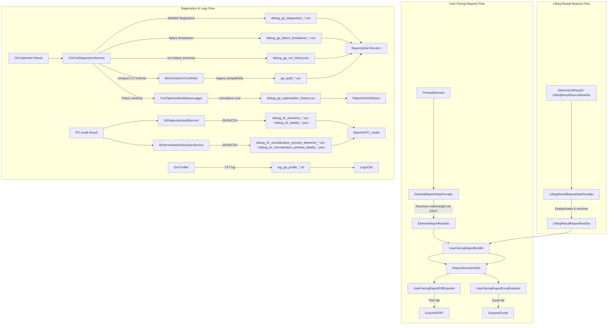

# Reporting & Diagnostics Architecture

This document describes the unified reporting and diagnostics architecture of the CraneOptimizer system.

---

## 1. Co-Existing Reporting Engines

The solution contains two co-existing reporting systems:

### A. Active User-Facing Reports Engine
* **Purpose:** Provides user-interactive reports, custom column selection, template management, and visual previews inside the WPF Reports tab.
* **Component Layering:**
  * **UI ViewModels:** [ReportBuilderViewModel.cs](file:///f:/06-ITI/00-Project/Main%20Project/CraneOptimizer/CraneOptimizer.UI/Features/F12_Reports/ViewModels/ReportBuilderViewModel.cs)
  * **Application Builder:** [UserFacingReportBuilder.cs](file:///f:/06-ITI/00-Project/Main%20Project/CraneOptimizer/CraneOptimizer.Application/Reports/Services/UserFacingReportBuilder.cs)
  * **Data Providers:** [ElementReportDataProvider.cs](file:///f:/06-ITI/00-Project/Main%20Project/CraneOptimizer/CraneOptimizer.Application/Reports/Services/ElementReportDataProvider.cs) and [LiftingResultReportDataProvider.cs](file:///f:/06-ITI/00-Project/Main%20Project/CraneOptimizer/CraneOptimizer.Application/Reports/Services/LiftingResultReportDataProvider.cs)
  * **Infrastructure Exporters:** [UserFacingReportPdfExporter.cs](file:///f:/06-ITI/00-Project/Main%20Project/CraneOptimizer/CraneOptimizer.Infrastructure/Reports/UserFacing/UserFacingReportPdfExporter.cs) (QuestPDF) and [UserFacingReportExcelExporter.cs](file:///f:/06-ITI/00-Project/Main%20Project/CraneOptimizer/CraneOptimizer.Infrastructure/Reports/UserFacing/UserFacingReportExcelExporter.cs) (OpenXML)
  * **Templates Store:** [JsonReportTemplateStore.cs](file:///f:/06-ITI/00-Project/Main%20Project/CraneOptimizer/CraneOptimizer.Infrastructure/Reports/UserFacing/JsonReportTemplateStore.cs) (saves custom template definitions in the user's roaming AppData directory)
* **Output Path:** Automatically routed to standard `Exports/` subdirectory inside the active project folder.

### B. Legacy Headless reporting foundation (Obsolete)
* **Purpose:** Generic headless reporting framework designed for batch processing, command line executors, or automated runners. It maps inputs to a generic `ReportDocument` layout.
* **Status:** Marked `[Obsolete]` to signal its deprecated status. Unused by the main UI but fully compiled and covered by unit tests (`PdfReportExporterTests.cs`, `CsvReportExporterTests.cs`, `OptimizationSummaryReportBuilderTests.cs`, `ReportExportServiceTests.cs`) to prevent compile-time breakage.
* **Classes:** `OptimizationSummaryReportBuilder`, `PdfReportExporter`, `CsvReportExporter`, `ReportExportService`, `IReportBuilder<TInput>`, `IReportExporter`, `IReportExportService`.

---

## 2. High-Level Data Flow Map

---

## 3. Output Storage & Filename Conventions

The workspace follows a strict project folder directory contract. All output directories are resolved dynamically by `IProjectOutputPathService` relative to the active project folder:

### A. Exports Folder (`Exports/`)
Contains end-user deliverables generated via the Reports UI. No `debug_` or `log_` prefix is allowed.
* **PDF Reports:** `<ProjectRoot>/Exports/PDF/`
  * Format: `{ProjectName}_{TemplateName}_{Timestamp}.pdf`
* **Excel Reports:** `<ProjectRoot>/Exports/Excel/`
  * Format: `{ProjectName}_{TemplateName}_{Timestamp}.xlsx`

### B. Reports Folder (`Reports/`)
Contains raw, structured diagnostic files generated automatically by background calculations and audits.
* **GA Runs:** `<ProjectRoot>/Reports/GA/<RunId>/`
  * Run History: `debug_ga_run_history.csv`
  * Detailed Diagnostics: `debug_ga_diagnostics_{runId}_{timestamp}.csv` or `debug_ga_diagnostics.csv`
  * Failure Breakdown: `debug_ga_failure_breakdown_{runId}_{timestamp}.csv` or `debug_ga_failure_breakdown.csv`
  * *Analytics Exporter Exception:* `BenchmarkV2CsvWriter` writes `ga_audit_run_summary.csv`, `ga_audit_settings_snapshot.csv`, `ga_audit_stage_summary.csv`, `ga_audit_positions.csv`, and `ga_audit_element_assignments.csv` to this folder. These files preserve their legacy prefix to prevent breaking external analytics dashboard integrations.
* **GA Run History:** `<ProjectRoot>/Reports/GA/History/`
  * Cumulative optimization runs tracker: `debug_ga_optimization_history.csv`
* **IFC Audits:** `<ProjectRoot>/Reports/IFC_Audit/`
  * Ingestion elements CSV: `debug_ifc_elements_{timestamp}.csv`
  * Ingestion details JSON: `debug_ifc_details_{timestamp}.json`
  * Normalization elements CSV: `debug_ifc_normalization_preview_elements_{timestamp}.csv`
  * Normalization details JSON: `debug_ifc_normalization_preview_details_{timestamp}.json`

### C. Logs Folder (`Logs/`)
Contains raw runtime/performance telemetry.
* **GA Profile Logs:** `<ProjectRoot>/Logs/GA/`
  * Profiler timer spans: `log_ga_profile_{timestamp}.txt`

---

## 4. Single Sources of Truth (SSOT)

To avoid presentation/logic discrepancies, the reporting engine enforces the following single sources of truth:
1. **Identity Display:** Resolves display label strings through [CanonicalMarkResolver.cs](file:///f:/06-ITI/00-Project/Main%20Project/CraneOptimizer/CraneOptimizer.Application/Services/Identity/CanonicalMarkResolver.cs). Priority order: Explicit `AssemblyMark` > Any `AssemblyMark` > `ResolvedDisplayMark` > `ElementMark` > `ElementName` > `ParentAssemblyName` > `ElementID`.
2. **Weight Display:** Formats weights and maps weight trust level warnings strictly through [ReportWeightMapper.cs](file:///f:/06-ITI/00-Project/Main%20Project/CraneOptimizer/CraneOptimizer.Application/Reports/Services/ReportWeightMapper.cs).
3. **Paths Resolution:** Resolves absolute files/folders strictly through [IProjectOutputPathService.cs](file:///f:/06-ITI/00-Project/Main%20Project/CraneOptimizer/CraneOptimizer.Application/Services/IProjectOutputPathService.cs), preventing path traversal and silent user directory fallbacks.
