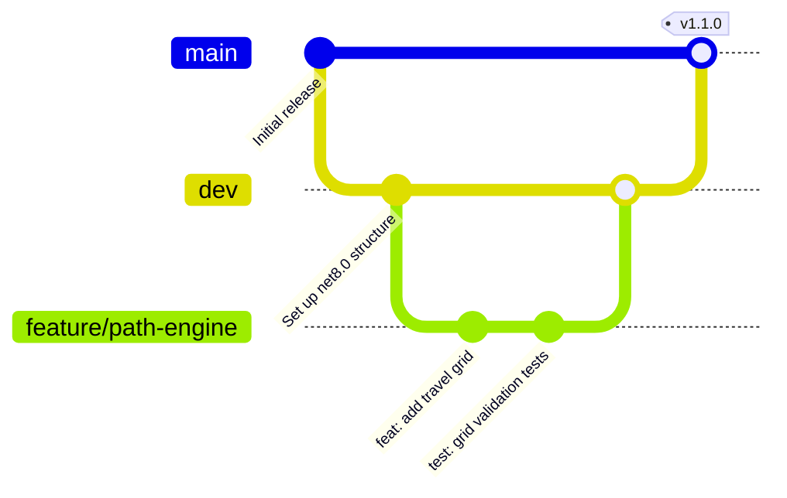

# Workflow: Feature Development

This document outlines the standard engineering workflow for introducing new features to the **Mobile Crane Path Optimizer** codebase.

---

## 1. Branching Strategy

The repository follows a Git Flow-inspired branching model:



* **`main` Branch:** Tracks production-ready, stable releases. Code is only merged here from `dev` when preparing a major version tag.
* **`dev` Branch:** Integration branch for active development. All new features and bug fixes target `dev`.
* **`feature/*` Branches:** Individual feature workspaces (e.g. `feature/lifting-sequencer`). Created off `dev` and merged back via Pull Requests.

---

## 2. Development Process Steps

1. **Synchronize Workspace:** Before starting, pull the latest changes on the integration branch:
   ```bash
   git checkout dev
   git pull origin dev
   ```
2. **Create Feature Branch:** Spin up a new branch with a descriptive name:
   ```bash
   git checkout -b feature/your-feature-name
   ```
3. **Write Code & Tests:** Implement modifications. If adding domain logic or application services, add corresponding unit tests in `CraneOptimizer.Application.Tests`.
4. **Local Verification:** Build and run tests locally to ensure there are no compilation errors or failures.
5. **Commit Changes:** Use semantic commit prefixes (see below).
6. **Push and Create PR:** Push the branch to the remote repository and open a Pull Request targeting `dev`.

---

## 3. Commit Message Standards

Commits must follow the Conventional Commits format:
* **`feat:`** Introducing a new feature (e.g. `feat: implement stepped load chart capacity resolver for tower cranes`).
* **`fix:`** Fixing a bug (e.g. `fix: correct ray-casting boundary edge checks`).
* **`refactor:`** Code modifications that do not add features or fix bugs (e.g. `refactor: decouple viewmodel instantiation`).
* **`docs:`** Documentation modifications (e.g. `docs: add database architecture schema`).
* **`test:`** Adding or updating unit tests (e.g. `test: add fitness function obstacle tests`).
* **`chore:`** Updating builds, package versions, or tooling configs.
